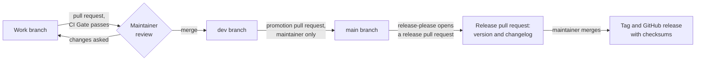
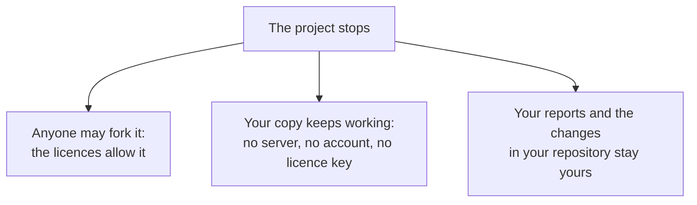

# Governance

This page says who runs this project, how it decides, and what you can rely on.
It is for a security reviewer, a lawyer or a technical lead who must judge support and continuity.

The short answers:

- One organisation, Nistapp, owns the project. One maintainer merges every change.
- Every change arrives as a reviewed pull request and passes the same automated checks.
- Support is best effort. There is no service-level agreement.
- If the project stops, you keep everything you have: the licences allow a fork, and your reports are yours.

## Who maintains it

Nistapp owns the GitHub repository, `Nistapp/codebase-agentic-readiness-framework`.

The maintainer is [`@kcramakrishna`](https://github.com/kcramakrishna).
The maintainer is the only person who merges a pull request and the only person who makes a release.
The [code owners file](.github/CODEOWNERS) sends every review request to the maintainer.

The project has one maintainer today. Read the [continuity](#continuity) section with that fact in mind.

## How the project decides

The project decides in the open, in pull requests.

- **Changes.** Anyone may open a pull request into the `dev` branch. Nobody commits to `dev` or `main` directly.
  The branch rules refuse it, and they have no bypass for any person.
- **Review.** The maintainer reviews each pull request and merges it. A required check, `CI Gate`, must pass first.
  The rules do not require a second approver, because the project has one maintainer.
- **Decisions of record.** A decision that lasts is written as an architecture decision record (ADR).
  Each ADR states the current decision, the alternatives and the consequences. Git keeps the history.
  The [ADR index](docs/architecture/adrs/README.md) lists every ADR, and the [ADR policy](docs/ADR_POLICY.md)
  holds the rules.
- **Releases.** Only the maintainer promotes `dev` to `main`. A bot, release-please, then opens a release pull request.
  It computes the version from the commit subjects and writes the [changelog](CHANGELOG.md).
  The maintainer merges that pull request, and the bot tags the release. Nobody edits a version by hand.

The diagram shows how one change becomes a release.

The full steps are in the [release process](RELEASE_PROCESS.md).
The exact branch rules are in [Branch protection](docs/reference/branch-protection.md).

## How the project changes with feedback

The checks are not fixed. The project improves them continuously from what users report.

- Post a question, a suggestion or an experience report in
  [GitHub Discussions](https://github.com/Nistapp/codebase-agentic-readiness-framework/discussions).
- Open an [issue](https://github.com/Nistapp/codebase-agentic-readiness-framework/issues) for a bug or a feature
  request. Each has a template.
- Read the [changelog](CHANGELOG.md) to see what each release changed.

Run the latest release about once a quarter. A newer release can add a check or change a verdict.
Then an older report no longer shows the current view of your repository.

## Support

Support is best effort. The project offers no service-level agreement, no paid support and no promised reply time
for an issue or a discussion.

The project states no list of supported versions. Fixes land in the next release, so use the latest release.
Versions follow [Semantic Versioning](https://semver.org/). Before version 1.0.0, a minor version may hold a
breaking change.

## Security

Report a security problem in private, never in a public issue or pull request.

1. Open the repository's **Security** tab on GitHub and choose **Report a vulnerability**.
2. If you cannot use GitHub, email <udan-security@nistapp.com>.

The project aims to acknowledge a report within 5 working days. It keeps you informed until the report is fixed
or closed. Give the project a reasonable time to fix a problem before you disclose it.

The [security policy](SECURITY.md) holds the scope. It states no deadline for a fix.

## Continuity

If the project stops, nothing you depend on stops with it.

- **The licences allow a fork.** Code is under AGPL-3.0-or-later. Documents, checks and schemas are under GFDL 1.3.
  Templates are under MIT-0. [Licensing](docs/reference/licensing.md) maps each path to its licence.
- **The tools are plain files.** The checks and the fix guides are Markdown. The tools are Python that uses only
  the standard library. A person can read, run and change them without the project.
- **Nothing runs on a project server.** The tools make no call to a service that the project hosts.
- **Your repository stays yours.** The audit never writes inside your repository. The fixes are commits on your
  own branches, and you review them. A fix adds a tool or a dependency only when you approve it.
- **Your outputs stay yours.** The tools place no licence on a report about your repository.
  Text and code that a fix generates or copies into your repository take your repository's own licence.

[Trust and safety](docs/explanation/user-overview/03-trust-and-safety.md) says what the tools may do on your machine.

## Contributing and conduct

[Contributing](CONTRIBUTING.md) takes a new contributor from a clone to a passing change.
The same rules bind people and AI agents.

Everyone who takes part follows the [code of conduct](CODE_OF_CONDUCT.md). It says how to report a
problem privately.
