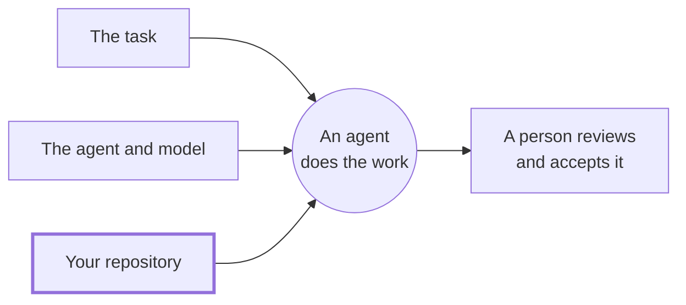
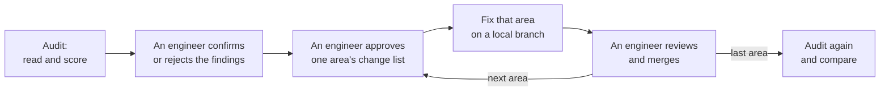

# Codebase Agentic Readiness Framework

[](https://scorecard.dev/viewer/?uri=github.com/Nistapp/codebase-agentic-readiness-framework)

Your AI coding agents work inside your repositories. This framework checks what a repository gives an agent:
commands it can find, tests it can trust, rules it can follow. Then it fixes the gaps, on branches you review.

- **Audit** (10 to 30 minutes): a scored report, with evidence for every finding. It never changes your repository.
- **Fix** (typically 3 to 6 hours elapsed, not yet measured): one area at a time, on local branches. An engineer
  approves each area's change list first.

Free and open source. You pay only for your agent's usage, which depends on the model.
[Cost and time](docs/start/cost-and-time.md)

**What to expect.** Published studies of single practices show the clearest gain in cost: fewer tokens per task.
Gains in task success are flat or small, and some practices raise cost when done badly. Nobody has yet measured a
whole prepared repository, this one included. [The evidence](docs/start/evidence.md)

**[Decide](docs/start/brief.md)** · **[Try it](#try-it)** · **[Contribute](CONTRIBUTING.md)**

## Is it safe?

- **Your code:** the audit only reads. The fix step commits on local branches, after an engineer approves each
  area's change list. It never merges, and pushes only if you opt in.
- **Your data:** your coding agent sends what it reads to its model provider, as it does today. The audit says so
  and records your yes before it reads anything. The tools open no connections of their own. The fix step reads
  your Git host to stay in sync, and pushes only if you opt in.
- **What enforces it:** the tools themselves open no network connection and never write into your repository; the
  agent makes the fix step's commits. Every other limit here is a rule the agent follows, so give it the access you
  would give any coding agent.
- **The licence:** the tools are AGPL-3.0, which covers the tools, not your repository. Reports on your
  repositories are yours. What the fix step generates or copies into your repository takes your repository's own
  licence, never the AGPL. If you install from the release zips, keep the skills out of the repositories you
  commit.

Details: [Security and data](docs/start/security-and-data.md) ·
[Licence in plain words](docs/start/licence-in-plain-words.md)

## Does it work with our agents?

A skill is a set of instructions that a coding agent follows. Running the audit and fix skills is tested on
Claude Code, with one run on opencode. Cursor, Codex, Gemini CLI and GitHub Copilot are not tested for running
them.

The changes they make to your repository help any agent and any engineer. They are ordinary engineering: one set
of commands, tests, automatic checks in CI and an `AGENTS.md` file of rules for agents.
[Questions and answers](docs/start/faq.md#does-it-help-teams-on-copilot-or-cursor)

## Results so far

One open-source repository that the project's maintainer owns went from a readiness score of 0.54 to 0.73 after
one fix run. The scale runs from 0 to 1. Read the details before you quote it: the engine changed between the two
audits, and unmet most-severe checks rose from 6 to 7. The run shows that the tools work on a real codebase. It
does not show that agents then did better, and no outside team has published a run yet.
[The evidence](docs/start/evidence.md#one-before-and-after)

## Why the repository matters

Three things decide the quality of an agent's work: the task, the agent and model, and the repository. You write
the task each time and buy the agent. You own the repository, and you prepare it once for every later task.



An agent that must guess how to build, test or run your code spends tokens guessing. An agent with no trustworthy
tests cannot tell when it broke something. This framework removes the guessing.

## How a run goes

The framework runs one loop on one repository, and an engineer decides at every step that changes something.



The second audit shows which findings closed and how the score moved. [How it works](docs/start/how-it-works.md)

## What the audit looks at

Nine ideas, each backed by published studies or by our own experience, and each checked by the audit:

| Good engineering anyway | Specific to agents |
| --- | --- |
| **Trustworthy feedback:** tests and checks the agent cannot weaken | **A map** of the code, so the agent finds the right place |
| **Guardrails:** what an agent may and may not touch | **Findable commands:** one way to build, test and run |
| **Readable code** | **Short instructions:** specific, and written by a person |
| **Written-down decisions,** where the next reader finds them | **Ready-made tools,** so an agent does not rewrite them |
| **Reviewable work:** changes a person can check fast | |

Five of the nine are good engineering anyway, so much of the work pays off for your engineers too.
[How it works](docs/start/how-it-works.md)

## Try it

One audit of a non-critical repository is a safe first step. You need
[Claude Code](https://claude.com/claude-code), `git` and Python 3.11 or newer.

1. Clone the latest release (the `main` branch) and start Claude Code in it:

   ```bash
   git clone --branch main https://github.com/Nistapp/codebase-agentic-readiness-framework.git
   cd codebase-agentic-readiness-framework
   claude
   ```

   To pin a version, clone a tag from the Releases page instead of `main`.

2. Say: **"Audit /path/to/your/repo and write the output to /path/to/output"**.
3. Read the report in `/path/to/output/`: a JSON file and a Markdown summary. Do not edit them.
4. When you are ready to fix, start a fresh Claude Code session in the same folder. Say: **"Start implementing the
   fixes on /path/to/your/repo based on /path/to/output/\<report\>.json"**. Keep the output folder until the run
   ends: your choices are saved there, not in your repository.

A pilot plan with success criteria: [Run a pilot](docs/start/run-a-pilot.md).

For security-minded teams: the release zips come with checksums and build provenance, which you can verify before
you install. [Install the skills](docs/how-to/install-the-skills.md)

## More

| You want to | Read |
| --- | --- |
| Install the skills from the release zips, with no clone | [Install the skills](docs/how-to/install-the-skills.md) |
| Audit and fix a repository that holds several services | [Audit and implement a monorepo](docs/how-to/audit-and-implement-a-monorepo.md) |
| Start a new repository that is agent-ready from the first commit | [Greenfield](greenfield/README.md) |
| See every check and every fix | [Audit master list](docs/reference/audit-master.md), [Implement master list](docs/reference/implement-master.md) |
| Read the method: four foundation phases, three later phases, and the requirements | [Phased approach](docs/framework/phased-approach.md), [`spec/`](spec/README.md) |
| Find any other page | [Documentation index](docs/README.md) |

## Platforms

Linux is tested. On macOS, the tools were tested in CI until November 2026, and the Claude Code path is not yet
checked by hand. Continuous macOS testing is planned
([issue #82](https://github.com/Nistapp/codebase-agentic-readiness-framework/issues/82)). Install Python 3.11 or
newer there, for example with Homebrew. Windows is not tested; WSL may work.

## Contributing

Start at [`CONTRIBUTING.md`](CONTRIBUTING.md). Agents read [`AGENTS.md`](AGENTS.md). Report a security problem
privately: [`SECURITY.md`](SECURITY.md). Changes: [`CHANGELOG.md`](CHANGELOG.md).

## Licence

Tools: AGPL-3.0-or-later ([`LICENSE-CODE`](LICENSE-CODE)). Text and code that the fix step generates or copies
into your repository take your repository's own licence. That holds even for text or code copied word for word
from this project. Documentation and the published examples: GFDL-1.3 ([`LICENSE`](LICENSE)). Reports you produce
on your own repositories are yours. This is a summary, not legal advice.
[Licence in plain words](docs/start/licence-in-plain-words.md)

---

> *"The more you sweat in peace, the less you bleed in war."* Preparing a codebase for AI coding agents is the
> sweat; agents changing it from user prompts is the war.
