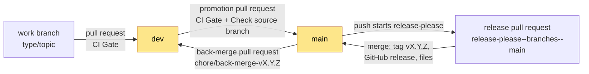
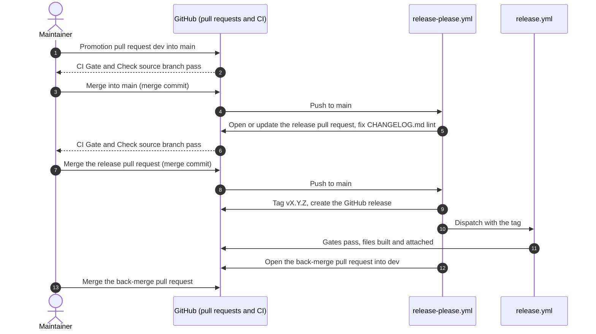

# Release process

This page tells the maintainer how to release this repository. It also tells every contributor how a change moves
from a work branch to a release.

Releases are automated with release-please. The maintainer promotes `dev` to `main` and merges two pull requests that
a bot opens. Nobody edits a version or the changelog by hand, and nobody pushes a tag. A session of an AI agent never
pushes, opens a pull request, merges or starts a workflow ([`AGENTS.md`](AGENTS.md)).

## The rules

1. Two branches live for ever: `dev` and `main`. Both are protected.
2. `dev` is the integration branch and the default branch. It accepts pull requests from any branch. It accepts no
   direct commits.
3. `main` is the release branch. It accepts two kinds of pull request only: a promotion from `dev`, and the release
   pull request that release-please opens. It accepts no direct commits.
4. Start every work branch from `dev`. Name it `<type>/<topic>`, where `<type>` is a Conventional Commits type, for
   example `fix/report-score` or `docs/release-process`.
5. Every pull request must pass the required check `CI Gate`. A pull request into `main` must also pass
   `Check source branch`.
6. Merge with a merge commit. Do not squash. Do not rebase.
7. Commit subjects follow Conventional Commits. They decide the next version, and they become the changelog.
8. A release is a tag `vX.Y.Z` that release-please makes on `main` when the release pull request is merged.

The exact ruleset settings are in [Branch protection](docs/reference/branch-protection.md). The reasons are in
[ADR 0002](docs/architecture/adrs/0002-dev-integrates-main-releases.md) and
[ADR 0005](docs/architecture/adrs/0005-release-please-cuts-releases.md).



## Who does what

| Person | Does | Does not |
| --- | --- | --- |
| Contributor (a person) | Starts a work branch from `dev`, commits with Conventional Commits subjects, pushes the work branch, opens a pull request into `dev` | Commit on `dev` or `main`; open a pull request into `main`; edit `CHANGELOG.md` or a version |
| AI agent session | Starts a work branch from `dev` and commits on it, when asked | Push, tag, open a pull request, merge, or change a ruleset unless the maintainer asks in that session |
| Maintainer | Merges pull requests into `dev`; promotes `dev` to `main`; merges the release pull request and the back-merge pull request | Push to `dev` or `main` directly (the rulesets refuse it); push a release tag |
| release-please (a bot) | Opens and updates the release pull request; tags; creates the GitHub release; opens the back-merge pull request | Merge anything |

To make one change, follow [Contribute a change](docs/how-to/contribute-a-change.md). The rest of this page is for the
maintainer.

## What a release is

A release is a tag `vX.Y.Z` on `main`, plus a GitHub release. The release holds the files that a one-off user
needs: `audit.pyz`, the two skill bundles as zips, and `SHA256SUMS`. That user does not clone or build anything.

The version follows [Semantic Versioning](https://semver.org/). release-please computes it from the commit subjects
since the last release:

| Commit subjects since the last release | Before 1.0.0 | From 1.0.0 |
| --- | --- | --- |
| A breaking change (`feat!:`, `fix!:` or a `BREAKING CHANGE:` footer) | MINOR | MAJOR |
| A `feat:` | PATCH | MINOR |
| Only `fix:`, `docs:`, `ci:` and other types | PATCH | PATCH |

The version is written in three places, and release-please changes all three in the release pull request:

- [`.release-please-manifest.json`](.release-please-manifest.json): the last released version.
- `__version__` in [`audit/engine/audit/__init__.py`](audit/engine/audit/__init__.py): what `audit --version` and
  each report's provenance print.
- The new entry in [`CHANGELOG.md`](CHANGELOG.md).

[`dev/tests/test_release_config.py`](dev/tests/test_release_config.py) fails when the manifest and `__version__`
disagree. The configuration is [`release-please-config.json`](release-please-config.json).

## One-time setup

Do this once. Without it the release workflow still works, but CI does not start on the bot's pull requests by itself.

A pull request or a push made with the default `GITHUB_TOKEN` starts no workflow. So `CI Gate` and
`Check source branch` never report on the release pull request, and the ruleset blocks its merge. Two ways out:

| Option | Pros | Cons |
| --- | --- | --- |
| A GitHub App token (recommended) | CI starts on the bot's pull requests by itself | One App, one variable and one secret to look after |
| `GITHUB_TOKEN` only (the default when no App is set) | Nothing to set up | You close and reopen each bot pull request to start CI |

To set up the App:

1. Create a GitHub App owned by the organisation. Turn off its webhook. Give it these repository permissions:
   Contents read and write, Pull requests read and write, Issues read and write.
2. Install the App on this repository only.
3. Store its client ID as the repository variable `RELEASE_APP_CLIENT_ID`.
4. Generate a private key. Store it as the repository secret `RELEASE_APP_PRIVATE_KEY`.

[`release-please.yml`](.github/workflows/release-please.yml) uses the App token when the variable is set. Each job
asks the token for the permissions it needs, no more.

Without the App, also allow the default token to open pull requests: Settings, Actions, General, "Allow GitHub
Actions to create and approve pull requests".

## Release steps



### Step 1: Make sure that `dev` is ready

1. Get the latest `dev`:

   ```bash
   git switch dev
   git pull --ff-only
   ```

2. Make sure that each pull request for this release is merged into `dev`.
3. Make sure that `CI Gate` passed on the last commit of `dev`:

   ```bash
   gh run list --branch dev --workflow CI --limit 1
   ```

4. Do the [dependency review](#review-before-each-release).
5. Check that the numbers that appear in more than one place are current. They are the self-audit score in
   [Self-Audit](docs/reference/self-audit.md) and the check count. Fix them on a work branch into `dev` if not.

There is no release preparation branch. Do not edit `CHANGELOG.md` or a version.

### Step 2: Promote `dev` to `main`

1. Open the promotion pull request. The head is `dev`. The base is `main`:

   ```bash
   gh pr create --base main --head dev --title "chore(release): promote dev to main" \
     --body "Promotes dev to main. release-please opens the release pull request after the merge."
   ```

2. Wait for the two required checks, `CI Gate` and `Check source branch`:

   ```bash
   gh pr checks --watch
   ```

3. Read the list of commits in the pull request. Make sure that it holds only the work for this release.
4. Merge with a merge commit:

   ```bash
   gh pr merge --merge
   ```

> [!CAUTION]
> Do not add `--delete-branch` to the merge of a promotion pull request. The head branch is `dev`. The `dev` ruleset
> blocks its deletion, but the command can still delete your local `dev`.

### Step 3: Read and merge the release pull request

The push to `main` starts `release-please.yml`. A minute later the release pull request is open, titled
`chore(release): vX.Y.Z`. If one was already open, release-please updates it instead.

1. Find it:

   ```bash
   gh pr list --base main --head release-please--branches--main
   ```

2. Read its diff. It changes `.release-please-manifest.json`, `__version__` in the engine and `CHANGELOG.md`. A second
   commit, `style(changelog): ...`, holds the markdownlint fixes.
3. Check the version. To force a different one, see [Choose the version](#choose-the-version).
4. Without the App token, close and reopen the pull request to start CI:

   ```bash
   gh pr close <n> && gh pr reopen <n>
   ```

5. Wait for `CI Gate` and `Check source branch`, then merge with a merge commit:

   ```bash
   gh pr checks <n> --watch
   gh pr merge <n> --merge --delete-branch
   ```

A release pull request may stay open while more promotions land. release-please updates it after each one. Merge it
when you want to release.

### Step 4: Watch the release

The merge pushes to `main` again. This time `release-please.yml` tags `vX.Y.Z`, creates the GitHub release with the
changelog entry as its notes, and starts `release.yml`:

```bash
gh run watch "$(gh run list --workflow Release --limit 1 --json databaseId --jq '.[0].databaseId')"
```

### Step 5: Merge the back-merge pull request

`release-please.yml` also opens a pull request into `dev` from `chore/back-merge-vX.Y.Z`. That branch starts at the
release commit on `main`. It brings the new version and the changelog entry into `dev`.

1. Find it:

   ```bash
   gh pr list --base dev --head chore/back-merge-vX.Y.Z
   ```

2. Without the App token, close and reopen it to start CI.
3. If `dev` moved since the release, click "Update branch" (the `dev` ruleset requires an up-to-date branch).
4. When `CI Gate` passes, merge it with a merge commit and delete the branch:

   ```bash
   gh pr merge <n> --merge --delete-branch
   ```

Merge it before the next promotion. If you forget, nothing breaks: the files do not conflict. But `dev` shows the old
version until you merge it.

### Choose the version

release-please picks the version from the commit subjects. You can force a version, for example `0.4.0` for a
release with no breaking change. Put a `Release-As:` footer in a commit on a work branch into `dev`:

```bash
git commit --allow-empty -m "chore: release 0.4.0" -m "Release-As: 0.4.0"
```

After the next promotion, the release pull request uses that version.

## What the workflows do

[`release-please.yml`](.github/workflows/release-please.yml) runs on each push to `main`. Its jobs:

| Job | When | What it does |
| --- | --- | --- |
| `release-please` | Every push to `main` | Opens or updates the release pull request; after its merge, tags `vX.Y.Z` and creates the GitHub release |
| `format-changelog` | The release pull request was opened or updated | Runs `make changelog-fix` (markdownlint `--fix`) on `CHANGELOG.md` and pushes the fix to the release pull request. release-please writes `*` bullets and double blank lines, which the `docs-lint` ratchet refuses |
| `publish` | A release was created | Starts `release.yml` with the tag (a dispatch is the one event that `GITHUB_TOKEN` may start a workflow with) |
| `back-merge` | A release was created | Creates `chore/back-merge-vX.Y.Z` at the release commit and opens its pull request into `dev` |

[`release.yml`](.github/workflows/release.yml) runs on a dispatch with a tag. It does these steps in sequence:

1. It makes sure that the tag has the form `vX.Y.Z` and that its commit is on `main`.
2. It makes sure that the engine's `__version__` equals the tag.
3. It runs `make check` and `make security`. A tag on a red commit publishes nothing.
4. It runs `python3 audit/engine/build.py`. This builds the reproducible single-file engine, `audit.pyz`.
5. It runs `make validate-skills`. This builds the `agentic-readiness-audit` and `agentic-readiness-implement` skill
   bundles and validates both against the Agent Skills specification.
6. It zips the two bundles from `dev/dist/skills/` and writes `SHA256SUMS` for `audit.pyz` and the two zips.
7. It attaches the four files to the GitHub release. If the tag has no release (a run started by hand), it creates
   one.

Every action in both workflows is pinned by commit SHA. To check a download, run `sha256sum -c SHA256SUMS` in the
folder that holds all four files.

## If the release fails

release-please creates the tag and the release before `release.yml` runs. So a failed `release.yml` leaves a release
with no files.

1. Read the log of the failed step in the Actions tab.
2. If the cause was outside the code (for example a network failure), run the workflow again for the same tag:

   ```bash
   gh workflow run release.yml --ref main -f tag=vX.Y.Z
   ```

3. If the code must change, fix it on a work branch from `dev` and merge it. Then promote `dev` again. release-please
   opens a new release pull request with the next PATCH version. Mark the broken release as a pre-release, or delete
   it and its tag, so users do not download it:

   ```bash
   gh release edit vX.Y.Z --prerelease
   ```

Do not change the files of a published release by hand.

## Hotfix

A hotfix follows the same path as every other change. `main` accepts nothing except a promotion from `dev` and the
release pull request.

1. Make a work branch from `dev`, for example `fix/<topic>`.
2. Merge the fix into `dev` through a pull request.
3. Do the [release steps](#release-steps). A `fix:` commit gives a PATCH version.

If `dev` holds work that is not ready for a release, you have two choices:

- Release that work too, if it passes the gates and you accept it.
- Revert it on `dev` first, through a pull request with `git revert -m 1 <merge commit>`. After the hotfix release,
  revert the revert on `dev` to get the work back.

## Dependency updates

Dependabot opens a pull request only for a security fix, and never for a major version
([ADR 0003](docs/architecture/adrs/0003-dependabot-security-pull-requests-only.md)). The configuration is
[`.github/dependabot.yml`](.github/dependabot.yml).

| What Dependabot watches | Where the versions are | Security fix, minor or patch | Security fix that needs a major version | New version, no security fix |
| --- | --- | --- | --- | --- |
| GitHub Actions | `.github/workflows/*.yml`, pinned by commit SHA | One grouped pull request into `dev` | Alert only | Nothing |
| Python dev tools | `dev/tools/pyproject.toml` and `dev/tools/uv.lock` | One grouped pull request into `dev` | Alert only | Nothing |
| Node dev tools | `dev/tools/package.json` and `dev/tools/package-lock.json` | One grouped pull request into `dev` | Alert only | Nothing |
| Greenfield template and test fixtures | `greenfield/templates/`, `audit/engine/tests/fixtures/` | Alert only | Alert only | Nothing |

### A Dependabot pull request

1. Make sure that its base is `dev`. Dependabot uses the default branch, which is `dev`.
2. Read the list of updates and the release notes that Dependabot links.
3. Wait for `CI Gate`. Then merge with a merge commit, like any other pull request.

Do not turn on auto-merge for Dependabot.

### An alert with no pull request

The fix needs a major version, or the alert is on the template or a fixture.

1. Open the alert in the Security tab. Read the advisory and the first patched version.
2. Is the alert on the greenfield template or a test fixture? Then dismiss it. These files are data. Give the
   reason "Vulnerable code is not actually used".
3. If the alert is on a real dependency, make a work branch from `dev`, for example `chore/update-ruff`.
4. Read the release notes of the major version. Make the upgrade (see
   [Change a tool version](#change-a-tool-version)).
5. Run `make check`, `make security` and `make docs-lint`. Open a pull request into `dev`.

### Change a tool version

Each dev tool version is written once, in `dev/tools/`. The `Makefile`, `lefthook.yml`, `dev/mermaid_check.py` and
the workflows read it from there. `dev/tests/test_tool_pins.py` fails when a version is written anywhere else.

1. Change the version in `dev/tools/pyproject.toml` (Python tools) or `dev/tools/package.json` (Node tools).
2. Make the lockfile again:

   ```bash
   uv lock --directory dev/tools
   (cd dev/tools && npm install --package-lock-only --ignore-scripts)
   ```

3. Run `make check`. If ruff or markdownlint changed a rule, fix the new findings in the same branch.
4. Commit the manifest and its lockfile together, for example `build(dev): update ruff to 0.17.0`.

The Node version for CI is in `.nvmrc`. The Python versions are in `.python-version` and the CI matrix. Dependabot
does not watch these. Change them by hand.

### Review before each release

Dependabot does not tell you about a new version that has no security fix. Thus do this review before each
promotion ([Step 1](#step-1-make-sure-that-dev-is-ready)):

1. Read the open Dependabot alerts in the Security tab. Close each one, or write down why it stays open.
2. Look for new versions of the GitHub Actions and the dev tools. Update those that you accept, on their own
   `chore/` branch.

## Release-day checklist

- [ ] Each pull request for the release is merged into `dev`, and `CI Gate` is green on `dev`.
- [ ] The [dependency review](#review-before-each-release) is done: no open Dependabot alert without a reason.
- [ ] The self-audit score and the check count are current on `dev`.
- [ ] Both rulesets are active, and [Branch protection](docs/reference/branch-protection.md) says so with the date.
- [ ] `SECURITY.md` is present. Private vulnerability reporting, secret scanning and push protection are on.
- [ ] The root `README.md` quick start works from a fresh clone in a clean directory (Linux checked; macOS by the
      maintainer, or stated as CI-only).
- [ ] The docs state platform support truthfully: no native Windows claim.
- [ ] The promotion pull request from `dev` into `main` passed `CI Gate` and `Check source branch`, and is merged with
      a merge commit.
- [ ] The release pull request shows the version you expect, its `CHANGELOG.md` entry reads well, and it is merged
      with a merge commit.
- [ ] `release.yml` passed; the release lists `audit.pyz`, both skill zips and `SHA256SUMS`; and
      `sha256sum -c SHA256SUMS` passes on the downloads.
- [ ] The back-merge pull request into `dev` is merged, and its branch is deleted.
