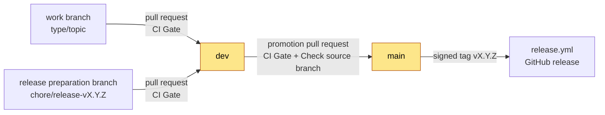
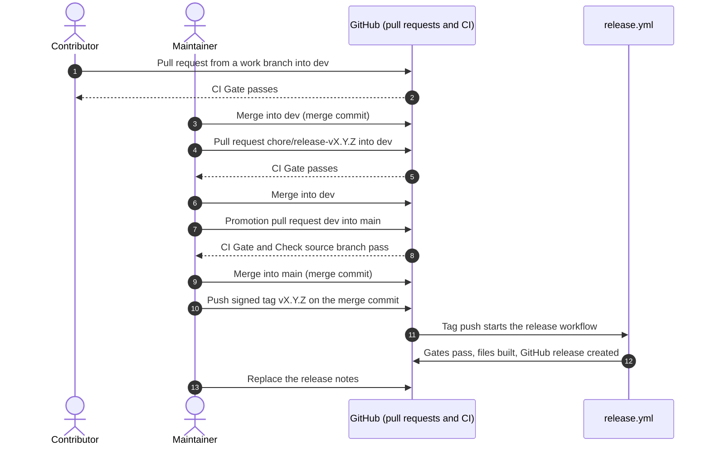

# Release process

This page tells the maintainer how to release this repository. It also tells every contributor how a change moves
from a work branch to a release.

Only the maintainer promotes `dev` to `main`, tags and releases. A session of an AI agent never pushes, tags, opens a
pull request or starts the release workflow ([`AGENTS.md`](AGENTS.md)).

## The rules

1. Two branches live for ever: `dev` and `main`. Both are protected.
2. `dev` is the integration branch and the default branch. It accepts pull requests from any branch, `main` included.
   It accepts no direct commits.
3. `main` is the release branch. It accepts pull requests from `dev` only. It accepts no direct commits.
4. Start every work branch from `dev`. Name it `<type>/<topic>`, where `<type>` is a Conventional Commits type, for
   example `fix/report-score` or `docs/release-process`.
5. Every pull request must pass the required check `CI Gate`. A pull request into `main` must also pass
   `Check source branch`.
6. Merge with a merge commit. Do not squash. Do not rebase.
7. A release is a signed tag `vX.Y.Z` on the merge commit of a promotion pull request. The release workflow refuses a
   tag that is not on `main`.

The exact ruleset settings are in [Branch protection](docs/reference/branch-protection.md). The reasons are in
[ADR 0002](docs/architecture/adrs/0002-dev-integrates-main-releases.md).



## Who does what

| Person | Does | Does not |
| --- | --- | --- |
| Contributor (a person) | Starts a work branch from `dev`, commits, pushes the work branch, opens a pull request into `dev` | Commit on `dev` or `main`; open a pull request into `main` |
| AI agent session | Starts a work branch from `dev` and commits on it, when asked | Push, tag, open a pull request, merge, or change a ruleset unless the maintainer asks in that session |
| Maintainer | Reviews and merges pull requests into `dev`; prepares the release; promotes `dev` to `main`; tags | Push to `dev` or `main` directly (the rulesets refuse it) |

To make one change, follow [Contribute a change](docs/how-to/contribute-a-change.md). The rest of this page is for the
maintainer.

## What a release is

A release is a tag `vX.Y.Z` on `main`. The tag starts
[`.github/workflows/release.yml`](.github/workflows/release.yml). The workflow publishes a GitHub release with the
files that a one-off user needs. That user does not clone or build anything.

The version follows [Semantic Versioning](https://semver.org/). Before 1.0.0, a change that breaks users increments
MINOR. Any other change increments PATCH.

## Release steps



### Step 1: Make sure that `dev` is ready

1. Get the latest `dev`:

   ```bash
   git switch dev
   git pull --ff-only
   ```

2. Make sure that each pull request for this release is merged into `dev`.
3. Make sure that `CI Gate` passed on the last commit of `dev`:

   ```bash
   gh run list --branch dev --workflow CI --limit 1
   ```

### Step 2: Prepare the release on a branch from `dev`

The changelogs and version strings change on `dev`, before the promotion. Do not change them on `main`.

1. Make the release preparation branch:

   ```bash
   git switch -c chore/release-vX.Y.Z
   ```

2. In [`CHANGELOG.md`](CHANGELOG.md), move the entries from `[Unreleased]` to a new heading
   `[X.Y.Z] - YYYY-MM-DD`. Keep an empty `[Unreleased]` heading above it.
3. Do the same in [`audit/CHANGELOG.md`](audit/CHANGELOG.md). Make sure that the engine's
   [changelog](audit/engine/docs/reference/changelog.md) agrees with it.
4. Change the version named in [`README.md`](README.md) and [`audit/README.md`](audit/README.md) to `vX.Y.Z`.
5. Do the [dependency review](#review-before-each-release).
6. Make sure that the numbers that appear in more than one place are current: the self-audit score in
   [Self-Audit](docs/reference/self-audit.md), and the check count.
7. Run the gates. All of them must pass:

   ```bash
   make check
   make security
   make docs-lint
   make validate-skills
   ```

8. Commit, push the branch and open a pull request into `dev`:

   ```bash
   git commit -am "chore(release): prepare vX.Y.Z"
   git push -u origin chore/release-vX.Y.Z
   gh pr create --base dev --title "chore(release): prepare vX.Y.Z" --body "Changelogs and versions for vX.Y.Z."
   ```

9. When `CI Gate` passes, merge the pull request with a merge commit:

   ```bash
   gh pr merge --merge --delete-branch
   ```

### Step 3: Promote `dev` to `main`

1. Open the promotion pull request. The head is `dev`. The base is `main`:

   ```bash
   gh pr create --base main --head dev --title "chore(release): vX.Y.Z" \
     --body "Promotes dev to main for vX.Y.Z. See CHANGELOG.md."
   ```

2. Wait for the two required checks, `CI Gate` and `Check source branch`:

   ```bash
   gh pr checks --watch
   ```

3. Read the list of commits in the pull request. Make sure that it holds only the work for this release.
4. Merge with a merge commit:

   ```bash
   gh pr merge --merge
   ```

> [!CAUTION]
> Do not add `--delete-branch` to the merge of a promotion pull request. The head branch is `dev`. The `dev` ruleset
> blocks its deletion, but the command can still delete your local `dev`.

### Step 4: Tag the merge commit

1. Get the latest `main`:

   ```bash
   git switch main
   git pull --ff-only
   ```

2. Make sure that `HEAD` is the merge commit of the promotion pull request:

   ```bash
   git log --oneline -1
   ```

   The subject must be `Merge pull request #<n> from Nistapp/dev`.
3. Make a signed tag and push it:

   ```bash
   git tag -s vX.Y.Z -m "vX.Y.Z"
   git push origin vX.Y.Z
   ```

   Use `git tag -a` if you do not sign tags.
4. Go back to `dev` for the next work:

   ```bash
   git switch dev
   ```

### Step 5: Watch the release workflow

```bash
gh run watch "$(gh run list --workflow Release --limit 1 --json databaseId --jq '.[0].databaseId')"
```

## What the workflow does

On a pushed tag that matches `v*`, the workflow runs on Ubuntu. Its only permission is `contents: write`. It uses no
secret other than `GITHUB_TOKEN`. It does these steps in sequence:

1. It makes sure that the tagged commit is on `main`. A tag on any other commit stops the workflow.
2. It runs `make check` and `make security`. A tag on a red commit publishes nothing.
3. It runs `python3 audit/engine/build.py`. This builds the reproducible single-file engine, `audit.pyz`.
4. It runs `make validate-skills`. This builds the `agentic-readiness-audit` and `agentic-readiness-implement` skill
   bundles and validates both against the Agent Skills specification.
5. It zips the two bundles from `dev/dist/skills/`: `agentic-readiness-audit-<tag>.zip` and
   `agentic-readiness-implement-<tag>.zip`.
6. It writes `SHA256SUMS` for `audit.pyz` and the two zips.
7. It creates the GitHub release for the tag and attaches `audit.pyz`, the two zips and `SHA256SUMS`. The release body
   says "See CHANGELOG.md". Replace it after the release (see [After the release](#after-the-release)).

Every action in the workflow is pinned by commit SHA. To check a download, run `sha256sum -c SHA256SUMS` in the folder
that holds all four files.

## After the release

1. Replace the release body with short notes. Say what a user can do with this release, and link the changelog entry:

   ```bash
   gh release edit vX.Y.Z --notes-file <file>
   ```

2. Do not change `main`. The next change goes to `dev` through a pull request.

No back-merge from `main` into `dev` is necessary. The only commits on `main` that `dev` does not have are the merge
commits of promotion pull requests. They hold no file change. GitHub shows `main` as "ahead of `dev`" by those
commits. This is expected.

## If the release fails

The workflow creates the release in its last step. Thus a failure in an earlier step leaves no release.

1. Read the log of the failed step in the Actions tab.
2. Delete the tag on GitHub and on your machine:

   ```bash
   git push origin :refs/tags/vX.Y.Z
   git tag -d vX.Y.Z
   ```

3. Fix the cause on a work branch from `dev`. Merge it into `dev`.
4. Do [Step 3](#step-3-promote-dev-to-main) and [Step 4](#step-4-tag-the-merge-commit) again.

Do not change the files of a published release.

## Hotfix

A hotfix follows the same path as every other change. `main` accepts nothing except a promotion from `dev`.

1. Make a work branch from `dev`, for example `fix/<topic>`.
2. Merge the fix into `dev` through a pull request.
3. Do the [release steps](#release-steps) with a PATCH version.

If `dev` holds work that is not ready for a release, you have two choices:

- Release that work too, if it passes the gates and you accept it.
- Revert it on `dev` first, through a pull request with `git revert -m 1 <merge commit>`. After the hotfix release,
  revert the revert on `dev` to get the work back.

## Dependency updates

Dependabot opens a pull request only for a security fix, and never for a major version
([ADR 0003](docs/architecture/adrs/0003-dependabot-security-pull-requests-only.md)). The configuration is
[`.github/dependabot.yml`](.github/dependabot.yml).

| What Dependabot watches | Where the versions are | Security fix, minor or patch | Security fix that needs a major version | New version, no security fix |
| --- | --- | --- | --- | --- |
| GitHub Actions | `.github/workflows/*.yml`, pinned by commit SHA | One grouped pull request into `dev` | Alert only | Nothing |
| Python dev tools | `dev/tools/pyproject.toml` and `dev/tools/uv.lock` | One grouped pull request into `dev` | Alert only | Nothing |
| Node dev tools | `dev/tools/package.json` and `dev/tools/package-lock.json` | One grouped pull request into `dev` | Alert only | Nothing |
| Greenfield template and test fixtures | `greenfield/templates/`, `audit/engine/tests/fixtures/` | Alert only | Alert only | Nothing |

### A Dependabot pull request

1. Make sure that its base is `dev`. Dependabot uses the default branch, which is `dev`.
2. Read the list of updates and the release notes that Dependabot links.
3. Wait for `CI Gate`. Then merge with a merge commit, like any other pull request.

Do not turn on auto-merge for Dependabot.

### An alert with no pull request

The fix needs a major version, or the alert is on the template or a fixture.

1. Open the alert in the Security tab. Read the advisory and the first patched version.
2. If the alert is on the greenfield template or a test fixture, dismiss it with the reason "Vulnerable code is not
   actually used". These files are data.
3. If the alert is on a real dependency, make a work branch from `dev`, for example `chore/update-ruff`.
4. Read the release notes of the major version. Make the upgrade (see
   [Change a tool version](#change-a-tool-version)).
5. Run `make check`, `make security` and `make docs-lint`. Open a pull request into `dev`.

### Change a tool version

Each dev tool version is written once, in `dev/tools/`. The `Makefile`, `lefthook.yml`, `dev/mermaid_check.py` and
the workflows read it from there. `dev/tests/test_tool_pins.py` fails when a version is written anywhere else.

1. Change the version in `dev/tools/pyproject.toml` (Python tools) or `dev/tools/package.json` (Node tools).
2. Make the lockfile again:

   ```bash
   uv lock --directory dev/tools
   (cd dev/tools && npm install --package-lock-only --ignore-scripts)
   ```

3. Run `make check`. If ruff or markdownlint changed a rule, fix the new findings in the same branch.
4. Commit the manifest and its lockfile together, for example `build(dev): update ruff to 0.17.0`.

The Node version for CI is in `.nvmrc`. The Python versions are in `.python-version` and the CI matrix. Dependabot
does not watch these. Change them by hand.

### Review before each release

Dependabot does not tell you about a new version that has no security fix. Thus do this review in the release
preparation (Step 2):

1. Read the open Dependabot alerts in the Security tab. Close each one, or write down why it stays open.
2. Look for new versions of the GitHub Actions and the dev tools. Update those that you accept, on their own
   `chore/` branch.

## Release-day checklist

- [ ] Each pull request for the release is merged into `dev`, and `CI Gate` is green on `dev`.
- [ ] The [dependency review](#review-before-each-release) is done: no open Dependabot alert without a reason.
- [ ] The release preparation pull request is merged into `dev`: changelogs have `[X.Y.Z] - YYYY-MM-DD` under an
      empty `[Unreleased]`, and the versions in `README.md` and `audit/README.md` are `vX.Y.Z`.
- [ ] Locally, `make check`, `make security`, `make docs-lint` and `make validate-skills` pass.
- [ ] Both rulesets are active, and [Branch protection](docs/reference/branch-protection.md) says so with the date.
- [ ] `SECURITY.md` is present. Private vulnerability reporting, secret scanning and push protection are on.
- [ ] The root `README.md` quick start works from a fresh clone in a clean directory (Linux checked; macOS by the
      maintainer, or stated as CI-only).
- [ ] The docs state platform support truthfully: no native Windows claim.
- [ ] The promotion pull request from `dev` into `main` passed `CI Gate` and `Check source branch`, and is merged with
      a merge commit.
- [ ] The tag is on the merge commit of the promotion pull request.
- [ ] After the tag: `release.yml` passes; the release lists `audit.pyz`, both skill zips and `SHA256SUMS`; and
      `sha256sum -c SHA256SUMS` passes on the downloads.
- [ ] The release notes replace the default body.
