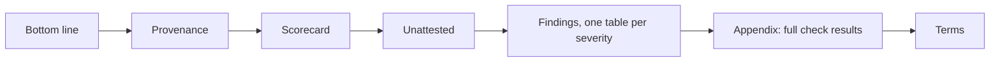

# How to Read the Report

> **Goal:** Turn an audit report into an ordered work queue, without reading too much into the score.
> **Audience:** CTOs, engineering leads, engineers
> **Status:** Live for all 13 implemented check packs (`python3 -m audit --list-checks`). The report shape below is
> what the engine writes today.

---

## Prerequisites

- [ ] A completed scan ([Run an audit](run-an-audit.md)).
- [ ] Both outputs: the Markdown page for reading, and the JSON for filtering.

---

## Step-by-Step Instructions

The Markdown report has these sections, in this order. Read them in the order of the steps below.



### Step 1: Read the bottom line, then the provenance block

The **Bottom line** section comes first. It gives the answer in three parts:

- the number of blocker findings;
- what the scan could not settle: the `UNKNOWN` checks, the `ATTEST` checks and the unattested properties;
- the first three actions: the findings in severity order, then by check ID, each with what it blocks and its fix.
  The engine records no effort and no dependency between findings, so it ranks by nothing finer.

The engine derives the section from the JSON report. It adds no fact, and no verdict depends on it. The **Terms**
section at the end says what each verdict and severity means.

The provenance block says what the report is *about*:

- the target path and its git SHA;
- whether the working tree was dirty;
- the tool version;
- the framework revision whose rules were applied.

A report against a dirty tree or the wrong revision describes a different repository.

### Step 2: Read the blockers, and stop there

Each finding row gives:

- the check ID and its title;
- the verdict;
- the specifics;
- the evidence (`path:line`);
- the fix.

Only the blockers need action before an agent works on the repository.

| Severity | What to do |
|---|---|
| **BLOCKER** | Fix before any agent work. These findings make agent output unverifiable, or the repository unsafe to touch. |
| **DEGRADER** | Schedule. Each one costs accuracy or tokens on every task. |
| **COSMETIC** | Note it and move on. |

The **Appendix — full check results** table lists every check that applies, with the `PASS` and `UNKNOWN` rows that
the findings tables leave out.

The engine renders the Markdown from the JSON report. So both always describe the same run. You can render the
Markdown again from a saved `audit-report.json` (ADR-0007).

### Step 3: Read the unattested list

Every report lists the same five properties as *unattested*. A scan cannot settle them:

1. whether the index is *used*;
2. whether the baselines are *adequate*;
3. whether the test suite is *trustworthy*;
4. whether the docs are *accurate*;
5. whether the gate will be *honoured*.

The report prints them so that nobody reads the score as a guarantee.

> [!IMPORTANT]
> No finding does not mean good quality. A check that could not gather evidence is `UNKNOWN`, and `UNKNOWN` never
> counts as a pass. Treat each `UNKNOWN` item as an open question about the *tool's* coverage, not about the
> repository.

### Step 4: Read `PARTIAL` findings as ratios

A per-component check reports `PARTIAL` with a ratio. Example: in a monorepo, 3 of 7 components have governance.
That is neither a pass nor a fail. It is 43% done, and the ratio is the useful number.

### Step 5: Filter the JSON for work assignment

This script prints each blocker and its first evidence path:

```bash
# Everything a specific team should look at
python3 -c "
import json
d = json.load(open('audit-report.json'))
for f in d['findings']:
    if f['severity'] == 'BLOCKER':
        print(f\"{f['check']:<8} {f['statement']}\")
        print(f\"         evidence: {f['evidence'][0]['path']}\")
"
```

---

## Verification

You have read the report correctly if you can answer these questions without opening the JSON:

- How many blockers exist?
- Which requirement does each blocker map to?
- Which properties could the scan not verify?

---

## Next

- [Hand findings to remediation](hand-findings-to-remediation.md)
