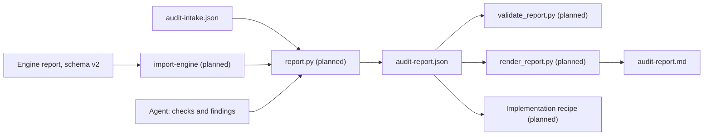

# 2. Report Schema

> **Audience:** Engineers, maintainers
> **Goal:** Explain why the audit report has the shape it has, how it differs from the engine's schema v2, and what keeps it honest. The field tables are in [`SCHEMA.md`](../../../schema/SCHEMA.md), and this page does not repeat them.
> **Related ADRs:** the engine's [ADR-0007](../../../deterministic-audit/docs/architecture/adrs/0007-json-report-render-contract.md), which makes the JSON report the render contract.
> **Status:** Live for the schemas ([`audit-report.schema.json`](../../../schema/audit-report.schema.json), [`audit-intake.schema.json`](../../../schema/audit-intake.schema.json)). The tools that read and write them are planned.

> [!NOTE]
> Planned. `tools/validate_report.py` (S2.2), `tools/report.py` (S2.3), `tools/render_report.py` (S2.4) and the engine adapter (S2.5) do not exist yet. Where this page names one, it says what the schema requires of it, not what it does.

---

## 1. Shape

One JSON file is the audit's result. The Markdown report is a pure function of it, as in ADR-0007, so there is no second source of truth to drift.

Three decisions give the report its shape.

- **The model writes through one tool.** The builder is the only writer, so a model never edits the JSON by hand. That keeps `key`, `id` and `status` computable, and it is why `summary` is not the model's to write.
- **`provenance` says what ran, and `run_context` says what was decided.** `provenance` is the engine, the harness and the target. `run_context` is the intake: `eval_mode`, `confirmation_policy`, the index, the probes allowed. A reader can tell an unattended evaluation from a person's audit without reading anything else.
- **Closed objects.** Every object has `additionalProperties: false`, except the engine's `checks[].data`. A misspelt field is an error, and a field added later is a version change.

The `summary` object is the readiness summary of [`spec/readiness-summary.md`](../../../../spec/readiness-summary.md): a score, the blockers remaining and two qualifiers. The schema has no level, grade or pass mark because the spec defines none. The validator must recompute `summary` and fail on a difference.

---

## 2. Evidence model

The spec gives each [verification method](../../../../spec/README.md#verification-methods) a different standard of proof, and the schema follows it.

| Method | What backs the verdict | Schema consequence |
|---|---|---|
| `automated` | The tool's output, recorded with its name and version | `engine_verdict` equals `verdict`, and `provenance.engine` names the engine. The check needs no evidence of its own. |
| `agent` | Cited evidence | `PASS` and `PARTIAL` need an evidence item. `FAIL` needs nothing: if the agent found no evidence, its summary says so. |

Two facts about the engine's own report forced the distinction. On its example report, 23 of the 42 `FAIL` and `PARTIAL` checks have no evidence on any of their findings ([audit-report.json](../../../deterministic-audit/examples/digital-assistant-sdk/audit-report.json)): the verdict is the tool's whole claim. A rule that every `FAIL` needs evidence would reject real engine output. For an agent, a positive verdict is judgment, and a judgment without a citation cannot be audited. A `FAIL` is different. It claims that something is missing, and the honest record of a failed look may be nothing. A rule that every `FAIL` lists a search would push a model to invent one, and nothing can check that the search ran, so the schema accepts a `FAIL` with no evidence and no search and leaves the summary to say "we did not find any evidence".

`captured_by` says who recorded each fact, `tool` or `agent`. Evidence captured by a tool names the tool and its version, so a reader can tell a command the engine ran from one the model reports having run. The schema cannot prove capture. It makes the claim visible and leaves the proof to the tools that write the file; a report whose evidence was typed by a model and labelled `tool` is a failure the validator cannot catch alone.

There are three evidence kinds: `file`, `command` and `index_query`. There is no `absence` kind. A search that found nothing is a record of effort, not a fact about a file, and `searches[]` is where it goes.

Quotes are limited to 300 characters and command output to 2,000, and the validator is to reject credential-shaped strings in either. The engine redacts at capture time ([`probes.py`](../../../deterministic-audit/audit/probes.py)); the validator adds a second check at the end, so that a model-captured quote cannot carry a secret into a report.

---

## 3. Stable keys and versions

A finding has two identifiers. `id` (`F-001`) is for display, and the builder numbers findings in a report's order. `key` is the check ID plus an optional scope, as in `SEC-02:src/config/constants.ts`, and it does not change between runs. A re-audit, a before-and-after comparison and the implementation recipe's re-verification all match findings by `key`. The engine already derives its finding ID this way ([`findings.py`](../../../deterministic-audit/audit/findings.py#L69-L72)), so an imported engine ID becomes the key unchanged.

The schema is at `0.1`, and a `0.x` schema may break between releases. The freeze at `1.0` waits until both recipes have run end to end on two repositories, so that the first breaking change is not the one that follows a release. The report also records `catalogue_version`, because the schema, the check catalogue, the rubrics and the tools form one shared layer. The implementation recipe is meant to warn when a report was built against a different catalogue. The catalogue is planned (S1.5), so the field has no format yet beyond a non-empty string.

---

## 4. Engine mapping

[`SCHEMA.md`](../../../schema/SCHEMA.md#engine-schema-v2-mapping) maps every field of the engine's schema v2. Four properties of the engine's output shaped it.

- **Counts of findings and counts of checks differ.** The engine's `summary.blockers` counts findings, and one check can raise many. The spec's "blockers remaining" counts checks, so that an `UNKNOWN` check, which raises no finding, is not hidden. The two numbers differ by design, and the engine's is not carried.
- **A finding can be less severe than its check.** `AGT-08` is `DEGRADER`, and its finding is `COSMETIC`. The rule is therefore that a finding is not more severe than its check, not that the two are equal.
- **Evidence paths are not always paths.** The engine writes `tsconfig.json:strict` and `(no example file)` in a `path` field. The adapter splits the first into a path and a note and drops the second, because the schema's `path` is a repository-relative path that the validator can resolve.
- **The engine's `ATTEST` verdict maps to no verdict.** A requirement verified by a person or by declaration has no check ([`spec/traceability.md`](../../../../spec/traceability.md)), so it appears in `unattested[]` with its requirement ID. The engine emits no `ATTEST` verdict today; its five fixed unattested items are mapped instead.

---

## 5. Invariants & Failure Modes

- **Invariant: the verdict that counts is `verdict`.** `engine_verdict` is kept beside it. A difference needs an `override_reason` and agent-captured counter-evidence, so the report shows the tool's word and the agent's side by side.
- **Invariant: an eval-mode report is never final.** `eval_mode` is part of `run_context`, and `status: final` is forbidden with it, so evaluation output cannot pass as an audit.
- **Invariant: blockers are confirmed one by one.** A final report's BLOCKER findings all carry `confirmed_via: interactive`. Batch confirmation covers non-blockers only.
- **Failure mode: a shape the 0.x schema cannot express.** The schema has no `oneOf`, so what each evidence kind needs is a rule of the validator, not of the schema. A consumer that reads only the schema accepts an evidence item with a `kind` and nothing else. Both the validator and `SCHEMA.md` carry the rules, and a consumer must run the validator.
- **Failure mode: schema drift.** The subset keyword list is in `SCHEMA.md`, and the validator's lint is meant to reject any other keyword, so a later schema edit cannot quietly depend on a keyword the validator does not implement. Until that lint exists (S2.2), the reference `jsonschema` package cross-checks the examples.
