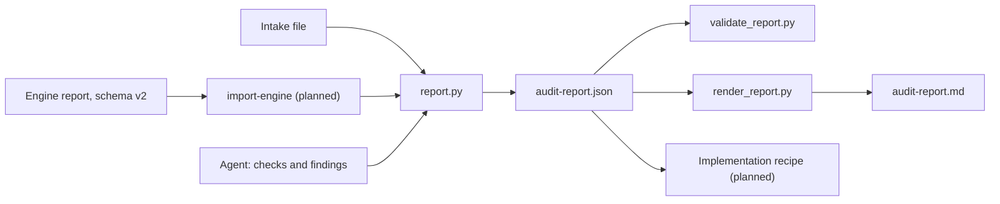

# 2. Report Schema

> **Audience:** Engineers, maintainers
> **Goal:** Explain why the audit report has the shape it has, how it differs from the engine's schema v2, and what keeps it honest. The field tables are in [`SCHEMA.md`](../../../schema/SCHEMA.md), and this page does not repeat them.
> **Related ADRs:** the engine's [ADR-0007](../../../deterministic-audit/docs/architecture/adrs/0007-json-report-render-contract.md), which makes the JSON report the render contract.
> **Status:** Live for the schemas ([`audit-report.schema.json`](../../../schema/audit-report.schema.json), [`audit-intake.schema.json`](../../../schema/audit-intake.schema.json)), the validator, the report builder and the renderer. The engine adapter is planned.

> [!NOTE]
> Planned. The engine adapter, `report.py import-engine` (S2.5), does not exist yet. `tools/validate_report.py`, `tools/report.py` and `tools/render_report.py` do. Where this page names a tool that does not, it says what the schema requires of it, not what it does.

---

## 1. Shape

One JSON file is the audit's result. The Markdown report is a pure function of it, as in ADR-0007, so there is no second source of truth to drift.

Three decisions give the report its shape.

- **The model writes through one tool.** The builder, `report.py`, is the only writer, so a model never edits the JSON by hand. That keeps `key`, `id` and `status` computable, and it is why `summary` is not the model's to write.
- **`provenance` says what ran, and `run_context` says what was decided.** `provenance` is the engine, the harness and the target. `run_context` is the intake: `eval_mode`, `confirmation_policy`, the index, the probes allowed. A reader can tell an unattended evaluation from a person's audit without reading anything else.
- **Closed objects.** Every object has `additionalProperties: false`, except the engine's `checks[].data`. A misspelt field is an error, and a field added later is a version change.

The `summary` object is the readiness summary of [`spec/readiness-summary.md`](../../../../spec/readiness-summary.md): a score, the blockers remaining and two qualifiers. The schema has no level, grade or pass mark because the spec defines none. The validator must recompute `summary` and fail on a difference.

---

## 2. Evidence model

The spec gives each [verification method](../../../../spec/README.md#verification-methods) a different standard of proof, and the schema follows it.

| Method | What backs the verdict | Schema consequence |
|---|---|---|
| `automated` | The tool's output, recorded with its name and version | `engine_verdict` equals `verdict`, and `provenance.engine` names the engine. The check needs no evidence of its own. |
| `agent` | Cited evidence | `PASS` and `PARTIAL` need an evidence item. `FAIL` needs nothing: if the agent found no evidence, its summary says so. |

Two facts about the engine's own report forced the distinction. On its example report, 23 of the 42 `FAIL` and `PARTIAL` checks have no evidence on any of their findings ([audit-report.json](../../../deterministic-audit/examples/digital-assistant-sdk/audit-report.json)): the verdict is the tool's whole claim. A rule that every `FAIL` needs evidence would reject real engine output. For an agent, a positive verdict is judgment, and a judgment without a citation cannot be audited. A `FAIL` is different. It claims that something is missing, and the honest record of a failed look may be nothing. A rule that every `FAIL` lists a search would push a model to invent one, and nothing can check that the search ran, so the schema accepts a `FAIL` with no evidence and no search and leaves the summary to say "we did not find any evidence".

`captured_by` says who recorded each fact, `tool` or `agent`. Evidence captured by a tool names the tool and its version, so a reader can tell a command the engine ran from one the model reports having run. The schema cannot prove capture. It makes the claim visible and leaves the proof to the tools that write the file; a report whose evidence was typed by a model and labelled `tool` is a failure the validator cannot catch alone. The builder closes it at the door: evidence in a fragment is the agent's whatever it says, and a fragment that claims a tool captured it is refused ([`agent_evidence`](../../../tools/report.py#L476-L501)).

There are three evidence kinds: `file`, `command` and `index_query`. There is no `absence` kind. A search that found nothing is a record of effort, not a fact about a file, and `searches[]` is where it goes.

Quotes are limited to 300 characters and command output to 2,000, and the validator is to reject credential-shaped strings in either. The engine redacts at capture time ([`probes.py`](../../../deterministic-audit/audit/probes.py)); the validator adds a second check at the end, so that a model-captured quote cannot carry a secret into a report.

---

## 3. Stable keys and versions

A finding has two identifiers. `id` (`F-001`) is for display, and the builder numbers findings one past the highest in use. `key` is the check ID plus an optional scope, as in `SEC-02:src/config/constants.ts`, and it does not change between runs. A re-audit, a before-and-after comparison and the implementation recipe's re-verification all match findings by `key`. The engine already derives its finding ID this way ([`findings.py`](../../../deterministic-audit/audit/findings.py#L69-L72)), so an imported engine ID becomes the key unchanged.

The schema is at `0.1`, and a `0.x` schema may break between releases. The freeze at `1.0` waits until both recipes have run end to end on two repositories, so that the first breaking change is not the one that follows a release. The report also records `catalogue_version`, because the schema, the check catalogue, the rubrics and the tools form one shared layer. The implementation recipe is meant to warn when a report was built against a different catalogue. The catalogue is planned (S1.5), so the field has no format yet beyond a non-empty string.

---

## 4. Engine mapping

[`SCHEMA.md`](../../../schema/SCHEMA.md#engine-schema-v2-mapping) maps every field of the engine's schema v2. Five properties of the engine's output shaped it.

- **Counts of findings and counts of checks differ.** The engine's `summary.blockers` counts findings, and one check can raise many. The spec's "blockers remaining" counts checks, so that an `UNKNOWN` check, which raises no finding, is not hidden. The two numbers differ by design, and the engine's is not carried.
- **A finding can be less severe than its check.** `AGT-08` is `DEGRADER`, and its finding is `COSMETIC`. The rule is therefore that a finding is not more severe than its check, not that the two are equal.
- **Evidence paths are not always paths.** The engine writes `tsconfig.json:strict` and `(no example file)` in a `path` field. The adapter splits the first into a path and a note and drops the second, because the schema's `path` is a repository-relative path that the validator can resolve.
- **The engine's finding IDs can collide.** An ID is the check ID plus a path, and `AGT-08` raises two findings with no path, so both are `AGT-08` (seen on the Digital-Assistant-Server report). A key must be unique, so the adapter numbers the later one `AGT-08:2`. The engine's baseline ratchet compares these IDs and would merge the two, which is an engine defect to fix.
- **The engine's `ATTEST` verdict maps to no verdict.** A requirement verified by a person or by declaration has no check ([`spec/traceability.md`](../../../../spec/traceability.md)), so it appears in `unattested[]` with its requirement ID. The engine emits no `ATTEST` verdict today; its five fixed unattested items are mapped instead.

---

## 5. The builder

[`report.py`](../../../tools/report.py) owns the draft, and four choices in it follow from what an agent is and does.

- **The agent hands over a fragment, and the tool does the rest.** A check's title, phase, severity, `scored` flag and method come from the catalogue; a finding's `key` and `id` are computed; the summary is computed from the checks and findings. Each is a field a model could get wrong or make up, and a field the schema refuses in a fragment is a field the model cannot get wrong. The fragment's own rules are the report schema's, taken from its definitions by [`fragment_validator`](../../../tools/report.py#L448-L469) and never copied, so the two cannot disagree.
- **A change is validated before it is written ([`update_draft`](../../../tools/report.py#L401-L432)).** The builder reads the draft and validates it, applies the change, recomputes the summary, validates the result with the validator's own function, and writes it atomically. A change the rules refuse writes nothing, and an agent that cannot see why reads `data.errors`, which names the rule. A draft that was already invalid is refused up front, so a broken draft cannot be blamed on the next change.
- **The agent can add what only it can judge, and dispute what the engine said.** An automated check's verdict is the engine's, so the builder will not let an agent add one. It lets the agent dispute one the engine ran: the engine's verdict and evidence stay, and the agent's verdict, reason and evidence sit beside them. This is the override described under Invariants, made through a door that records both sides ([`override_check`](../../../tools/report.py#L586-L615)).
- **Calls take turns.** An agent harness can run tool calls in parallel, and each call here is a read, a change and a write, so two at once would lose one. A lock on the output folder (`flock`, [`write_lock`](../../../tools/report.py#L343-L356)) makes them queue. It is on the folder because the draft file is replaced on every write, which would leave a waiting call holding a lock on a file that no longer exists. The system drops the lock when the process dies, so an interrupted run leaves nothing that blocks the next one. Where `flock` does not exist, which is native Windows (backlog item 2), the builder takes no lock and the calls must be made one at a time.

What the builder does not do is judge. It does not decide that a check passes, that a finding is real, or that a finding should be confirmed; the agent supplies the first two and a person the third. `set-disposition` records a decision and who made it, and refuses the ones that would claim a person where there is none ([`refused_decisions`](../../../tools/report.py#L817-L848)).

---

## 6. The renderer

[`render_report.py`](../../../tools/render_report.py) turns a valid report into Markdown. It has the shape it has because of who wrote the words in a report and who reads the page.

- **A pure function, and tests that hold it to that ([`render`](../../../tools/render_report.py#L690-L706)).** It reads its argument and nothing else: no file, no clock, no process. The tests render every example twice, after a trip through JSON, and with the keys of every object in the opposite order, and require one text. They run it with `open`, the clocks and `subprocess` made to fail. Two examples have a golden file beside them in [`schema/examples/`](../../../schema/examples/), the smallest report and the worked example.
- **The summary is recomputed and never read.** `render` calls `_summary.compute_summary` and ignores the `summary` in the file, so a stale or edited number cannot reach a reader. The command line refuses a report that fails the validator, rule 10 included, so the file and the page cannot disagree.
- **Text from a repository is untrusted.** A statement, a note or a quote is the model's rewording of what it read in the audited repository. [`text`](../../../tools/render_report.py#L111-L113) escapes every Markdown special character, and an underscore only where it could open or close emphasis, so that `__tests__` is not bold and `pull_request` is not littered with backslashes. [`prose`](../../../tools/render_report.py#L116-L122) also escapes a first character that would start a block, because a paragraph that began with `# ` would be a heading. [`code`](../../../tools/render_report.py#L131-L138) and [`fenced`](../../../tools/render_report.py#L141-L150) use a delimiter longer than any run of backticks inside, [`cell`](../../../tools/render_report.py#L153-L165) stops a `|` adding a column, and [`clean`](../../../tools/render_report.py#L86-L103) writes out control characters and the ones that reorder or hide text. The tests render a report whose every free-text field holds an image, a tag, a link, a heading, a quotation, a table row, a fence and a right-to-left override, and check the page for each.
- **The reader sees the verdict that counts, and the engine's beside it.** An override is in its own table, on the check's row, and in the check's block with the reason and the agent's evidence, because rule 6 forbids an override without them.
- **Absence is said, not implied.** [`check_lines`](../../../tools/render_report.py#L507-L543) prints "We did not find any evidence." for a `FAIL` or `UNKNOWN` check for which [`shows_evidence`](../../../tools/render_report.py#L217-L221) finds nothing, on the check or on any of its findings. The sentence is the renderer's: the validator does not require the agent to write it (rule 5), and a summary that does not say it must not leave the reader to guess. It also appears on a check that a tool settled, where it is accurate and terse, and the check's `summary` beside it says what the engine looked for.
- **One block for a check, with its findings under it.** [`needs_detail`](../../../tools/render_report.py#L224-L227) gives a block to every check that is not met, was overridden, was judged by the agent or raised a finding, and a passing check that a tool settled keeps its table row alone. The engine adapter copies a finding's evidence to its check, so [`finding_lines`](../../../tools/render_report.py#L463-L504) says "the same as under the check" when the two are equal, and prints the evidence once.

The renderer does not judge either. It never decides that a check is worth a block because of what it says; the rules above are the whole of it.

---

## 7. Invariants & Failure Modes

- **Invariant: the verdict that counts is `verdict`.** `engine_verdict` is kept beside it. A difference needs an `override_reason` and agent-captured counter-evidence, so the report shows the tool's word and the agent's side by side.
- **Invariant: an eval-mode report is never final.** `eval_mode` is part of `run_context`, and `status: final` is forbidden with it, so evaluation output cannot pass as an audit.
- **Invariant: the Markdown adds no fact.** Everything it shows is in the JSON, apart from the words that explain a verdict or a severity and the fixed sentences around them. A reader who wants more than the page shows opens the JSON, and the page says when that is so.
- **Invariant: blockers are confirmed one by one.** A final report's BLOCKER findings all carry `confirmed_via: interactive`. Batch confirmation covers non-blockers only.
- **Failure mode: a viewer without GitHub alerts.** The banners are `> [!WARNING]` and `> [!NOTE]` blocks. A viewer that does not know them shows a quotation whose first line reads `[!WARNING]`. The banner is still there and still says what it says.
- **Failure mode: a report the renderer will not read.** The command line refuses a report that fails the validator, with exit 2 and the errors, and renders nothing. A report that `report.py` wrote is valid, so this means a hand edit. `render` itself, called on a report that breaks a rule, fails with a `KeyError` and not with a guess.
- **Failure mode: a shape the 0.x schema cannot express.** The schema has no `oneOf`, so what each evidence kind needs is a rule of the validator, not of the schema. A consumer that reads only the schema accepts an evidence item with a `kind` and nothing else. Both the validator and `SCHEMA.md` carry the rules, and a consumer must run the validator.
- **Failure mode: schema drift.** The subset keyword list is in `SCHEMA.md`, and the validator's lint ([`_jsonschema_subset.py`](../../../tools/_jsonschema_subset.py)) rejects any other keyword, so a later schema edit cannot quietly depend on a keyword the validator does not implement. A test holds all three schemas to the lint. The validator itself is held to the reference `jsonschema` package by `make crosscheck`, a dev-only script outside the shipped tools that CI runs as part of `make check`; `SCHEMA.md` describes it under "Validating".
