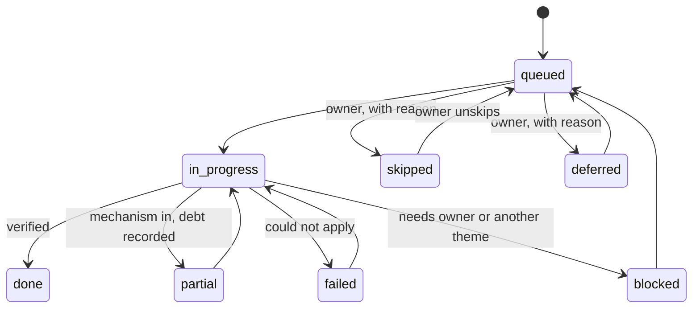

# State contract

The [implement recipe](SKILL.md) keeps one tracked state per target repository. The state is what lets a run
stop after any theme and resume another day, and it is where the owner's skips and preferences live. This
page is an agent directive: MUST and MUST NOT are used in the RFC 2119 sense.

> [!NOTE]
> Planned. The rules on this page bind every session now. The JSON Schema and the tool that writes the state
> do not exist yet: the schema is `Planned (IR02.1)`, the transitions, skip, defer and preference commands are
> `Planned (IR02.2)`. Until then a session writes the state by hand, in the draft shape below.

## Files and paths

The state lives in the target repository, in `docs/agentic-readiness/`. The audit report folder is never
edited; the state points at it.

| File | Role |
|---|---|
| `<label>-agentic-readiness-state.json` | The source of truth |
| `<label>-agentic-readiness-STATE.md` | Rendered from the JSON. Its header says it is generated and must not be edited |
| `README.md` | What the folder is, how to resume a run, a link to the audit report folder |

`<label>` is the audit report's `provenance.target.label`.

- The JSON MUST be the only file a session changes by intent; the Markdown view MUST be re-rendered from it,
  never edited by hand.
- The target's root `AGENTS.md` MUST carry one line that points at the STATE.md file and says: read it before
  changing tooling, CI, docs or `AGENTS.md`; skipped findings in it are final.

TBD: `brownfield-recipes/tools/progress.py` will be the only writer of the JSON and the
renderer of the Markdown view (IR02.1). Writing inside a target repository is an exception to the tools rule,
limited to the state files, and gets its own ADR in IR02.1.

## Item statuses

Every confirmed finding is one item. An item has exactly one status:

| Status | Meaning |
|---|---|
| `queued` | Confirmed in the report and waiting for its theme |
| `in_progress` | A session is applying its playbook |
| `done` | The mechanism is in and the check's verification passes |
| `partial` | The mechanism is in, the repository does not pass it yet, and the debt is recorded |
| `failed` | The playbook could not be applied; the reason is recorded |
| `blocked` | Needs an owner decision or another theme first |
| `deferred` | The owner chose to leave it for later, with a reason |
| `skipped` | The owner chose not to do it, with a reason. Final until the owner unskips it |

A finding the audit marked `rejected` is never an item; the Markdown view lists it as `not_queued`.



- A transition not in the diagram MUST NOT be recorded.
- Every transition MUST record who made it (`owner` or `agent`), the date and, for `skipped`, `deferred`,
  `failed` and `blocked`, a reason.

## Skip, defer and preferences

- **Skip.** Only the owner skips. A session MUST NOT skip a finding on its own judgment, and MUST NOT propose
  a skipped finding again in any stage or session. The close-out re-audit lists skipped findings as
  owner-accepted, not as new gaps.
- **Defer.** Only the owner defers. A deferred item goes back to `queued` when the owner says so; a session
  MAY remind the owner of deferred items at the start of a theme.
- **Preferences.** Every owner choice (a tool, a style, a scope limit such as "no mass reformat") MUST be
  recorded as a preference with a key, a value, a reason, who decided, the date and the step. A session MUST
  read every preference before it plans a theme. A playbook step that conflicts with a preference MUST stop
  and ask; it MUST NOT override the preference.

## Continue on error

A theme's job is to install the mechanism: the formatter, the linter, the test verb, the coverage floor, the
CI step. When the repository does not pass it yet (unformatted code, lint debt, missing tests):

1. Count the debt and record it on the item: what, how many, and the baseline file if one exists.
2. Wire the check so the debt cannot grow: a ratchet, a baseline file, or a step marked report-only.
3. Mark the item `partial` and continue with the next item.

A session MUST NOT mass-fix, suppress rules or lower a gate unless the owner chooses that, and MUST NOT
record `done` for an item that is `partial`.

## Draft JSON shape

Planned (IR02.1): the schema will be `schema/readiness-state.schema.json`. Until then this is the shape, with
example values:

```json
{
  "schema_version": "0.1",
  "repo": { "label": "example-service", "default_branch": "dev" },
  "recipe": { "name": "brownfield-implement", "version": "0.2.0-dev", "framework_rev": "<12 hex>" },
  "source_reports": [
    { "path": "docs/agentic-readiness-report/<report>.json", "git_sha": "<12 hex>", "catalogue_version": "0.2.2" }
  ],
  "preferences": [
    { "key": "java.formatter", "value": "palantir-java-format", "reason": "...", "by": "owner",
      "date": "2026-11-02", "phase": "IR04.2" }
  ],
  "themes": [
    { "id": "T1", "phase": "IR04.2", "status": "pr_open",
      "branch": "agentic-readiness/ir04-command-surface", "pr": 110, "merged_sha": null }
  ],
  "items": [
    {
      "finding": "F-001", "check": "CMD-01", "severity": "BLOCKER", "theme": "T1",
      "status": "partial", "by": "agent", "date": "2026-11-02", "reason": null,
      "commits": ["<12 hex>"],
      "verification": { "command": "./gradlew check", "result": "fails: 312 checkstyle violations (debt)" },
      "debt": [ { "what": "checkstyle violations", "count": 312, "baseline_file": "config/checkstyle/baseline.xml" } ],
      "notes": ""
    }
  ],
  "log": [ { "date": "2026-11-02", "phase": "IR04.2", "event": "T1 PR #110 opened" } ]
}
```
