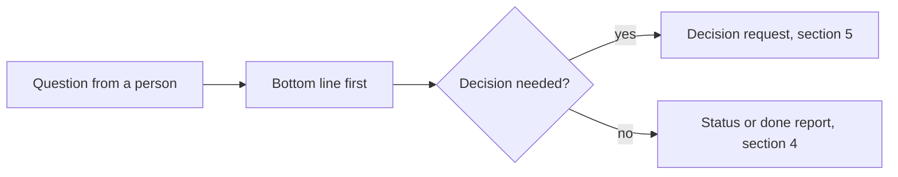

# Communications

This page says how to write for people in this repository. It applies to people and AI agents. It covers chat
replies, plans, reports, commit messages, pull request descriptions and documentation.
[`AGENTS.md`](../AGENTS.md) holds the short version. [`docs/STYLE_GUIDE.md`](STYLE_GUIDE.md) adds the rules that
apply only to documentation pages.

## 1. Who you write for

Write for **a new engineer who knows Git, Python and Markdown, but not this repository or its terms**.

- Do not assume they know a term from this repository. Define it the first time, or link to the glossary.
- Do not talk down to them. They are a skilled engineer. They only lack the context.
- When you are not sure if a sentence is clear, ask: "Can this engineer act on it without asking me?"

## 2. Plain-language rules

These rules come from the writing rules of ASD-STE100 (Simplified Technical English). We use only the rules
that help us. We do not use its fixed word list: technical names are fine.

`dev/prose_check.py` checks the rules marked *checked*. A person or an agent applies the others.

1. **Bottom line first.** Put the answer, the result or the decision you need in the first two lines. Put the
   detail after it.
2. **Short sentences** (*checked*). At most 20 words in a step of a procedure. At most 25 words in other text.
3. **One instruction per sentence.** Write steps in the imperative: "Run `make check`", not "You should run it".
4. **Active voice.** Say who does what: "The engine reads the file", not "The file is read".
5. **One word, one meaning.** Use the term from the glossary every time. Do not change words for variety.
   The glossaries are [`docs/glossary.md`](glossary.md) and
   [`docs/framework/glossary.md`](framework/glossary.md).
6. **No vague or padded words** (*checked*). Do not write `simply`, `just`, `obviously`, `clearly`,
   `basically`, `easily`, `utilize`, `leverage`, `in order to`, `and/or` or `etc.`. Name the real items instead
   of `etc.`.
7. **An example before the rule.** Show one concrete case first. Then state the general rule.
8. **Exact facts.** Give the file path, the command, the number and the unit. Write "3 of 11 checks", not
   "some checks".
9. **Code names in code spans.** Write file names, commands, check IDs and keys as `code`.

### Example

The "before" text breaks rules 2, 3, 4 and 6 on purpose, so the check skips it.

<!-- prose-check off -->

> Before: In order to ensure that the gate is green, it is recommended that `make check` is run by the
> contributor prior to the proposal of a change, as CI will also run it.
>
> After: Run `make check` before you propose a change. CI runs the same command.

<!-- prose-check on -->

## 3. Diagrams

A diagram often explains a flow faster than text. Use Mermaid. Pick the type by what you show:

| You show | Mermaid type |
|---|---|
| Steps and choices in a process | `flowchart` |
| Who calls whom, in order | `sequenceDiagram` |
| The states of one thing and how it moves between them | `stateDiagram-v2` |
| Data shapes and how they relate | `classDiagram` or `erDiagram` |

- Keep a diagram to about 12 nodes. Split a larger one.
- Write one sentence before the diagram that says what it shows.
- Validate every block you add: `make docs-mermaid FILES=<file.md>`.

Example:

## 4. Messages to people

Use the same layout each time. Then the reader knows where to look.

### 4.1 Status report

- **Done:** what is finished.
- **Not done:** what is left.
- **Blocked:** what stops you, and what you need.
- **Next:** what you do next.

### 4.2 Done report

- **What changed:** files, commits or pages.
- **How it was checked:** the command and its result, for example "`make check`: passed".
- **What was not done:** skipped steps and known gaps. Say so plainly.

### 4.3 Evidence labels

Mark each claim that matters:

- *checked*: you ran a command or read the file;
- *inferred*: you concluded it from other facts;
- *assumed*: you did not check it.

### 4.4 Length and layers

- Keep a chat reply short. Put long material in a file, and give its full path in the reply.
- Temporary notes and plans go in `artefacts/`. Permanent knowledge goes in `docs/`.
- In Markdown, put optional detail in a `
` block.

### 4.5 Changes

For a change, show the old and the new side by side, or as a short diff.

## 5. Decision requests

When the reader must decide, give them what they need to decide quickly.

1. **Context:** what the problem is and why a decision is needed now. Two to four sentences.
2. **Options:** a table, two to four rows.

   | Option | Pros | Cons | Cost | How hard to undo |
   |---|---|---|---|---|
   | A. ... | ... | ... | ... | ... |

3. **Recommendation:** the option you pick, and why, in one or two sentences.
4. **Default:** what you do if no answer comes.

When you ask several questions, number them and letter the options. Then the reader can answer "1b, 2a".

## 6. Where these rules apply

| Text | Rules |
|---|---|
| Chat replies, plans, reports | Sections 1 to 5 |
| Commit messages and pull request descriptions | Sections 1 and 2; Conventional Commits from [`AGENTS.md`](../AGENTS.md) |
| Documentation pages | Sections 1 to 3, plus [`docs/STYLE_GUIDE.md`](STYLE_GUIDE.md) |
| Recipe files (`SKILL.md`, playbooks, checks) | Section 2. Their messages to users are a planned change |
