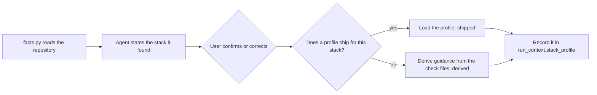

# 4. Stack Profiles

> **Audience:** Engineers, contributors
> **Goal:** Explain how a stack profile adapts the stack-neutral checks and playbooks to one toolchain. The anatomy
> and the contribution steps are in [`stacks/README.md`](../../../audit/stacks/README.md). This page does not repeat
> them.
> **Status:** Live. Three profiles exist:
>
> - [`stacks/typescript-node.md`](../../../audit/stacks/typescript-node.md), with a NestJS section;
> - [`stacks/java.md`](../../../audit/stacks/java.md), for Gradle and Quarkus, with Maven marked untested;
> - [`stacks/python.md`](../../../audit/stacks/python.md).
>
> [`stacks/README.md`](../../../audit/stacks/README.md) holds the anatomy.

A **stack profile** is one Markdown file that tells the agent how a toolchain names its commands, tools and CI
steps. The checks themselves stay stack-neutral.

---

## 1. Detection and confirmation

The diagram shows how the audit picks a profile.

1. [`facts.py`](../../../audit/tools/facts.py) reads the facts: `ecosystems`, `package_managers`, `ci_providers`,
   `test_frameworks` and `hook_managers`. A profile never reads them again.
2. The agent tells the user what `facts.json` found. The user confirms it or corrects it.
3. The agent loads the profile for that stack, if one ships. If none ships, the agent derives guidance from the check
   files. It tells the user which of the two it does ([`stacks/README.md`](../../../audit/stacks/README.md) §3).
4. `run_context.stack_profile` records the choice (`shipped` or `derived`) and the profile ID. A report reader can
   then tell a tested profile from a best guess for one run (§4 there).

A profile has a *Detection signals* section. It exists only so that a reader can check how the facts map to the
toolchain's own conventions.

## 2. Profile anatomy

Every profile has the same ten sections, in this order:

1. Detection signals
2. Command-surface map
3. Tooling defaults
4. Execution determinism
5. CI idiom
6. Baseline / ratchet
7. Boundaries
8. Engine coverage
9. Pitfalls
10. Verified

A profile has at most 150 lines. [`stacks/README.md`](../../../audit/stacks/README.md) §2 sets out the shape.

*Engine coverage* is not in the six sections of the original design plan (§2 there). It says which engine checks
give a reliable verdict for the stack, and which need the agent to verify them. When a real repository exposes an
engine gap for one toolchain, the gap is written here once. Later audits read it instead of finding it again.

## 3. Tested stacks

| Profile | Toolchain | Checked against | Real gaps found |
|---|---|---|---|
| [`typescript-node.md`](../../../audit/stacks/typescript-node.md) | npm, pnpm, Yarn, with a NestJS section | `agentic-tdd`, the Digital-Assistant-SDK, and a private repository with two Node packages composed through Docker | A gitignored lockfile (`EXEC-02` `FAIL`); a Nest-schematic `lint` script running `eslint --fix` under a read-only verb name (`CMD-04` `FAIL`); a scaffolded `tsconfig.json` with no strict flag (`TOOL-03` `FAIL`) |
| [`java.md`](../../../audit/stacks/java.md) | Gradle, with Quarkus; Maven marked untested | The Digital-Assistant-Server | No formatter/linter/dependency-scanner task registered by name; CI workflows that never run a Gradle verb; an `AGENTS.md` describing a Maven layout the repository does not have |
| [`python.md`](../../../audit/stacks/python.md) | pip, uv, poetry | The engine repo's own pre-migration tree (`source_only`, no manifest at all) | `EXEC-02`'s Python lockfile table omits `pip` entirely, so a plain `requirements.txt` project is told it is missing a `poetry`/`uv`/`pipenv` lockfile |

Each profile's *Verified* section is the source of record for the dates, the tool versions and the repository used.
This table only points to it.
