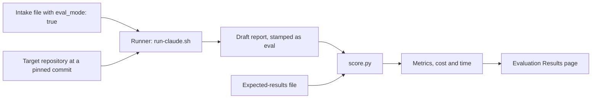

# 5. Evaluation

> **Audience:** Engineers, maintainers
> **Goal:** Explain how the recipes are evaluated and what the published results mean.
> **Status:** Live:
>
> - the corpus format, the scorer and the Claude Code runner;
> - the fixture sweep (S4.1, S4.2) and the real-repo runs (S4.3);
> - the round of rubric fixes that the runs fed (S4.4).
>
> A second harness and model ran once through `opencode` (S4.5.3), without a runner script. The scripts
> `run-opencode.sh` and `run-codex.sh` stay Planned (§4). Three runs per repository, to measure variance, are
> deferred (`D61`).

An **eval** runs a recipe without a person, on a repository whose correct verdicts are written down. A script then
scores the report against those verdicts. The diagram shows one eval run.

---

## 1. Why headless, not interviewed

The audit recipe needs a person twice. Stage 0 is an interview, and Stage 4 asks the person to confirm each finding.
An unattended run cannot do either. The plan calls for three runs across eight to ten repositories and several
models (DP §11). Review R-07 is the reason the harness exists: a person cannot re-run the recipe by hand each time.

Two inputs replace the person:

- An **intake file** answers the Stage 0 questions in advance.
- **Eval mode** (`"eval_mode": true` in
  [`audit-intake.schema.json`](../../../audit/schema/audit-intake.schema.json)) fixes the `confirmation_policy` to
  `accept-all` or `defer-all`. It stamps the output, so the output can never pass as a real final report.

`report.py set-disposition` confirms every finding under `accept-all` in eval mode, and refuses `accept-all`
otherwise. `report.py finalise` always refuses an eval-mode draft (`audit/SKILL.md`, Stages 0 and 4).

## 2. Corpus

The corpus has two kinds of repository (DP §11).

- **The engine's one-defect fixtures** (`audit/engine/tests/fixtures/`).
  - Each fixture fails exactly one catalogue check, by design. The `MATRIX` in `test_fixture_matrix.py` lists them.
    So nobody has to work out the expected verdict by hand.
  - [`generate_fixture_expected.py`](../../../dev/eval/generate_fixture_expected.py) generates their expected-results
    files into `dev/eval/expected/fixtures/<fixture>.json` (S4.2.1). There are 92 today. The published sweep ran on
    89.
  - The plan: run them all for the strongest model, and a sample for the other models (S4.2.2 to S4.2.5).
- **Real repositories**, picked by hand for stack coverage. DP §11 asks the corpus to include:
  - a repository that already passes;
  - a monorepo;
  - a tiny repository;
  - a repository with no tests or CI;
  - a repository with a planted hostile file (an injection test);
  - NestJS and Java/Quarkus coverage (S4.3).

For both kinds, the ground truth is one JSON file that matches
[`eval-expected.schema.json`](../../../audit/schema/eval-expected.schema.json). For each check it covers, the file
gives:

- the acceptable verdict or verdicts;
- the evidence paths the report must cite;
- a note.

A check that the file does not mention is not scored for that repository. `repo_sha` pins the commit that the file
was written for. [Run the Evals](../../how-to/run-the-evals.md) Step 1 shows how to write one.

## 3. Metrics

[`dev/eval/score.py`](../../../dev/eval/score.py) computes five metrics against one expected-results file. Usage:
`score.py <report> <expected> [--target <repo>]`.

| Metric | What it answers | Needs `--target`? |
|---|---|---|
| `schema_valid` | Does the report validate against `audit-report.schema.json`? | No |
| `blocker_recall` | Of the expected checks that are ground-truth blockers (catalogue `severity: BLOCKER`, `PASS` not acceptable), what share does the report also carry as an open blocker (`_summary.open_blockers`)? | No |
| `false_positive_candidates` | Which expected-PASS-only checks did the report not verdict `PASS`? | No |
| `override_precision` | Of the report's `override_reason` checks the expected file has ground truth for, what share lands on an acceptable verdict? | No |
| `evidence_validity` | What share of `kind: file` evidence citations have a path that exists in the target at the recorded commit, with `lines` (when given) fitting the file? | Yes |

`score.py` also prints the report's `run_context.stack_profile` as `stack_profile`. Results can then be grouped by
stack. This field is for information and is never scored.

Two rules for edge cases:

- **Wrong repository or commit.** The report's `provenance.target.label` and `git_sha` may not match the expected
  file's `repo_label` and `repo_sha`. Then the result is recorded as `comparable: false` and not scored. This is not a
  hard stop on purpose: a stop would throw away the `schema_valid` result of the same run.
- **Nothing to score.** A ratio is `null`, not `0`, when there is nothing of that kind to score. Examples: no expected
  blockers, or no overrides.

DP §11 also names two more measures:

- **Run-to-run variance:** three runs per repository, to describe the non-determinism, not to remove it.
- **Cost and time:** the runners (§4) record both for each run. The results for the fixture sweep and the real-repo
  runs are in [Evaluation Results](../../reference/eval-results.md).

Run-to-run agreement on blockers is not measured, by choice. `D61` chose one run per repository (Claude Code on
Sonnet), not three, to get real-repo numbers faster. KC accepted this gap when `S4.4.3` closed (`D63`).

DP §11 also means a false-positive *rate*: the findings that a person rejects. That rate is in the triage section of
[Evaluation Results](../../reference/eval-results.md). It is not the same as `false_positive_candidates`, which is
scored against written ground truth.

Review R-27: cost and time have metrics but no targets yet. The targets are set after the first baseline runs.

## 4. Headless runs

A **runner** drives a recipe without a person and records what the run cost.

- Each run needs an intake file with `eval_mode: true` in the output folder:
  `<out-dir>/audit-intake.<repo-label>.json`. So Stage 0 never asks a question.
- Review R-08 still applies. The recipe runs target commands only through the engine's Tier-C probe runner, never
  through the harness's own shell.

### `dev/eval/run-claude.sh` (Live)

- It runs `claude -p --dangerously-skip-permissions`, because an unattended run cannot answer a permission prompt.
  This is a choice for the eval harness only. It is not a recommendation for a real audit.
- Verified end to end on `tests/fixtures/cmd-02-weak-check`: exit 0, 131 s, $0.92, 30 turns. The draft validated
  and scored `blocker_recall: 1.0` and `evidence_validity: 1.0` against a one-check expected file.
- With `--recipe implement` (IR13), it runs the implement recipe on one eval scenario instead. It first checks the
  sandbox it runs in:
  - a local bare `origin`;
  - a `gh` shim that logs and fails every call;
  - a copy of the recipe without the eval files.
- In implement mode it also records a `stream-json` transcript, so a test can assert on every tool call.
- The implement scenarios have no ground-truth verdicts. `dev/eval/implement_eval.py` asserts the recipe's hard rules
  (A1 to A8) instead. See [Run the Evals](../../how-to/run-the-evals.md#implement-recipe-scenarios).

### `run-opencode.sh` and `run-codex.sh` (Planned)

Two things stopped these scripts in the session that built `run-claude.sh`:

- **The safety classifier.** Claude Code's safety classifier refused to write an unattended, auto-approving runner
  for another harness ("Create Unsafe Agents"). It refused through the `Write` tool and through a Bash heredoc. An
  explicit `permissions.allow` rule had no effect.
- **No `codex`.** `codex` was not installed, so its headless flags could not be checked against `--help`.

The scripts wait for a session or an environment where both are possible. They do not ship unverified.

`S4.5.3` reached a second harness without a script: `opencode` drove the installed skill bundle, with DeepSeek flash
as the model. The trick was one chained shell command as the instruction, not a numbered list of steps. Each
`opencode run` is a fresh session with no memory. A multi-step prompt hung, or ran finished steps again. See
[Harness Notes](../../reference/harness-notes.md).

That run shows that the recipe works in another harness. It does not replace the unattended runner with cost
tracking that this item still lacks.

## 5. Models

DP §11 asks for a model matrix:

- at least one top-tier model;
- one mid-tier model;
- one small, cheap model;
- one non-Anthropic model through opencode.

Its rule: "wherever a smaller model fails, tighten the rubric wording, not the model choice."

| Leg | State |
|---|---|
| Claude Code on Sonnet (D5) | Scored against ground truth: the fixture sweep and all three real repositories (S4.2 to S4.4) |
| Non-Anthropic model | Smoke run only: `opencode` on DeepSeek flash finished the skill bundle on one fixture (`S4.5.3`), with no expected-results comparison |
| Mid-tier and small models | Not run |

## 6. Publishing

The results are on the [Evaluation Results](../../reference/eval-results.md) page.

- **Why a reference page (D59):** a table of results is reference data, not a how-to or an explanation. The roadmap
  named `docs/eval/`, but the style guide has no `eval/` category. D54 set the same precedent.
- **The fixture sweep:** 89 of 89 fixtures, a 98.9% expected-verdict rate, cost and time, the one miss and its triage,
  and two evidence-validity findings.
- **The real-repo runs:** one run per repository (`D61`), KC's triage, the licence check, and `D62`'s revision of
  the Digital-Assistant-Server override.

A scored comparison for a second harness and model (`S4.3.4`) stays Planned, deferred by `D57`. See
[Run the Evals](../../how-to/run-the-evals.md) Step 4.
