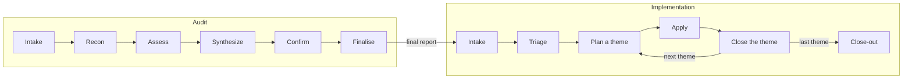

# 2. How the Recipes Work

> **Audience:** CTOs, engineering leads, adopters
> **Goal:** Walk through the audit stages and the implementation loop at a level a reader can evaluate.
> **Status:** Audit stages live (S3.5). Implementation Stages 0 to 5 live (IR12).

---

## 1. Audit stages

The diagram shows both recipes. The audit runs once; the implementation loops over the themes, one branch each.

The audit recipe ([`audit/SKILL.md`](../../../audit/SKILL.md)) works through six stages, in order, against
one repository at a time, writing nothing inside it:

1. **Intake.** The person says who runs the audit, what the agent may read or run, and the confirmation
   policy. The run starts only after they accept that the model provider sees what the agent reads.
2. **Recon.** The agent lists the repository and detects its stack: a shipped profile, or a labelled guess.
3. **Assess.** The engine runs once and its verdicts are imported. Then the agent works through the thirteen
   check families. It verifies every blocker on its own and judges what the engine could not. It records each
   issue as a finding with its evidence.
4. **Synthesize.** The agent reads the whole draft back. It looks for one root cause scored twice, or two
   families whose findings contradict each other.
5. **Confirm.** The person decides on each blocker alone and on the rest in batches. An evaluation run skips
   this stage by a fixed policy.
6. **Finalise.** The tools write the final report and its Markdown. An evaluation run has no final report,
   only the draft.

## 2. Implementation loop

The implementation recipe ([`implement/SKILL.md`](../../../implement/SKILL.md)) takes a final,
owner-confirmed audit report and closes its confirmed findings in the audited repository, one theme at a
time. Everything a later session needs to resume lives in a state file inside the target, described in the
[state contract](../../../implement/state.md).

1. **Intake (live).** `validate_report.py` refuses a report that is not `final`. `check_drift.py` shows how
   far the repository moved since the audit, and the agent re-verifies each finding whose evidence changed.
   `progress.py init` creates the state file, or `show` reads it to resume.
2. **Triage (live).** The owner walks the confirmed findings theme by theme. They keep, skip or defer each one
   with a reason. They state the preferences for the whole run. A skipped finding is never proposed again.
3. **Plan a theme (live).** The agent records the merged themes and picks the next theme in dependency order.
   It briefs the owner on what, why, the options and the expected debt. The owner approves the change list.
4. **Apply (live).** Each theme gets one branch and a separate worktree, from the integration branch. Per
   finding, the agent re-verifies, applies the playbook, verifies, commits and records the end status.
   Existing debt is recorded and guarded, not mass-fixed.
5. **Close the theme (live).** The engine re-checks the theme's checks, and the agent runs the gate. With
   `ci.pr_by_agent=yes`, the agent pushes and opens one pull request. Otherwise it stops at the local branch.
   It never merges.
6. **Close-out (live).** After the last theme, the audit recipe runs again. `compare_reports.py` compares the
   two reports, and one list shows what was skipped, deferred and left as debt.

## 3. What the user decides

In an audit, the person decides:

- the intake answers, and which of the target's own commands may run (Stage 1);
- the plan before assessment starts (Stage 2);
- the disposition of every finding (Stage 5): blockers one at a time with their evidence, the rest in batches.

In an implementation, the owner decides:

- at intake, what to do about drifted findings;
- at triage, keep, skip or defer for every finding, and the preferences for the run;
- per theme, the option for each choice, and the change list;
- the merge of every theme's branch. Only the owner or their review process merges.

Both recipes ask and report in the same way. They follow one shared prompt,
[`audit/prompts/talking-to-the-user.md`](../../../audit/prompts/talking-to-the-user.md), which both skill
bundles carry. Each message puts the bottom line first. Each question gives the options, a recommendation and the
default. Each claim that matters is marked *checked*, *inferred* or *assumed*, and the labels match the evidence
the report records. The prompt fixes the layout of the audit intake, the finding confirmation, the triage, each
status report and each pull request description.

## 4. Reading the report

A report's `checks[]` carry a verdict (`PASS`, `PARTIAL`, `FAIL`, `NOT_APPLICABLE`, `UNKNOWN` or `ATTEST`)
and a severity (`BLOCKER`, `DEGRADER`, `COSMETIC`) per Phase-1 requirement, each with cited `evidence[]` or
`searches[]` — nothing is scored on an unstated hunch. `findings[]` are the issues those checks raised,
each with a disposition a person set. `summary` is computed by the tools from the checks and findings, not
written by the model, and the validator recomputes it and refuses a mismatch. `unattested[]` lists what a
human verified or the repository's owner attested to instead, which earns no score either way. Each piece
of evidence carries its own `captured_by` (`tool` or `agent`), and, when a tool recorded it, which one and
its version — so a reader can tell a deterministic reading from an agent's own search.
