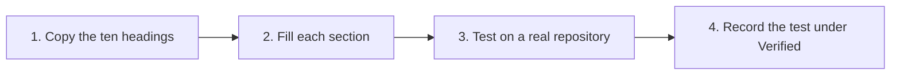

# How to Add a Stack Profile

> **Goal:** Contribute a tested profile for a toolchain that the recipes do not cover yet.
> **Audience:** Operators / Engineers
> **Status:** Live. Three profiles exist: [`typescript-node.md`](../../audit/stacks/typescript-node.md),
> [`java.md`](../../audit/stacks/java.md) and [`python.md`](../../audit/stacks/python.md).
> [`README.md`](../../audit/stacks/README.md) holds the anatomy. Keep one profile open beside this page as a worked
> example.

A **stack profile** tells the audit and implement agents how one toolchain names its commands, tools and CI steps.
This page takes you from an empty file to a tested profile.

---

## Prerequisites

- [ ] An open-source repository in the target stack, to test the profile against.
- [ ] You have read all of [`stacks/README.md`](../../audit/stacks/README.md). It is short. This page does not
      repeat its anatomy or its contribution rules. It shows how to apply them.

---

## Step-by-Step Instructions

The four steps, in order:

### Step 1: Copy the profile anatomy

1. Create `stacks/<id>.md`.
2. Copy the ten section headings from [`stacks/README.md`](../../audit/stacks/README.md) §2, in the same order.

The headings are: Detection signals, Command-surface map, Tooling options, Execution determinism, CI idiom,
Baseline / ratchet, Boundaries, Engine coverage, Pitfalls, Verified.

Some frameworks share a toolchain with an existing profile, for example Spring Boot on Maven or Django on pip.
Such a framework gets a `###` section inside that profile, not a new file. For the pattern, see the `## NestJS`
section of `typescript-node.md` or the Quarkus parts of `java.md`.

### Step 2: Fill each section from the stack's own conventions

1. Prefer what repositories in the stack already use over your own preference.
2. Where the stack supports several tools, recommend one default. Name the alternatives you considered.
3. Say where the facts tool gives an empty or misleading signal for this stack. The model is the note in
   `typescript-node.md` on a multi-component repository with no root lockfile.
4. Write *Engine coverage* last, once the rest is settled.

For *Engine coverage*, read the engine source for the checks that back this stack:
`audit/rules/checks/_common.py` and the family files under
[`audit/engine/audit/rules/checks/`](../../audit/engine/audit/rules/checks/). Then say which verdicts are reliable
as the engine reads them. Also say which verdicts need the agent to read the build file itself. Two worked
examples show a real gap found this way:

- the Gradle and Maven engine-coverage sections of `java.md`;
- the `source_only` discussion in `python.md`.

### Step 3: Test on a real repository

1. Run the audit against at least one real repository in the stack. If a full recipe run is not possible, read the
   repository directly.
2. Record what the run showed.

A real `FAIL` is better evidence for *Pitfalls* than a guess. Sometimes no repository exists for a toolchain, as for
Maven in `java.md`. Write the section anyway, from the engine source. Say in the section that it is untested.

### Step 4: Record the test under Verified

Write down:

- the date;
- the tool versions you used;
- each repository you used, with a commit SHA if the checkout can change.

A section that was checked against no repository says so in *Verified* too, not only in its own body.

---

## Verification

- [ ] `python3 dev/recipe_lint.py .` is clean.
- [ ] The file has 150 lines or fewer. The recipe linter does not check this for `stacks/`. It is the folder's own
      rule, from [`stacks/README.md`](../../audit/stacks/README.md) §2.
- [ ] `make check` still passes.
