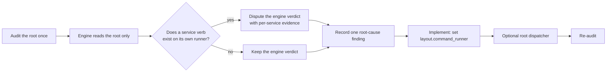

# How to Audit and Implement a Monorepo

> **Goal:** Audit a repository that holds several services, and hand its follow-up fixes to the implement recipe.
> **Audience:** Operators / Engineers
> **Status:** Live. The engine scores declared components only; scoping a check to one nested component is
> not built yet (GitHub issue #20). This page covers what works today.
> **See also:** [Run an audit](run-an-audit.md) and [Implement an audit report](implement-an-audit-report.md).

---

## The short answer

Audit the repository root once. Treat each service as a component. Fix the one gap a monorepo causes, a missing
root command runner, in the implement run.

- **Checked:** the engine counts a command runner only at the repository root
  ([ADR 0008](../../audit/engine/docs/architecture/adrs/0008-what-counts-as-the-repository.md)). A repository with a
  `package.json` in each service and none at the root has no runner for the engine.
- **Checked:** the engine scores a component only when a build manifest declares it, one level deep
  ([ADR 0003](../../audit/engine/docs/architecture/adrs/0003-component-depth-declared-depth-1.md)). Services
  without a workspace file appear as candidates, not as scored components.
- **Inferred:** a root `Makefile` that delegates each verb to every service gives the engine a runner to read.

---

## Prerequisites

- [ ] The [prerequisites of an audit](run-an-audit.md#prerequisites)
- [ ] A repository whose services each have their own manifest, with no root manifest or workspace file
- [ ] The names of the service folders, relative to the repository root

---

## Step-by-Step Instructions



### Step 1: Choose one audit, not one per service

| Option | Pros | Cons | Use it when |
|---|---|---|---|
| **One audit of the root (recommended)** | Root `AGENTS.md`, CI, hooks and hygiene files stay in scope. One report. | Command and test checks need your review. | Always, for now |
| One audit per service folder | Each service's manifest is the runner. | The root files fall outside the target, so they read as missing. Findings repeat. | Never as the only audit |
| Wait for component scoping (issue #20) | Native handling. | No audit until then. | Only if you can wait |

Default: audit the root.

### Step 2: Name the services at intake

Put each service folder in `known_components`. Put build output and dependency folders in `excluded`. Allow no probe
verbs: the verbs resolve inside each service, and a probe runs the target's own code.

```json
{
  "known_components": ["service-a", "service-b"],
  "excluded": ["service-a/node_modules", "service-a/dist", "service-b/node_modules", "service-b/build"],
  "probes": { "allowed": [], "timeout_s": 120 }
}
```

The rest of the intake follows [Run an audit](run-an-audit.md#step-1-optional-write-an-intake-file).

### Step 3: Expect these verdicts

With no root runner, the engine reports the checks below as `UNKNOWN`, `PARTIAL` or `FAIL`, whatever each service
holds. Read the evidence before you accept any of them.

| Check | What the engine says | What to verify |
|---|---|---|
| `CMD-01` Seven verbs on one runner | `UNKNOWN`: no runner | Whether each service defines all seven verbs |
| `CMD-02` `check` composes the verbs | `UNKNOWN` | Whether each service's `check` runs format check, typecheck and test |
| `CI-02` CI runs the same verbs | `UNKNOWN` | Whether CI runs each service's verbs, directly or through a script |
| `AGT-05`, `TOOL-01`, `TOOL-02`, `TST-01` | `PARTIAL` or `FAIL`: "no runner exposes the verb" | The same service manifests |
| `TOOL-03`, `TST-05` | `FAIL`: no strict config, no coverage config | A nested `tsconfig` or a coverage threshold in a service manifest |
| `NAV-01` Components declared | `PARTIAL`: candidates only | Nothing to fix in the audit; the fix is a workspace file |

### Step 4: Verify per service, then dispute with evidence

In Stage 2, open each service's manifest yourself. For every engine verdict that the service files contradict,
record a dispute with `report.py add-check`. Give an `override_reason` and cite the service manifest lines.

1. A check with no finding yet (such as an `UNKNOWN`) is disputed straight away.
2. A check with a pending finding, disputed to `PASS`, needs that finding rejected first. Ask the person, then
   run `report.py set-disposition --disposition rejected --via interactive`.
3. Record **one** finding for the root cause: no root runner. Put it under `CMD-01`, with the playbook
   `define-command-surface`. Do not leave the same cause as four findings under `AGT-05`, `TOOL-01`, `TOOL-02`
   and `TST-01`. Recommend rejecting the repeats as duplicates in Stage 4.

Say in the report which verdicts are the engine's and which are your overrides.

### Step 5: Hand the fix to implement

The audit report is the hand-over. Nothing else carries the request. The implement run reads the confirmed
`CMD-01` finding, and its remediation names the `define-command-surface` playbook.

At Triage (Stage 1), the owner chooses how the services are run. Record the choice as a preference:

```bash
python3 implement/tools/progress.py pref set layout.command_runner per-app \
  --reason "each service keeps its own runner" --by owner \
  --workspace <workspace> --phase <session id>
```

| Choice | Effect | Pros | Cons |
|---|---|---|---|
| `per-app` and no dispatcher | Each service keeps its runner. The playbook adds only missing verbs. | No new files. | The engine keeps reading no root runner. |
| `per-app` and a root dispatcher (recommended) | A root `Makefile` or script delegates each verb to each service and composes nothing itself. | One command at the root. The engine and an agent both find a runner. | A second runner to keep in step. Every target must delegate. |
| One root runner | One manifest runs every service. | One place for the verbs. | A root workspace manifest changes installs and lockfiles. The playbook proposes it only when the owner asks. |

The playbook's rules: [`define-command-surface`](../../implement/playbooks/define-command-surface.md), input 3.
Other playbooks read the same preference. For example, `adapt-agents-md` lists the verbs under each service.

### Step 6: Re-audit

After the theme merges, run a new audit of the root. A dispatcher that delegates all seven verbs should let
`CMD-01` and `CI-02` read a real runner (inferred; confirm it in the new report). Overrides from the first run no
longer apply, because the engine now sees the evidence itself.

---

## Verification

- The report names the services as components, or as candidates when no workspace file declares them.
- Each override has an `override_reason` and cites a service manifest.
- One finding holds the root cause, not four.
- The implement state records `layout.command_runner`.
