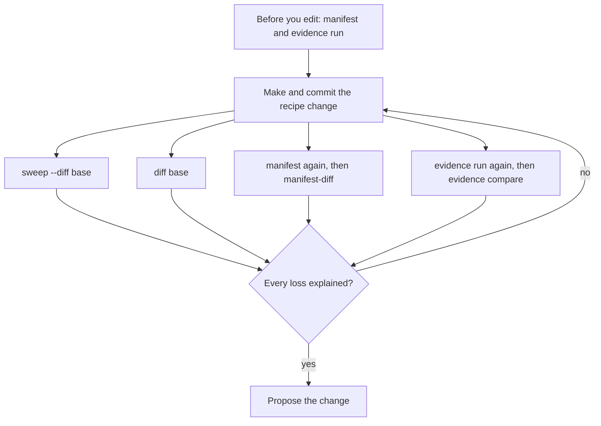

# How to Check a Recipe Change

> **Goal:** Find what a change to the recipes dropped or broke before you propose it: normative rules, sections,
> links, IDs, bundle files and engine evidence.
> **Audience:** Engineers who change `audit/`, `implement/`, `greenfield/templates/` or an `AGENTS.md`
> **Status:** Live. Every command on this page runs today. None of them is a gate: `make check` does not run them.

A change to a recipe can drop a rule or break a reference, and no test fails. The document index tool,
[`dev/doc_index.py`](../../dev/doc_index.py), compares two states of the repository and reports what went missing.
[ADR 0011](../architecture/adrs/0011-index-the-documents-with-a-standard-library-tool.md) records why it exists and
how it is built.

> [!NOTE]
> The index is built on demand from the files and is not committed. Each command reads the working tree, or a commit
> with `--at`, through `git show`. It never checks out a commit. No gate reads an index file.

Each command answers one question:

| Question | Command | Step |
| --- | --- | --- |
| Which normative rules of the old state are gone? | `sweep --diff <base>` | [Step 3](#step-3-list-the-rules-that-vanished-the-sweep) |
| Which sections, links and IDs moved, changed or went? | `diff <base>` | [Step 4](#step-4-compare-the-index-the-index-diff) |
| Which files do the skill bundles ship differently? | `manifest`, then `manifest-diff` | [Step 5](#step-5-compare-the-bundles-the-manifest-diff) |
| Which engine checks changed verdict or evidence? | `evidence run`, then `evidence compare` | [Step 6](#step-6-compare-the-engine-evidence) |
| Does each quote in a report exist where it says? | `verify-quotes <folder>` | [Step 7](#step-7-check-the-quotes-of-a-report) |
| Does a playbook change still keep what each check reads? | `make consistency-map` | [Step 8](#step-8-run-the-consistency-maps-gate) |
| What did my branch change in the text the checks read? | `make consistency-map CMAP_ARGS=--base` | [Step 8](#step-8-run-the-consistency-maps-gate) |

The flow below shows the order. The manifest and the evidence run read only the working tree, so record their
before side first.



---

## Prerequisites

- [ ] Python 3.11+ on `PATH`, and `git`
- [ ] A clone of this repository whose tree holds `dev/doc_index.py`
- [ ] The base of your change as a git ref, for example `dev` or `HEAD~1`. This page writes it as `<base>`.
- [ ] A scratch folder outside the repository, for example `/tmp/rc`. This page writes it as `<scratch>`.

Run every command from the repository root.

---

## Step-by-Step Instructions

### Step 1: Record the before side

Run these two commands before you edit anything. They read the working tree only and take no `--at`.

```bash
python3 dev/doc_index.py manifest --out <scratch>/old-manifest.json
python3 dev/doc_index.py evidence run --out <scratch>/old-run
```

`manifest` builds both skill bundles into a temporary folder and writes the size and SHA-256 of each file. It never
builds into `dev/dist/skills/`. `evidence run` runs the audit engine on this repository and writes
`reports/repo.json` and `run.json` into the folder.

> [!IMPORTANT]
> The `evidence run` folder must be new or empty, and outside the repository. Otherwise the run is refused with exit 2,
> for example `refused: <folder> is inside the repository; give a folder outside it`.

If you already edited the tree, record the before side in a second worktree at `<base>`. Its tree must hold
`dev/doc_index.py` too.

### Step 2: Make the change and commit it

Edit the recipe and commit the change on your work branch. The sweep and the index diff also compare the uncommitted
working tree. A commit gives you a fixed ref to name with `--at`, and to show a reviewer.

### Step 3: List the rules that vanished (the sweep)

The sweep lists every normative item of the in-scope files. An item is a paragraph, a list item, a table row or a
fenced command block. An item is normative when it holds a trigger word ("must", "never"), a limit, an exit code or a
write to a path. A command block and a row of a tool table are normative too.

The scope is the files the skill bundles carry, as `dev/build_skills.py` names them. It adds `greenfield/templates/`
and every `AGENTS.md`. The scope and the trigger words are in
[`dev/docindex.config.json`](../../dev/docindex.config.json).

Run the diff mode against your base:

```bash
python3 dev/doc_index.py sweep --diff <base>
python3 dev/doc_index.py sweep --diff <base> --at HEAD
```

The first form compares `<base>` with the working tree; the second compares it with a commit. Example: the commit
`7545276` trimmed the greenfield `AGENTS.md` template.

```bash
python3 dev/doc_index.py sweep --diff 7545276~1 --at 7545276
```

The output ends with the counts. Read the `vanished` line first:

```text
# Counts
  1952  items at the old state
  1917  items at the new state
  1891  unchanged
     2  moved verbatim
     0  path re-point
    59  vanished
```

Above the counts, each vanished item is one block: its path and section address, its kind, its triggers and its text.
Under `closest:` are the three most similar items of the new state, with a similarity ratio from 0 to 1.

```text
greenfield/templates/AGENTS.md#agentsmd/1-project-overview
  kind: required-step
  triggers: must
  **Zero Specification Drift:** Code and architecture specs MUST remain synchronized.
  closest:
    0.6640  greenfield/templates/docs/STYLE_GUIDE.md#documentation-style-guide/1-the-5-core-invariants: ...
```

Explain every vanished item. A high ratio often means the rule moved and was reworded. A low ratio means it may be
gone. A `path re-point` item changed only a path or a file name; check that the new path is right.

Options of `sweep`:

| Option | Use |
| --- | --- |
| (none) | Report mode: list every normative item of the working tree, and each file's item count on stderr |
| `--at <ref>` | Sweep the files at a commit, not the working tree. With `--diff`, the new side |
| `--diff <ref>` | List the items at `<ref>` that vanished by the new side |
| `--paths a,b` | With `--diff` only: sweep these files or folders on both sides, in place of the scope |
| `--triggers group1` | Use the first trigger group only. The default, `all`, uses both groups |
| `--format json` | Write JSON: `counts`, `vanished` with `closest`, and `path_repoint` |

Use `--paths` when a file moved or the scope changed. A path that exists on one side only still works, for example
`--paths greenfield/templates/AGENTS.md`. Report mode prints about 2,000 items today, so redirect it to a file.

### Step 4: Compare the index (the index diff)

The index diff compares the sections, the edges and the IDs of the two states. Edges are links, mentions, the tools
a command runs, and the files a bundle ships. IDs are check IDs, requirement IDs, ADR numbers, playbooks, schemas and
tools.

```bash
python3 dev/doc_index.py diff <base>
python3 dev/doc_index.py diff 7545276~1 --at 7545276
```

The text output has one group per kind of change, each with its count:

```text
# Index diff from 7545276~1 to 7545276: 36 changes

# Sections added: 6
# Sections removed: 17
# Sections moved: 0
# Sections renamed: 0
# Sections edited: 9
# Edges lost: 2
  links: implement/playbooks/adapt-agents-md.md#playbook-adapt-agents-md/steps/generic -> greenfield/templates/AGENTS.md#agentsmd/8-documentation-standards-diátaxis/81-how-to-write-for-people (anchor #81-how-to-write-for-people)
# Edges gained: 2
# IDs that lost their definition: 0
# IDs that lost every mention: 0
```

How to read each group:

| Group | What it means | What to do |
| --- | --- | --- |
| Sections moved | The same heading and text at a new address | Check the links to it; the diff maps them |
| Sections renamed | The same text under a new title, at the same place | Check the anchors that named the old title |
| Sections edited | The same address, new text. Re-wrapping a paragraph is not an edit | Read the change |
| Sections removed | No pair found on the new side | Find where its rules went (Step 3) |
| Edges lost | A link, mention, run or bundle edge that is gone | A lost anchor is a broken reference |
| IDs that lost their definition | A check or requirement no longer defined | Restore it, or remove every use |
| IDs that lost every mention | Defined, but no file names it any more | Check that no recipe step still needs it |

To see who depends on a section or an ID, query it. For example, `python3 dev/doc_index.py query AGT-04` lists the 57
places that mention "`AGT-04` Definition of done stated". `diff` exits 0 whatever it finds.

### Step 5: Compare the bundles (the manifest diff)

After the change, build the manifest again and compare it with the one from Step 1:

```bash
python3 dev/doc_index.py manifest --out <scratch>/new-manifest.json
python3 dev/doc_index.py manifest-diff <scratch>/old-manifest.json <scratch>/new-manifest.json
```

With no change, it prints `no bundle file changed`. Otherwise it prints one block per bundle, and one line per file:

```text
bundle <name>: 1 added, 0 removed, 2 changed
  added   <path in the bundle>
  changed <path in the bundle>
```

A removed file that a recipe still names is a break in the installed skill. The archive `audit.pyz` is compared by
its members, so two builds of the same source compare equal.

### Step 6: Compare the engine evidence

After the change, run the engine again into a second new folder, then compare the two runs:

```bash
python3 dev/doc_index.py evidence run --out <scratch>/new-run
python3 dev/doc_index.py evidence compare <scratch>/old-run <scratch>/new-run
```

With no change, it prints the two sides and `no verdict or evidence changed`:

```text
old: 7a1c601613132131ab174db24d847c5442b96c8a (dirty), audit 0.4.0 (ruleset 2026-11-17.4), target repo
new: 7a1c601613132131ab174db24d847c5442b96c8a (dirty), audit 0.4.0 (ruleset 2026-11-17.4), target repo
no verdict or evidence changed
```

Otherwise it prints one line per changed check, then the counts. Read both kinds of change:

- `verdict PASS -> FAIL` (or any other pair): the check's verdict changed.
- `same verdict PASS, evidence changed`: the verdict held, but its summary, data or findings changed. A
  verdict-only comparison misses this break.

`(dirty)` means the tree had changes or untracked files when the run started. Two other targets exist. Two runs with
different targets do not compare (exit 1).

- `--target fixtures` runs the engine on every engine fixture, 114 reports today.
- `--target scaffold` runs the greenfield scaffolder on `greenfield/templates/`, then runs the engine on the new
  project. It writes one report, `scaffold`, in about a second. Use it when you change a template.

The scaffold target fixes every input of the scaffold: the names, the date and the commit. So two runs of the same
tree compare equal. The engine's positive-fixture test fails only on `FAIL`, so it misses a fall to `PARTIAL`. The
comparison shows it. For example, moving "never restate" to the next line of the `AGENTS.md` template prints this:

```text
report scaffold:
  AGT-06: verdict PASS -> PARTIAL: finding AGT-06 added, summary
```

### Step 7: Check the quotes of a report

A review report that quotes the recipes keeps its quotes in a `quotes.json` beside it. Each entry has an `id` (`Q1`),
a repository `path` and the exact `quote`. The report cites a quote as `[Q1]`.

```bash
python3 dev/doc_index.py verify-quotes <report-folder>
python3 dev/doc_index.py verify-quotes <report-folder> --at <base>
```

It checks that each quote occurs in its file and that each `[Qn]` resolves. Only runs of whitespace are collapsed;
case, punctuation and words must match. A pass prints one line, for example
`verify-quotes: 261 quotes and 261 citations checked, 0 failed`. Each failure goes to stderr with its id, path and
reason.

---

### Step 8: Run the consistency map's gate

The consistency map, [`dev/consistency-map.json`](../../dev/consistency-map.json), says what each check reads.
Its `names` part, the file names the engine gives a meaning to, is in
[`dev/consistency-map-names.json`](../../dev/consistency-map-names.json). The map also says what each playbook
Commits row and template does to that text, and which sentence keeps each read true.
[ADR 0012](../architecture/adrs/0012-keep-the-consistency-map-as-json-in-dev.md) records its design. Do not edit
the map's `reads` part by hand: the engine declares each check's reads in `audit/engine/audit/rules/reads.py`. After
you change a declaration, run `python3 dev/consistency_map_reads.py --write` to rewrite the part.

```bash
make consistency-map
make consistency-map CMAP_ARGS=--verbose
```

The gate prints a count for each kind of problem, then the problems. Read these first:

- `unkept`: a move names a check in `touches`, and no keeps entry covers the pair.
- `quote`: a kept quote is no longer in its section. Your change moved or reworded the sentence.
- `coverage`: a new Commits row or check has no entry. Add one to the map in the same change.
- `boundary`: a hard rule of the implement run lost its home sentence, or the tool, test or eval function that
  enforces it is gone. Restore the sentence, or update the boundary's home or enforcer in the map.

`unreviewed` is advice. The gate guesses touches from paths and content kinds, and the guess is coarse.
`--verbose` lists the pairs. The gate exits 0 whatever it finds; `CMAP_ARGS=--strict` makes it exit 1.

On a work branch, add change mode. It compares your branch with a base ref, `origin/dev` by default:

```bash
make consistency-map CMAP_ARGS=--base
make consistency-map CMAP_ARGS="--base <ref> --at HEAD"
```

It prints the static report, then four groups:

- `review`: the sections your change moved, renamed, edited or removed in a file a check reads, with the checks.
  A template counts at the path the scaffolder writes it to. Read each one; it is not a problem.
- `lost-mention`: a kept section named the check ID before your change and does not now. This is a problem, even
  when the kept sentence still exists somewhere else.
- `left-scope`: you renamed a file a check reads to a path the check does not read. This is a problem.
- `evidence`: the checks whose verdict or evidence changed, when their reads overlap your change. It is reported,
  never a problem.

Some checks read every file of a kind, for example `**` or `docs/**/*.md`. The gate calls such a place broad: a
wildcard place whose files carry at least 5% of the tree's distinct file names. In the `review` group, each line
names only the checks that read the place through a place of their own. The group lists the broad checks once, in
a `broad checks` line. A line that only broad checks read is counted in an `and N more` line. `--verbose` lists
those lines, and names the broad checks on each line. The JSON keeps every check of each entry under `checks`, and
the broad ones under `broad`. The evidence part still compares all of them.

The evidence part copies each side into a temporary repository and runs the engine on both. It takes about
15 seconds on this repository. `--no-evidence` skips it.

---

## What the tools cannot see

The tools find a loss in text and structure. They do not prove that the recipes still mean the same thing.

| Tool | What it cannot see |
| --- | --- |
| `sweep` | A rule with no trigger word, limit, exit code or path write, for example "Use Conventional Commits." It is not an item, so its loss is not reported |
| `sweep` | A rule reworded so far that its closest ratio is low. It shows as vanished; only a reader can say whether it moved |
| `sweep` | Text in a code fence that is not a command block, and files outside the scope (use `--paths` for them) |
| `diff` | A changed rule inside a section that kept its address. It shows as edited, with no detail |
| `diff` | A link or ID form that the config does not describe |
| `manifest-diff` | Whether a changed bundle file still says the same thing |
| `evidence compare` | A check whose input changed but whose verdict and evidence stayed the same |
| `consistency-map` | A touch that no reviewer declared. It shows only as an unreviewed guess |
| `consistency-map --base` | The evidence of a fresh greenfield scaffold. A template change shows under `review`, but the engine audits only this repository |
| All but `consistency-map` and `evidence compare` | An engine contract bound to one line of a file |

The last row needs a note. Some engine checks need two things on one physical line, for example
"`AGT-06` Architectural boundaries declared" and "`AGT-08` No competing instruction files". Re-wrapping such a line
can change the verdict. The consistency map records each such binding in its reads, and its gate checks that a
sentence keeps it. It checks that the rule is stated, not that an agent follows it.
`evidence compare` sees a broken binding when the verdict or the evidence changes. For a template, run it with
`--target scaffold` ([Step 6](#step-6-compare-the-engine-evidence)).

---

## Exit codes

Every `doc_index.py` command exits 1 on a usage error, such as an unknown option. `--help` exits 0.

| Command | 0 | 1 | 2 |
| --- | --- | --- | --- |
| `sweep`, `diff` | A report, whatever it finds | A git failure, such as a ref that names no commit; or a usage error, such as `--paths` without `--diff` | Not used |
| `manifest` | The manifest is written | The bundle build failed, or the file cannot be written; or a usage error | Not used |
| `manifest-diff` | A report, whatever it finds | A manifest cannot be read; or a usage error | Not used |
| `evidence run` | Every report is written | A command failed; or a usage error | The run is refused: folder not fresh or inside the repository, or a report missing or stale |
| `evidence compare` | A report, whatever it finds | A run folder cannot be read, or the targets differ; or a usage error | Not used |
| `verify-quotes` | Every quote and citation passes | A usage error, or a folder with no `quotes.json` | A quote or citation fails |
| `consistency_map.py` | A report, whatever it finds | With `--strict`: a problem found; with `--base`: an engine run failed | A usage error, such as a base ref that names no commit |

---

## Verification

You checked the change when all of this holds:

- [ ] `sweep --diff <base>` ran, and you explained every vanished and re-pointed item.
- [ ] `diff <base>` shows no lost anchor and no ID that lost its definition, or you explained each one.
- [ ] `manifest-diff` lists only the bundle files you meant to change.
- [ ] `evidence compare` shows no verdict and no evidence change, or you explained each one.
- [ ] `make consistency-map` shows no new `unkept`, `quote` or `coverage` problem.
- [ ] `make consistency-map CMAP_ARGS=--base` shows no `lost-mention` or `left-scope` problem, and you read each
  `review` and `evidence` line.
- [ ] `make check` passes, as [`AGENTS.md`](../../AGENTS.md#definition-of-done) asks.
