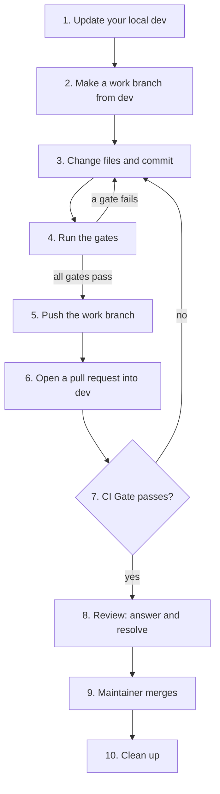

# How to contribute a change

> **Goal:** Move one change from your machine into the `dev` branch through a pull request.
> **Audience:** Contributors, interns included. You know basic `git` commands; you do not know this repository.
> **Status:** Live.

---

This page uses these terms:

| Term | Meaning |
| --- | --- |
| `dev` | The integration branch and the default branch. Every change goes here first. It is protected: you cannot commit or push to it directly |
| `main` | The release branch. It accepts pull requests from `dev` and the release pull request that release-please opens. You never open a pull request into `main` |
| Work branch | Your own branch for one change. You start it from `dev` |
| Pull request | A request to merge your work branch into `dev`. GitHub runs the checks on it |
| `CI Gate` | The one required check. It passes only when all CI jobs pass |
| Maintainer | The person who merges pull requests and makes releases |

The rules behind this page are in [`RELEASE_PROCESS.md`](../../RELEASE_PROCESS.md#the-rules).



---

## Prerequisites

- [ ] You have a GitHub account with write access to `Nistapp/codebase-agentic-readiness-framework`. If you do not
      have write access, ask the maintainer for it.
- [ ] `git` and the GitHub CLI, `gh`, are on your `PATH`. Run `gh auth login` once.
- [ ] Python 3.11 or newer, `uv` and `make` are on your `PATH`. Run `make setup` to check them.
- [ ] Node 22, if you change Markdown. `make docs-lint` needs it.
- [ ] You read [`CONTRIBUTING.md`](../../CONTRIBUTING.md) and [`AGENTS.md`](../../AGENTS.md).

---

## One-time setup

Do these steps once, on each new machine.

1. Clone the repository and go into it:

   ```bash
   git clone https://github.com/Nistapp/codebase-agentic-readiness-framework.git
   cd codebase-agentic-readiness-framework
   ```

2. Tell `git` to remove branches that were deleted on GitHub each time you fetch:

   ```bash
   git config fetch.prune true
   ```

3. Make sure that you are on `dev`. `dev` is the default branch, so the clone starts on it:

   ```bash
   git switch dev
   ```

4. Optional: install the local hooks. They stop a commit on `dev` or `main`. They also run four checks: the
   format check, the Markdown lint, the secrets scan and the commit message check:

   ```bash
   lefthook install
   ```

   Get `lefthook` from [lefthook.dev](https://lefthook.dev). The hooks do not replace the gates in CI.

5. Optional: give your coding agent the code index. Your agent offers this once, before its first edit. To do it
   yourself, follow [Set up the agent tools](set-up-agent-tools.md). No gate needs it.

---

## Step-by-step instructions

### Step 1: Update your local `dev`

Always start from the latest `dev`.

```bash
git switch dev
git pull --ff-only
```

If `git pull --ff-only` fails, your local `dev` has commits that are not on GitHub. Do not continue. Go to
[I committed on `dev` or `main` by mistake](#i-committed-on-dev-or-main-by-mistake).

### Step 2: Make a work branch from `dev`

Name the branch `<type>/<topic>`. Use lowercase letters, digits and hyphens in `<topic>`. Keep it short.

| Type | Use it for | Example branch |
| --- | --- | --- |
| `feat` | A new feature | `feat/stack-profile-go` |
| `fix` | A bug fix | `fix/report-score` |
| `docs` | Documentation only | `docs/release-process` |
| `test` | Tests only | `test/catalogue-ids` |
| `refactor` | A code change that does not change behaviour | `refactor/engine-walk` |
| `ci` | The workflows in `.github/` | `ci/source-branch-check` |
| `chore` | Other maintenance | `chore/update-baseline` |

```bash
git switch -c docs/release-process
```

Make sure that you are on the new branch:

```bash
git branch --show-current
```

### Step 3: Change files and commit

1. Make one logical change.
2. Stage the files. Name each file. Do not use `git add .`, because it can stage files that you did not intend to
   commit:

   ```bash
   git add RELEASE_PROCESS.md docs/how-to/contribute-a-change.md
   ```

3. Commit with a [Conventional Commits](https://www.conventionalcommits.org/) message, `type(scope): subject`:

   ```bash
   git commit -m "docs(release): describe the promotion from dev to main"
   ```

   The subject says what the commit does, in the imperative: "add", "fix", "remove". The scope is optional.
   At release time, release-please copies the subject into `CHANGELOG.md`. The type picks the next version: `feat` for a
   feature, `fix` for a bug fix, `!` after the type for a breaking change. So write it for a user. Do
   not edit `CHANGELOG.md` yourself.
4. Make one commit for each logical change. Then the maintainer can revert one commit alone.

If the work follows a roadmap step, add a trailer to the commit message: `Roadmap-Step: <step id>`.

### Step 4: Run the gates

Run these commands from the root of the repository. All of them must pass before you push.

```bash
make check
make security
```

If you changed Markdown, also run:

```bash
make docs-lint
make docs-prose FILES=<file.md>
```

`docs-prose` never fails. Fix the warnings it reports on the lines you changed.

If you added or changed a Mermaid diagram, also run this for each file:

```bash
make docs-mermaid FILES=<file.md>
```

If a gate fails, read its output, fix the cause and commit again. Do not skip a test, turn off a rule or relax an
assertion to make a gate pass. If you cannot make a gate pass, say so in the pull request.

### Step 5: Push the work branch

The first push of a new branch needs `-u`. It connects your local branch to the branch on GitHub:

```bash
git push -u origin docs/release-process
```

After the first push, use `git push`.

### Step 6: Open a pull request into `dev`

```bash
gh pr create --base dev --fill
```

- `--base dev` names the target branch. `dev` is also the default branch, but write `--base dev` each time. Then a
  pull request never goes to `main` by mistake.
- `--fill` uses your commit messages for the title and the body. Then edit the body on GitHub and complete the
  checklist from the [pull request template](../../.github/pull_request_template.md).
- Use a Conventional Commits title for the pull request too.

### Step 7: Wait for `CI Gate`

```bash
gh pr checks --watch
```

If `CI Gate` fails:

1. Find the failed job:

   ```bash
   gh pr checks
   ```

2. Read its log:

   ```bash
   gh run view --log-failed
   ```

3. Fix the cause on your work branch. Commit and push again. CI runs again on each push.

### Step 8: Answer the review

1. Read each comment from the reviewer.
2. Make the change, commit and push. Or answer the comment with your reason.
3. Resolve each conversation when it is done. The `dev` ruleset blocks the merge while a conversation is open.

If GitHub says that your branch is out of date with `dev`, bring the new `dev` commits into your branch:

```bash
git fetch origin
git merge origin/dev
git push
```

You can also click **Update branch** on the pull request page. Do not rebase a branch that you already pushed.

### Step 9: The maintainer merges

The maintainer merges your pull request with a merge commit. You do not merge it yourself.

### Step 10: Clean up

After the merge, GitHub deletes your branch on GitHub. Delete your local copy:

```bash
git switch dev
git pull --ff-only
git branch -d docs/release-process
```

If `git branch -d` refuses, make sure that the pull request is merged. Then use `git branch -D` with the same name.

---

## Troubleshooting

### The hook says "Do not commit on 'dev'"

You are on `dev` or `main`. Your staged change is not lost. Move it to a new work branch and commit again:

```bash
git switch -c <type>/<topic>
git commit -m "<type>(<scope>): <subject>"
```

### I committed on `dev` or `main` by mistake

The commit is only on your machine, because GitHub refuses a push to these branches. Move the commit to a work branch.
This example is for `main`. For `dev`, use `dev` in place of `main`.

1. Make a work branch at your current commit. The branch keeps your commits:

   ```bash
   git switch -c <type>/<topic>
   ```

2. Look at the commits that you will move. Make sure that they are only your commits:

   ```bash
   git log --oneline origin/main..main
   ```

3. Move your local `main` back to the GitHub version. This command does not change your work branch or your files:

   ```bash
   git branch -f main origin/main
   ```

4. Continue at [Step 4](#step-4-run-the-gates).

If your work branch started from `main` and not from `dev`, bring in `dev` before you open the pull request:

```bash
git merge origin/dev
```

If you have changes that you did not commit, `git switch -c <type>/<topic>` carries them to the new branch. Then
commit them there.

### GitHub refuses my push

The message contains `GH013: Repository rule violations found` and `Changes must be made through a pull request`.
You pushed to `dev` or `main`. Push your work branch instead. If your commits are on `dev` or `main`, follow
[I committed on `dev` or `main` by mistake](#i-committed-on-dev-or-main-by-mistake).

### `Check source branch` failed on my pull request

Your pull request targets `main`. Change its base to `dev`:

```bash
gh pr edit <number> --base dev
```

Only the maintainer opens a pull request into `main`, and only from `dev`.

---

## Verification

Your change is in `dev` when this command prints `MERGED` and the base `dev`:

```bash
gh pr view <number> --json state,baseRefName --jq '.state + " " + .baseRefName'
```

The change reaches `main` and users at the next release ([`RELEASE_PROCESS.md`](../../RELEASE_PROCESS.md)).
