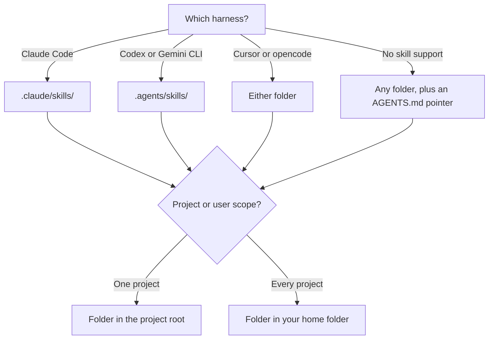

# How to install the skills from a release

> **Goal:** Use the audit and implement skills in your own project without a clone of this repository.
> **Audience:** Users of Claude Code, Codex, Gemini CLI, Cursor, opencode, or an agent that reads `AGENTS.md`
> **Status:** Live. Only Claude Code and opencode have run an installed bundle; see
> [harness notes](../reference/harness-notes.md). Every other path on this page is untested.

---

## Prerequisites

- [ ] Python 3.11 or newer on `PATH`
- [ ] `curl` (or a browser), `unzip` and `sha256sum` (on macOS: `shasum -a 256`)
- [ ] Optional, for Step 2b: the [GitHub CLI](https://cli.github.com/) (`gh`). This page was checked with 2.102.0

The quicker path is a clone: see the quick start in the root [`README.md`](../../README.md). Use this page when you
want the skills inside another project instead.

> [!NOTE]
> Native Windows is not tested. A stock Windows has no `unzip` or `sha256sum`, and `python3` may be `py` there.

---

## Step 1: Download the release files

Open the [releases page](https://github.com/Nistapp/codebase-agentic-readiness-framework/releases) and pick a tag,
for example `v0.3.0`. Download three files into an empty folder:

- `agentic-readiness-audit-<tag>.zip`
- `agentic-readiness-implement-<tag>.zip`
- `SHA256SUMS`

## Step 2: Check the files

```bash
sha256sum --ignore-missing -c SHA256SUMS
```

Expect `OK` for each zip. On macOS, use `shasum -a 256 --ignore-missing -c SHA256SUMS`. Do not use a zip that fails
this check.

## Step 2b (optional): Check the build provenance

The checksums prove that a file was not damaged. The build provenance also proves that the file was built by this
repository's release workflow, from the tag you picked.

1. Also download `<tag>.sigstore.json` from the release page.
2. Run this command for each zip. Replace `<tag>` with the tag, for example `v0.3.3`:

   ```bash
   gh attestation verify agentic-readiness-audit-<tag>.zip \
     --repo Nistapp/codebase-agentic-readiness-framework \
     --source-ref refs/tags/<tag> \
     --bundle <tag>.sigstore.json
   ```

The command exits with 0 when the file passes. Do not use a file that fails. With `--bundle`, you do not need a
GitHub login. Without it, `gh` fetches the attestation from GitHub and asks you to run `gh auth login` first.
Releases up to v0.3.2 have no provenance.

## Step 3: Pick the skills folder

Each harness looks for skills in its own folders. Two folders reach every harness named here:

- `.claude/skills/` for Claude Code. opencode and Cursor read it too.
- `.agents/skills/`, the shared folder. Codex, Gemini CLI, Cursor and opencode read it. Claude Code does not.

Pick the scope too. A **project** folder sits in the project root and serves that project only. A **user** folder
sits in your home folder and serves every project on the machine.

| Harness | Project folder | User folder | Tested with this bundle |
| --- | --- | --- | --- |
| Claude Code | `.claude/skills/` | `~/.claude/skills/` | Yes: project folder, audit skill |
| Codex | `.agents/skills/` | `~/.agents/skills/` | No |
| Gemini CLI | `.agents/skills/` (or `.gemini/skills/`) | `~/.agents/skills/` (or `~/.gemini/skills/`) | No |
| Cursor | `.agents/skills/` or `.claude/skills/` | `~/.agents/skills/` or `~/.claude/skills/` | No |
| opencode | `.claude/skills/` or `.agents/skills/` | `~/.claude/skills/` or `~/.agents/skills/` | Yes: `.claude/skills/`, audit skill |

The folder lists come from each vendor's docs, linked with the date checked in
[harness notes](../reference/harness-notes.md#vendor-docs). The sections below give the details per harness.



Install the skills into one folder only. Cursor and opencode read both folders, so a second copy may list each skill
twice. This is inferred from their docs, not tested.

## Step 4: Unzip both bundles side by side

Unzip both zips into the same skills folder. This example uses the `.claude/skills/` folder of a project:

```bash
mkdir -p /path/to/project/.claude/skills
unzip agentic-readiness-audit-<tag>.zip -d /path/to/project/.claude/skills
unzip agentic-readiness-implement-<tag>.zip -d /path/to/project/.claude/skills
```

For another folder, change the path only:

| Folder | Path to give `mkdir -p` and `unzip -d` |
| --- | --- |
| Project, shared folder | `/path/to/project/.agents/skills` |
| User, Claude Code | `~/.claude/skills` |
| User, shared folder | `~/.agents/skills` |

> [!IMPORTANT]
> Keep both bundles in one folder, from the same release. The implement skill has no engine of its own. Its
> `scripts/tools/engine.py` loads `../agentic-readiness-audit/scripts/tools/engine.py`, and its `SKILL.md` runs the
> engine by that path. With the audit bundle in another folder, the implement skill stops at its first step.

To upgrade, unzip a newer release over the old folders.

## Claude Code

Claude Code reads `.claude/skills/` in the folder where you start it, and in each parent folder up to the
repository root. The user folder is `~/.claude/skills/`. It does not read `.agents/skills/`.

The audit bundle was run from a project's `.claude/skills/` folder. The `Skill` tool found it with no restart. The
implement bundle and the user folder are not yet tested as installed skills.

## Codex

Codex reads `.agents/skills/` in the folder where you start it, in its parent folder, and in the repository root.
The user folder is `~/.agents/skills/`. Codex does not read `.claude/skills/`. Untested with this bundle.

## Gemini CLI

Gemini CLI reads `.gemini/skills/` and `.agents/skills/` in the workspace, and `~/.gemini/skills/` and
`~/.agents/skills/` for the user. When both folders of one scope hold a skill, `.agents/skills/` wins. Untested with
this bundle.

Its docs say that Antigravity CLI replaced Gemini CLI on 2026-06-18. This page does not cover Antigravity CLI.

## Cursor

Cursor reads `.agents/skills/` and `.cursor/skills/` in the project, and the same folders under your home folder.
For compatibility it also reads `.claude/skills/` and `.codex/skills/`, in both scopes. Untested with this bundle.

## opencode

opencode reads `.opencode/skills/`, `.claude/skills/` and `.agents/skills/`, from the current folder up to the
project root. The user folders are `~/.config/opencode/skills/`, `~/.claude/skills/` and `~/.agents/skills/`.

The audit bundle was run from a project's `.claude/skills/` folder. The other folders and the implement bundle are
untested.

## A harness with no skill support

Some agents read `AGENTS.md` but do not discover skills. Unzip both bundles into any one folder, for example
`.agents/skills/`. Then add this section to the project's `AGENTS.md`, with your folder in the paths:

```markdown
## Agentic-readiness skills

- To audit a repository for agentic readiness, read `.agents/skills/agentic-readiness-audit/SKILL.md` and follow it.
- To implement the fixes from an audit report, read `.agents/skills/agentic-readiness-implement/SKILL.md` and
  follow it.
- Run each tool command from the folder of the skill you follow.
```

This pointer is untested in every harness.

## Step 5: Use them

Start the harness in that project and say, for example, "Audit /path/to/repo and write the output to /path/to/out".
Later, say "Start implementing the fixes on /path/to/repo based on /path/to/out/\<report\>.json".

Each `SKILL.md` names its tools by a path from the skill's own folder, for example `python3 scripts/tools/report.py`.
The agent runs each tool command from that folder.

## Step 6: Check the result

Ask the agent which skills it has. Expect `agentic-readiness-audit` and `agentic-readiness-implement`. Then run
the audit engine's self-description from the audit skill's folder:

```bash
python3 scripts/tools/engine.py --describe
```

Expect exit 0 and one JSON envelope with `"ok": true`.

## Troubleshooting

| Symptom | Fix |
| --- | --- |
| The skill does not start | Check that `<skills folder>/agentic-readiness-audit/SKILL.md` exists, and that your harness reads that folder (Step 3). |
| A tool says Python is too old | Install Python 3.11 or newer and make sure `python3` runs it. |
| A tool cannot find its file | Run the command from the skill's own folder, the one that holds its `SKILL.md`. |
| The implement skill cannot find the engine | Install the audit bundle beside it, in the same folder, from the same release. |
