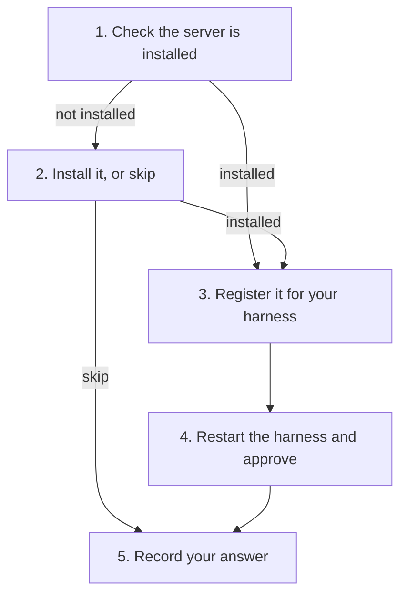

# How to set up the agent tools

> **Goal:** Give your coding agent the code index (`codebase-memory-mcp`) in this repository, or decide to skip it.
> **Audience:** Contributors, interns included, and AI coding agents. You know basic shell commands.
> **Status:** Live.

---

An agent tool is an MCP server: a program that your coding agent (the harness) starts and asks questions. This
repository lists one, `codebase-memory-mcp`, in `.mcp.json`. It gives the agent a graph of the code: functions,
callers and dependencies. The agent then reads fewer whole files.

The tool is optional. No gate, CI job or release step needs it. If you skip it, the agent searches and reads files
instead, and every check still gives the same result. The rules are in
[ADR 0006](../architecture/adrs/0006-first-run-agent-tool-offer.md).

This page uses these terms:

| Term | Meaning |
| --- | --- |
| Harness | The program that runs the agent: Claude Code, VS Code with Copilot, Cursor, Gemini CLI, opencode or Codex CLI |
| MCP server | A program that the harness starts to give the agent extra tools |
| Project scope | The setting applies to this clone only |
| User scope | The setting applies to every repository you open with that harness |

## Prerequisites

- Python 3.11 or newer on `PATH`.
- A clone of this repository.

## Steps



### Step 1: Check that the server is installed

```bash
python3 dev/mcp_config.py check
```

The output gives the version, or `not on PATH` and the install routes.

### Step 2: Install the server, or skip it

Install it only if you want it. These are the routes from the server's own documentation:

| System | Command |
| --- | --- |
| macOS or Linux | `curl -fsSL https://raw.githubusercontent.com/DeusData/codebase-memory-mcp/main/install.sh \| bash -s -- --skip-config` |
| Any, with Node | `npm install -g codebase-memory-mcp` |
| Windows | Follow the [quick start](https://github.com/DeusData/codebase-memory-mcp#quick-start) |

Keep `--skip-config`. Without it, the installer also writes its own settings into every harness it finds. With it,
you install the program only, and step 3 adds the one entry you want.

To skip the tool, go to step 5.

### Step 3: Register the server for your harness

Claude Code and VS Code read `.mcp.json` directly. For them, there is nothing to write.

For another harness, look at the entry first, then write it:

```bash
python3 dev/mcp_config.py show --harness opencode
python3 dev/mcp_config.py write --harness opencode
```

The names are `cursor`, `gemini`, `opencode` and `codex`. The default is project scope. Add `--scope user` to
register the server for every repository. Git ignores the project files that the tool writes
(`opencode.json`, `.cursor/`, `.gemini/`, `.codex/`), so they never go into a commit. If the file already has a
different entry with the same name, the tool stops and changes nothing.

### Step 4: Restart the harness and approve the server

| Harness | What you do |
| --- | --- |
| Claude Code | Approve `codebase-memory-mcp` when Claude Code asks. `/mcp` shows its state |
| VS Code with Copilot | Trust the folder. The server starts with no other prompt |
| Cursor | Turn the server on in the MCP settings |
| Gemini CLI | Trust the folder when Gemini CLI asks |
| opencode | Nothing. opencode connects the server with no prompt |
| Codex CLI | Trust the project. Codex loads `.codex/config.toml` only for a trusted project |

### Step 5: Record your answer

```bash
python3 dev/mcp_config.py record --harness opencode --answer accepted
```

Use `--answer declined` when you skip. The answer goes into `.agentic-readiness/setup.json`, which git ignores.
The agent then does not ask again for that harness.

## Verification

```bash
python3 dev/mcp_config.py status --harness opencode
```

The output is `asked: accepted on <date>` or `asked: declined on <date>`. In the harness, the server shows as
connected (for example in Claude Code's `/mcp` list).

## Undo

- Remove the entry from the harness's file, or delete the git-ignored project file.
- In Claude Code, run `claude mcp reset-project-choices` to be asked to approve again.
- Delete `.agentic-readiness/setup.json` to get the offer again.

## For agents: the first-run offer

`AGENTS.md` sends you here when you start a change to this repository. Do not make the offer when the person only
wants to audit or implement another repository.

1. Name your harness. Use your own knowledge first. `CLAUDECODE=1` in the environment confirms Claude Code. If
   you are not sure, ask the person.
2. Run `python3 dev/mcp_config.py status --harness <name>`. If it prints `asked: ...`, stop here.
3. Run `python3 dev/mcp_config.py check`.
4. Explain the server in two sentences: what it gives you and what it needs. Then ask one question: set it up now,
   or not now. Name the scope: project scope by default.
5. If the person says no, record `--answer declined` and continue with their task.
6. If the person says yes:
   - When the server is not installed, show the install routes from step 2. Never run an installer yourself.
   - Run `show`, then `write` for the person's harness and scope. For Claude Code and VS Code, explain the
     approval instead (step 4).
   - Run `check` again, and tell the person to restart the harness.
   - Record `--answer accepted`.
7. Ask once. Make the offer again only when the person asks for it.
