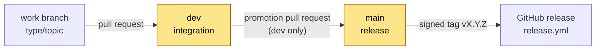

# Branch protection

**Status:** see [Current state](#current-state). Two repository rulesets protect the two long-lived branches, `dev`
and `main`. The decision and its reasons are in
[ADR 0002](../architecture/adrs/0002-dev-integrates-main-releases.md). The procedures that use these rules are in
[`RELEASE_PROCESS.md`](../../RELEASE_PROCESS.md) and [Contribute a change](../how-to/contribute-a-change.md).

## The branch model

| Branch | Purpose | Accepts | Direct commits |
| --- | --- | --- | --- |
| `dev` | The integration branch and the default branch. Every change goes here first | Pull requests from any branch, `main` included | Blocked |
| `main` | The release branch. It holds released work only | Pull requests from `dev` only | Blocked |
| `<type>/<topic>` | A work branch, for example `fix/report-score`. Start it from `dev` | Your commits | Allowed |



The two highlighted branches are protected. Nobody pushes to them directly, the maintainer included.

## Rules

The rulesets are declared in [`.github/rulesets/`](../../.github/rulesets/). Those files are the source of truth.
This table is a summary of them.

| Rule | `dev` ([`dev-protection.json`](../../.github/rulesets/dev-protection.json)) | `main` ([`main-protection.json`](../../.github/rulesets/main-protection.json)) |
| --- | --- | --- |
| Changes arrive through a pull request | Required | Required |
| Required approvals | 0 | 0 |
| Required status checks | `CI Gate` | `CI Gate` and `Check source branch` |
| Branch up to date before merge | Required | Not required (see below) |
| Conversations resolved before merge | Required | Required |
| Allowed merge method | Merge commit only | Merge commit only |
| Force pushes | Blocked | Blocked |
| Branch deletion | Blocked | Blocked |
| Bypass actors | None | None |
| Source branch of a pull request | Any branch | `dev` in this repository only |

Notes:

- **Merge commit only.** A squash joins several Conventional Commits into one. A rebase rewrites them. A merge commit
  keeps each commit, so each one can be reverted alone.
- **0 approvals.** A pull request is required, but an approval is not. The maintainer is the only person who merges.
- **`main` does not require an up-to-date branch.** Only promotion pull requests from `dev` merge into `main`, and
  nothing else writes to `main`. So `dev` always has every file change that `main` has. A strict rule would force a
  pull request from `main` into `dev` after each release, with no file change.
- **The source branch.** A ruleset cannot restrict the source branch of a pull request. The required check
  `Check source branch` does it (see [The required checks](#the-required-checks)).

## The required checks

Both checks come from GitHub Actions (integration id `15368`).

### `CI Gate`

`CI Gate` is the last job in [`.github/workflows/ci.yml`](../../.github/workflows/ci.yml). CI runs on every pull
request and on every push to `dev` and `main`. `CI Gate` needs five jobs and fails unless each one succeeded:

| Job | What it runs |
| --- | --- |
| `check` | `make check` on Ubuntu and macOS, Python 3.11 and 3.14 |
| `security` | `make security` |
| `coverage` | `make coverage`, which fails below the floor in `.coveragerc` |
| `self-audit` | `make self-audit`: the engine on this repository; exit 2 when a finding appears that `.audit-baseline.json` did not have |
| `docs` | `make docs-lint` and the Mermaid render check, when Markdown changed |

The rulesets require `CI Gate` alone. Thus a new matrix leg or a renamed job never needs a ruleset change. Add a new
job to `needs:` in the workflow, not to the rulesets.

### `Check source branch`

[`.github/workflows/pr-source-branch.yml`](../../.github/workflows/pr-source-branch.yml) runs on every pull request
into `main`: when it is opened, reopened, updated or edited. It passes only when the head branch is `dev` and the
head repository is this repository. Otherwise it fails with this message:

```text
A pull request into main must come from the dev branch of Nistapp/codebase-agentic-readiness-framework.
```

Pull requests into `dev` do not run this workflow. The `dev` ruleset does not require it.

## Current state

| Ruleset | Target | State on GitHub |
| --- | --- | --- |
| `main protection` (id 26750008) | `refs/heads/main` | Active since 2026-11-07. Updated to [`main-protection.json`](../../.github/rulesets/main-protection.json) on 2026-11-08 |
| `dev protection` (id 26787626) | `refs/heads/dev` | Active since 2026-11-08, from [`dev-protection.json`](../../.github/rulesets/dev-protection.json) |

On 2026-11-08 the default branch changed from `main` to `dev`.

On 2026-11-07 these settings were also turned on: private vulnerability reporting, secret scanning, push protection
and Dependabot security updates (see [`SECURITY.md`](../../SECURITY.md)).

To read the rules that apply to a branch, run these commands:

```bash
gh api repos/Nistapp/codebase-agentic-readiness-framework/rules/branches/main
gh api repos/Nistapp/codebase-agentic-readiness-framework/rules/branches/dev
```

An empty list (`[]`) means that no rule applies to that branch.

## How the maintainer changes a ruleset

Only the maintainer changes a ruleset. A session of an AI agent changes a ruleset only when the maintainer asks for
that change in that session.

1. Change the JSON file in `.github/rulesets/` on a work branch.
2. Change the [Rules](#rules) table on this page in the same commit.
3. Merge the change into `dev` through a pull request.
4. Find the id of the ruleset:

   ```bash
   gh api repos/Nistapp/codebase-agentic-readiness-framework/rulesets --jq '.[] | [.id, .name] | @tsv'
   ```

5. Apply the file. Use `PUT` with the id to change a ruleset. Use `POST` without an id to create one:

   ```bash
   gh api -X PUT repos/Nistapp/codebase-agentic-readiness-framework/rulesets/<id> \
     --input .github/rulesets/main-protection.json
   gh api -X POST repos/Nistapp/codebase-agentic-readiness-framework/rulesets \
     --input .github/rulesets/dev-protection.json
   ```

6. Read the rules back with the `rules/branches/<branch>` commands in [Current state](#current-state).
7. Update the [Current state](#current-state) table with the date.

> [!WARNING]
> Create the `dev` ruleset only after the `dev` branch exists on GitHub. The ruleset requires a pull request for every
> change to `dev`, and the first push that creates the branch is also a change to `dev`.

GitHub shows a required check in the web settings only after that check has run once. The API accepts the check name
before that.

## Who merges

A session of an AI agent never pushes, tags or merges in this repository (the rule is in
[`AGENTS.md`](../../AGENTS.md); [ADR 0003](../../implement/docs/architecture/adrs/0003-push-and-pr-policy.md) covers
the target repositories). The maintainer pushes, opens the promotion pull request, merges and tags.
