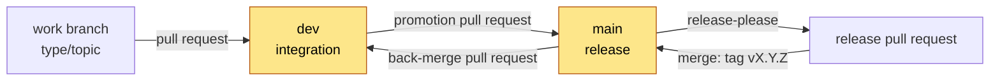

# Branch protection

**Status:** see [Current state](#current-state). Two repository rulesets protect the two long-lived branches, `dev`
and `main`. The decision and its reasons are in
[ADR 0002](../architecture/adrs/0002-dev-integrates-main-releases.md) and, for the release pull request,
[ADR 0005](../architecture/adrs/0005-release-please-cuts-releases.md). The procedures that use these rules are in
[`RELEASE_PROCESS.md`](../../RELEASE_PROCESS.md) and [Contribute a change](../how-to/contribute-a-change.md).

## The branch model

| Branch | Purpose | Accepts | Direct commits |
| --- | --- | --- | --- |
| `dev` | The integration branch and the default branch. Every change goes here first | Pull requests from any branch, including the back-merge branch `chore/back-merge-vX.Y.Z` | Blocked |
| `main` | The release branch. It holds released work only | Pull requests from `dev`, and the release pull request from `release-please--branches--main` | Blocked |
| `release-please--branches--main` | release-please's release branch. The bot writes it | The bot's commits | Allowed (bot only by convention) |
| `<type>/<topic>` | A work branch, for example `fix/report-score`. Start it from `dev` | Your commits | Allowed |



The two highlighted branches are protected. Nobody pushes to them directly, the maintainer included.

## Rules

The rulesets are declared in [`.github/rulesets/`](../../.github/rulesets/). Those files are the source of truth.
This table is a summary of them.

| Rule | `dev` ([`dev-protection.json`](../../.github/rulesets/dev-protection.json)) | `main` ([`main-protection.json`](../../.github/rulesets/main-protection.json)) |
| --- | --- | --- |
| Changes arrive through a pull request | Required | Required |
| Required approvals | 0 | 0 |
| Required status checks | `CI Gate` | `CI Gate` and `Check source branch` |
| Branch up to date before merge | Required | Not required (see below) |
| Conversations resolved before merge | Required | Required |
| Allowed merge method | Merge commit only | Merge commit only |
| Force pushes | Blocked | Blocked |
| Branch deletion | Blocked | Blocked |
| Bypass actors | None | None |
| Source branch of a pull request | Any branch | `dev` in this repository, or `release-please--branches--main` opened by a bot |

Notes:

- **Merge commit only.** A squash joins several Conventional Commits into one. A rebase rewrites them. A merge commit
  keeps each commit, so each one can be reverted alone.
- **0 approvals.** A pull request is required, but an approval is not. The maintainer is the only person who merges.
- **`main` does not require an up-to-date branch.** Promotions from `dev` and the release pull request both merge into
  `main`. A strict rule would make each wait for, or update with, the other.
- **The back-merge comes from its own branch.** `dev` requires an up-to-date branch. A pull request whose head is
  `main` could only be updated by a push to `main`, which the `main` ruleset refuses. So the back-merge pull request
  comes from `chore/back-merge-vX.Y.Z`, a branch at the release commit.
- **The source branch.** A ruleset cannot restrict the source branch of a pull request. The required check
  `Check source branch` does it (see [The required checks](#the-required-checks)).

## The required checks

Both checks come from GitHub Actions (integration id `15368`).

### `CI Gate`

`CI Gate` is the last job in [`.github/workflows/ci.yml`](../../.github/workflows/ci.yml). CI runs on every pull
request and on every push to `dev` and `main`. `CI Gate` needs eleven jobs and fails unless each one succeeded.
The jobs run on Ubuntu (issue #82 tracks macOS and Windows). The first six run the steps of `make check` at once;
`dev/tests/test_ci_parity.py` fails when a step of `check` has no job:

| Job | What it runs |
| --- | --- |
| `static` | `make format-check typecheck verify-rules recipe-lint masters-check workflow-lint spell` |
| `crosscheck` | `make crosscheck` on Python 3.11 and 3.14 |
| `test-engine` | `make coverage-engine`: the engine's suite under coverage.py, on Python 3.11 |
| `test-tools` | `make coverage-audit-tools coverage-implement-tools` on Python 3.11 |
| `test-dev` | `make test-dev` on Python 3.11 |
| `test-py314` | `make test verify-rules` on Python 3.14; on Linux `make test` runs its four suites at once |
| `coverage` | `make coverage-combine`: merges the suites' data files and fails below the floor in `.coveragerc` |
| `security` | `make security` |
| `self-audit` | `make self-audit`: the engine on this repository; exit 2 when a finding appears that `.audit-baseline.json` did not have |
| `docs` | `make docs-lint` and the Mermaid render check, when Markdown changed |
| `commits` | `dev/commit_lint.py` on each commit that the pull request or push adds: Conventional Commits subjects; merge commits are skipped |

The rulesets require `CI Gate` alone. Thus a new matrix leg or a renamed job never needs a ruleset change. Add a new
job to `needs:` in the workflow, not to the rulesets.

### `Check source branch`

[`.github/workflows/pr-source-branch.yml`](../../.github/workflows/pr-source-branch.yml) runs on every pull request
into `main`: when it is opened, reopened, updated or edited. The head repository must be this repository. Then it
passes in two cases:

- The head branch is `dev`: a promotion pull request.
- The head branch is `release-please--branches--main` and the pull request was opened by a bot (user type `Bot`):
  the release pull request. A person who names a branch that way still fails the check.

Otherwise it fails with this message:

```text
A pull request into main must come from the dev branch of Nistapp/codebase-agentic-readiness-framework, or be the release pull request that release-please opens. Open your pull request against dev. See RELEASE_PROCESS.md.
```

Pull requests into `dev` do not run this workflow. The `dev` ruleset does not require it.

## Code scanning

[`.github/workflows/codeql.yml`](../../.github/workflows/codeql.yml) runs CodeQL on the Python code and on the
workflows. It runs on each pull request into `dev` or `main`, on each push to `dev`, and every Monday. It does not
scan the engine's test fixtures (`audit/engine/tests/fixtures/`), because they hold flawed code on purpose. It does
not scan JavaScript or TypeScript, because the only such files are those fixtures.

[`.github/workflows/scorecard.yml`](../../.github/workflows/scorecard.yml) runs OpenSSF Scorecard on each push to
`dev` and every Monday. It scores the repository's security practices, such as pinned actions, token permissions and
signed releases. Each low score shows as an alert in the Security tab, in the `scorecard` category. The results are
also published (`publish_results: true`, the maintainer's decision on 2026-11-09). The workflow signs each result and
sends it to the public OpenSSF API. The latest score is on
[scorecard.dev](https://scorecard.dev/viewer/?uri=github.com/Nistapp/codebase-agentic-readiness-framework) and in the
badge at the top of [`README.md`](../../README.md). How each alert is handled: [Scorecard alerts](#scorecard-alerts).

Code scanning is advisory. No ruleset requires the CodeQL or the Scorecard workflow, and an alert does not block a
merge. The
maintainer handles an alert in the Security tab:

1. Fix the code in a pull request into `dev`. The alert closes when the fix reaches `dev`.
2. Or dismiss the alert as "false positive" or "used in tests", with a one-line reason.

A later change may add the ruleset rule "Require code scanning results" to `dev-protection.json`. That change needs
the maintainer.

### Scorecard alerts

The first Scorecard run on `dev` (2026-11-09) scored 7 checks below 10. Each one raised an alert. The table gives
each check, what it measures, why the score is low, and how it is handled. Scorecard rates each check 0 to 10.

| Check | Score | What it measures | Why the score is low | Handling |
| --- | --: | --- | --- | --- |
| Branch-Protection | 3 | The rules on `dev` and `main` | No approving review is required. "Dismiss stale reviews", "require review from code owners" and "require approval of the most recent push" are off; each only acts when a review is required. `main` does not require an up-to-date branch, on purpose (see [Rules](#rules)) | Open. A solo maintainer cannot approve their own pull request, so a required review would block every merge. Revisit when a second maintainer joins |
| Code-Review | 0 | Whether recent changes had an approving review | 0 of the last 4 merged changes had one: the maintainer merges their own pull requests | Dismissed as "won't fix", for the same reason |
| Maintained | 0 | Recent commits and issue activity | The repository is younger than 90 days. Scorecard scores every new repository 0 | Open. It clears by itself after 90 days |
| SAST | 8 | Whether a code scanner runs on every commit | Only 13 of the last 30 commits were scanned, because CodeQL started on 2026-11-09 | Open. It rises as CodeQL scans new commits |
| Vulnerabilities | 9 | Known vulnerabilities in the dependencies, from OSV | `GO-2026-5932` in osv-scanner's Go module. `make security` accepts it, but its ignore file was not next to that `go.mod` | Fixed: each `osv-scanner.toml` now sits next to its lockfiles ([Dependency audit](dev-tooling.md#dependency-audit)) |
| Fuzzing | 0 | Whether a fuzzer runs on the code | No fuzzer | Dismissed as "won't fix". The engine and tools are standard-library Python that reads files; their tests and fixtures cover the inputs |
| CII-Best-Practices | 0 | An OpenSSF Best Practices badge | None applied for | Open. The badge is a self-assessment on [bestpractices.dev](https://www.bestpractices.dev/); optional |

The other checks score 10, or do not apply. The full, current list is on the
[score page](https://scorecard.dev/viewer/?uri=github.com/Nistapp/codebase-agentic-readiness-framework).

## Current state

| Ruleset | Target | State on GitHub |
| --- | --- | --- |
| `main protection` (id 26750008) | `refs/heads/main` | Active since 2026-11-07. Updated to [`main-protection.json`](../../.github/rulesets/main-protection.json) on 2026-11-08 |
| `dev protection` (id 26787626) | `refs/heads/dev` | Active since 2026-11-08, from [`dev-protection.json`](../../.github/rulesets/dev-protection.json) |

On 2026-11-08 the default branch changed from `main` to `dev`.

On 2026-11-07 these settings were also turned on: private vulnerability reporting, secret scanning, push protection
and Dependabot security updates (see [`SECURITY.md`](../../SECURITY.md)).

On 2026-11-09 the CodeQL and Scorecard workflows were added. Code scanning default setup stays off: the CodeQL
workflow replaces it (see [Code scanning](#code-scanning)).

On 2026-11-08 "Automatically delete head branches" was turned on. GitHub deletes the head branch of a pull request
when the pull request is merged. It does not delete `dev` after a promotion pull request, because the `dev` ruleset
blocks deletion. To check the setting, run this command:

```bash
gh api repos/Nistapp/codebase-agentic-readiness-framework --jq .delete_branch_on_merge
```

To read the rules that apply to a branch, run these commands:

```bash
gh api repos/Nistapp/codebase-agentic-readiness-framework/rules/branches/main
gh api repos/Nistapp/codebase-agentic-readiness-framework/rules/branches/dev
```

An empty list (`[]`) means that no rule applies to that branch.

## How the maintainer changes a ruleset

Only the maintainer changes a ruleset. A session of an AI agent changes a ruleset only when the maintainer asks for
that change in that session.

1. Change the JSON file in `.github/rulesets/` on a work branch.
2. Change the [Rules](#rules) table on this page in the same commit.
3. Merge the change into `dev` through a pull request.
4. Find the id of the ruleset:

   ```bash
   gh api repos/Nistapp/codebase-agentic-readiness-framework/rulesets --jq '.[] | [.id, .name] | @tsv'
   ```

5. Apply the file. Use `PUT` with the id to change a ruleset. Use `POST` without an id to create one:

   ```bash
   gh api -X PUT repos/Nistapp/codebase-agentic-readiness-framework/rulesets/<id> \
     --input .github/rulesets/main-protection.json
   gh api -X POST repos/Nistapp/codebase-agentic-readiness-framework/rulesets \
     --input .github/rulesets/dev-protection.json
   ```

6. Read the rules back with the `rules/branches/<branch>` commands in [Current state](#current-state).
7. Update the [Current state](#current-state) table with the date.

> [!WARNING]
> Create the `dev` ruleset only after the `dev` branch exists on GitHub. The ruleset requires a pull request for every
> change to `dev`, and the first push that creates the branch is also a change to `dev`.

GitHub shows a required check in the web settings only after that check has run once. The API accepts the check name
before that.

## Who merges

A session of an AI agent never pushes, tags or merges in this repository (the rule is in
[`AGENTS.md`](../../AGENTS.md); [ADR 0003](../../implement/docs/architecture/adrs/0003-push-and-pr-policy.md) covers
the target repositories). The maintainer pushes, opens the promotion pull request and merges. release-please opens the
release and back-merge pull requests and tags ([`RELEASE_PROCESS.md`](../../RELEASE_PROCESS.md)).
