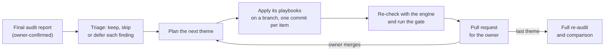

# Implement master list

> **Audience:** CTOs, senior engineers and anyone who wants to know what an implement run changes.
> **Source of truth:** the playbooks in [`implement/playbooks/`](../../implement/playbooks/README.md) and
> [`catalogue.json`](../../audit/catalogue.json).
>
> **Generated** by [`dev/build_masters.py`](../../dev/build_masters.py) from the playbooks and the catalogue. Do not
> edit it by hand: change a source, then run `make update-masters`. `make check` fails when this page is stale.

---

An implement run closes the confirmed findings of an audit with **13 playbooks** in 8 themes. Each theme is one branch
and one pull request in the audited repository. The agent never merges: the owner reviews and merges each pull request,
and can skip or defer any finding. Each playbook below says what it achieves, what it changes per check, and what it
never does. The checks themselves are in the [audit master list](audit-master.md).

## At a glance

Themes run in dependency order: the order and the dependencies are in
[`implement/SKILL.md`](../../implement/SKILL.md#themes).

| Theme | Playbooks | Checks closed |
|---|---|---|
| [T1 Command surface and quality tools](#t1-command-surface-and-quality-tools) | [`define-command-surface`](#define-command-surface), [`configure-quality-tools`](#configure-quality-tools) | 10 |
| [T2 Execution determinism](#t2-execution-determinism) | [`pin-execution-environment`](#pin-execution-environment), [`untrack-generated`](#untrack-generated) | 6 |
| [T3 Secrets and env](#t3-secrets-and-env) | [`env-inventory-and-secrets`](#env-inventory-and-secrets) | 4 |
| [T4 CI parity, hooks, commits](#t4-ci-parity-hooks-commits) | [`add-ci-parity`](#add-ci-parity), [`add-hooks-and-commit-rules`](#add-hooks-and-commit-rules) | 8 |
| [T5 Tests and baselines](#t5-tests-and-baselines) | [`add-baselines-and-ratchet`](#add-baselines-and-ratchet) | 8 |
| [T6 Docs and navigation](#t6-docs-and-navigation) | [`establish-docs-contract`](#establish-docs-contract) | 10 |
| [T7 AGENTS.md and governance](#t7-agentsmd-and-governance) | [`adapt-agents-md`](#adapt-agents-md), [`add-deny-rules`](#add-deny-rules) | 17 |
| [T8 Hygiene and index](#t8-hygiene-and-index) | [`add-repo-hygiene`](#add-repo-hygiene), [`register-index`](#register-index) | 14 |

## T1 Command surface and quality tools

### `define-command-surface`

The repository exposes the seven verbs of [`spec/command-surface.md`](../../spec/command-surface.md) on one
authoritative runner per component, `check` composes `format:check`, `typecheck` and `test` in that order, any
second runner only delegates, and no read-only verb writes to the working tree.

| Check | What the playbook does |
|---|---|
| [`CMD-01` Seven verbs resolvable on one runner](audit-master.md#cmd-01-seven-verbs-resolvable-on-one-runner) | Defines every missing verb on the authoritative runner |
| [`CMD-02` check composes the read-only verbs](audit-master.md#cmd-02-check-composes-the-read-only-verbs) | Makes `check` compose the three concerns |
| [`CMD-03` No divergent second definition](audit-master.md#cmd-03-no-divergent-second-definition) | Turns any second runner into a delegate |
| [`CMD-04` Write verbs separated from read-only verbs](audit-master.md#cmd-04-write-verbs-separated-from-read-only-verbs) | Splits write forms out of read-only verbs |
| [`EXEC-03` Non-interactive setup path](audit-master.md#exec-03-non-interactive-setup-path) | Names the non-interactive setup command beside the verbs (short section in Steps) |
| [`TST-01` Test verb exists, suite non-empty](audit-master.md#tst-01-test-verb-exists-suite-non-empty) | Makes `test` resolve on the runner (short section in Steps) |

**What it never does:**

- Do not create a second runner that composes its own `check`.
- Do not make `check` pass by dropping `test` or `typecheck`, or by `-x test`, unless the owner chose it.
- Do not add a verb that does nothing (`echo skipped`), and do not leave `--fix` or `--write` under a
  read-only verb name.
- Do not restructure a multi-component repository into one workspace.
- Do not rewrite the instruction file; add the command lines only.

Full playbook: [`define-command-surface.md`](../../implement/playbooks/define-command-surface.md).

### `configure-quality-tools`

The repository has a formatter, a linter, a type checker in its strictest practical mode and a dependency
scan, each configured in a committed file and reachable through its verb, adopted so that today's code keeps
`check` green and existing debt is counted, recorded and cannot grow.

| Check | What the playbook does |
|---|---|
| [`TOOL-01` Formatter configured](audit-master.md#tool-01-formatter-configured) | `format`, `format:check` |
| [`TOOL-02` Linter configured](audit-master.md#tool-02-linter-configured) | `lint` |
| [`TOOL-03` Type checker configured](audit-master.md#tool-03-type-checker-configured) | `typecheck` |
| [`TOOL-04` Dependency / security scan verb](audit-master.md#tool-04-dependency--security-scan-verb) | `security` |

**What it never does:**

- No mass reformat and no mass auto-fix of the tree, unless the owner chooses it (then its own pull request).
- No rule turned off and no blanket suppression to get green; a baseline file is recorded as debt.
- No dependency upgrade of an existing tool as part of T1.
- No tool the owner did not approve, and no version range: pin exact versions.
- No secrets scanner inside `security`; no placeholder `security` verb.
- Do not put a failing strict check inside `check` without the owner's recorded agreement.

Full playbook: [`configure-quality-tools.md`](../../implement/playbooks/configure-quality-tools.md).

## T2 Execution determinism

### `pin-execution-environment`

Every run of the repository gets the same toolchain and the same dependency versions: each ecosystem has a
committed pin (JDK, Node, package manager), each component has a tracked lockfile that matches its manifest, the
pins in CI, Dockerfiles and version files agree with each other, and every tool version the gate runs sits in a
manifest that dependency automation reads.

| Check | What the playbook does |
|---|---|
| [`EXEC-01` Toolchain pinned / wrapper committed](audit-master.md#exec-01-toolchain-pinned--wrapper-committed) | Commits a pin for every detected ecosystem and makes every other place that names a version agree with it |
| [`EXEC-02` Lockfile committed and consistent](audit-master.md#exec-02-lockfile-committed-and-consistent) | Commits a lockfile that resolves exactly what the manifest resolves today |
| [`EXEC-03` Non-interactive setup path](audit-master.md#exec-03-non-interactive-setup-path) | Check only (step 9): [`define-command-surface`](../../implement/playbooks/define-command-surface.md) owns the fix |
| [`EXEC-08` Tool versions visible to dependency automation](audit-master.md#exec-08-tool-versions-visible-to-dependency-automation) | Moves each tool version written into a command into a manifest with a lockfile, and has the command read it (step 10) |

**What it never does:**

- Do not choose a runtime major for the owner, and do not move a major in this theme without the owner's
  decision and a green build on it.
- Do not hand-edit a lockfile or regenerate one that already passes.
- Do not run `npm install`, `npm update` or `./gradlew dependencies --update-locks` to "refresh" while
  locking: the point is to record what resolves today.
- Do not add a root workspace manifest to a per-component repository unless the owner asks.
- Do not edit workflow files without `ci.edits_authorised`.
- Do not build images or start containers by hand: use the repository's scripts.
- Do not install a version manager the owner did not approve.
- Do not upgrade a tool while moving its version into a manifest.

Full playbook: [`pin-execution-environment.md`](../../implement/playbooks/pin-execution-environment.md).

### `untrack-generated`

No build output is tracked in the repository, or the output that has to stay tracked says so in its first
lines, and every concern (lint, format, test, types, security) has one authoritative root config.

| Check | What the playbook does |
|---|---|
| [`EXEC-05` No generated artifacts committed in-tree](audit-master.md#exec-05-no-generated-artifacts-committed-in-tree) | Finds tracked build output, proves nothing reads the tracked copy, and untracks it with the owner's yes (or adds a header where one fits) |
| [`EXEC-07` No competing configs for one concern](audit-master.md#exec-07-no-competing-configs-for-one-concern) | Detection and documentation only (step 8): lists competing root configs, asks which is authoritative, documents deliberate delegation |

**What it never does:**

- Do not untrack a path that a deploy path reads, or may read, without the owner's recorded yes.
- Do not untrack a secret-bearing file here; that is the secrets theme's decision (rotation, history).
- Do not untrack a lockfile, the Gradle wrapper or any hand-written file the ignore rule matches by accident:
  fix the rule.
- Do not delete working-tree files (`git rm` without `--cached`) and do not rewrite history.
- Do not delete, merge or rename a competing config (EXEC-07).
- Do not start containers or the local stack by hand to test a reader.

Full playbook: [`untrack-generated.md`](../../implement/playbooks/untrack-generated.md).

## T3 Secrets and env

### `env-inventory-and-secrets`

An agent can list every variable a script, build or application reads without seeing one value: a committed
example file declares the names (required or optional), no secret-bearing file is tracked without a recorded
owner decision, and the ignore rules cover every secret shape the audit probes.

| Check | What the playbook does |
|---|---|
| [`EXEC-04` Env-var inventory complete](audit-master.md#exec-04-env-var-inventory-complete) | Builds the names-only inventory and commits an example file that declares every variable the code reads |
| [`SEC-01` .env untracked and ignored](audit-master.md#sec-01-env-untracked-and-ignored) | Finds tracked `.env`-shaped files and hands each to the owner for a decision; never edits one |
| [`SEC-02` No key-shaped strings in tracked files](audit-master.md#sec-02-no-key-shaped-strings-in-tracked-files) | Counts key-shaped lines by path and line number, wires the repository's existing scanner, never prints a hit |
| [`SEC-03` Ignore patterns cover secret shapes](audit-master.md#sec-03-ignore-patterns-cover-secret-shapes) | Adds the missing secret shapes to the ignore file, with a tracked-file check before and after |

**What it never does:**

- Do not print, quote, log or copy a value from any env, properties, realm, keystore or credentials file, and
  do not open a `.env`-like file.
- Do not rotate a credential, remove one from history or run a history-rewriting command: report and stop.
- Do not touch a tracked env file the owner keeps; do not add an ignore rule or `git rm --cached` for it.
- Do not re-raise a finding the owner rejected or skipped; new observations go to the pull request body.
- Do not template, edit or "clean" realm or identity-provider exports.
- Do not install a scanner the owner has not approved.
- Do not put shell builtins or script-internal names in the example file.
- Do not start containers or the local stack by hand to test a change; use the repository's scripts.

Full playbook: [`env-inventory-and-secrets.md`](../../implement/playbooks/env-inventory-and-secrets.md).

## T4 CI parity, hooks, commits

### `add-ci-parity`

The gate an agent runs locally is the gate CI runs. CI calls the same verbs (`check`, and `security` where it
exists), every scan or test step either blocks the merge or says in its name that it is report-only with its debt
recorded, and a committed record shows which CI job the platform requires before a merge.

| Check | What the playbook does |
|---|---|
| [`CI-01` Pipeline present, triggered on PRs](audit-master.md#ci-01-pipeline-present-triggered-on-prs) | Verification only in most repositories: a workflow with a pull-request trigger exists. Adds or fixes the trigger block when it does not |
| [`CI-02` Local↔CI parity](audit-master.md#ci-02-localci-parity) | CI runs the local verbs, directly or through a wrapper script that calls them |
| [`CI-03` CI-only steps flagged](audit-master.md#ci-03-ci-only-steps-flagged) | Every CI step is a local command; a step that exists only in CI is flagged in its name and in the CI doc |
| [`CI-04` CI enforces the same gate as the local check](audit-master.md#ci-04-ci-enforces-the-same-gate-as-the-local-check) | No gating step swallows its exit code; non-gating steps are visibly report-only; the required-check wiring is recorded with evidence |
| [`CI-05` Workflow files are linted](audit-master.md#ci-05-workflow-files-are-linted) | A workflow linter that knows the CI provider runs from the local surface and in CI |

**What it never does:**

- Do not add a third-party `uses:` action without owner approval; do not install a scanner the owner has not
  approved.
- Do not rename the merge-gate job, drop a job from its `needs`, or lower a gate that already blocks.
- Do not leave a green no-op (a step that prints "skipped" and exits 0), and do not hide debt: a non-blocking
  step says so in its name.
- Do not claim a required check exists without the owner-supplied evidence; do not mark CI-04 `done` where the
  platform cannot enforce it.
- Do not edit workflows outside a PR, or beyond the scope of `ci.edits_authorised`.
- Do not mass-fix findings the scan reveals.

Full playbook: [`add-ci-parity.md`](../../implement/playbooks/add-ci-parity.md).

### `add-hooks-and-commit-rules`

A commit runs a fast local hook chain before it is created, with one committed configuration and a documented
one-time install. The commit-message convention runs in two places with one type list: a local `commit-msg` stage,
so an agent learns of a bad subject before it pushes, and a CI step, which no `--no-verify` can skip. The owner may
instead record the pull-request title check as enough. A guard in the same chain refuses a commit on a protected
branch, so an agent learns it is on the wrong branch before it commits, not when the push is refused.

| Check | What the playbook does |
|---|---|
| [`TOOL-05` Local hook chain active](audit-master.md#tool-05-local-hook-chain-active) | Commits a hook-manager configuration the engine reads as wired, with fast changed-files hooks |
| [`TOOL-06` Commit convention enforced](audit-master.md#tool-06-commit-convention-enforced) | Writes the commit rule as a local `commit-msg` stage and a CI step (`PASS`); the owner may skip when the title check is enough (see Commit rule) |
| [`TOOL-07` Local guard against commits to a protected branch](audit-master.md#tool-07-local-guard-against-commits-to-a-protected-branch) | Adds a `pre-commit` guard in the same manager that names every protected branch (see [Branch guard](../../implement/playbooks/add-hooks-and-commit-rules.md#branch-guard)) |

**What it never does:**

- Do not install the hook manager on the owner's machine or add it as a repository dependency without approval.
- Do not run tests, a full lint, a full-tree format or any network call in a hook.
- Do not advise `--no-verify` or add a bypass variable, in the branch guard either.
- Do not re-propose a `skipped` commit-convention finding.
- Do not pick a manager by what looks familiar or by what this framework uses: detect, then recommend by stack.
- Do not duplicate the secret-scanner version: reuse the CI pin.

Full playbook: [`add-hooks-and-commit-rules.md`](../../implement/playbooks/add-hooks-and-commit-rules.md).

## T5 Tests and baselines

### `add-baselines-and-ratchet`

Every kind of existing debt the repository carries is counted, committed as a baseline, and guarded inside the gate
so the count can only go down; the test suite's coverage is measured and held by a floor that can only go up; and
the suite's status and its skip markers are recorded, so an agent can tell old debt from the debt it adds.

**The rule this playbook enforces: a baseline only goes down, a floor only goes up.** Raising a count or lowering a
floor needs the owner, and is recorded as described in [Continue on error](../../implement/playbooks/add-baselines-and-ratchet.md#continue-on-error).

| Check | What the playbook does |
|---|---|
| [`BASE-01` Baseline artifact exists](audit-master.md#base-01-baseline-artifact-exists) | Tool-native baselines plus one committed counts file, named in `AGENTS.md` |
| [`BASE-02` Current violation counts measured](audit-master.md#base-02-current-violation-counts-measured) | Each tool's full-tree count, written down |
| [`BASE-03` No-new-violations mechanism](audit-master.md#base-03-no-new-violations-mechanism) | A compare step inside `format:check`, run by CI |
| [`BASE-04` Coverage floor configured](audit-master.md#base-04-coverage-floor-configured) | Coverage threshold in the test runner's own configuration |
| [`TST-02` Suite status known](audit-master.md#tst-02-suite-status-known) | Suite status recorded from a real run |
| [`TST-03` Skip / xfail census](audit-master.md#tst-03-skip--xfail-census) | Skip-marker census, each marker judged |
| [`TST-04` Fast path documented](audit-master.md#tst-04-fast-path-documented) | One fenced single-test command in `AGENTS.md` (shared with `adapt-agents-md`) |
| [`TST-05` Coverage configuration present](audit-master.md#tst-05-coverage-configuration-present) | Coverage tool configured and a coverage verb |

**What it never does:**

- No mass fix, mass reformat or bulk deletion of skip markers to reach a lower count.
- No suppression of a new violation; a baseline holds today's debt only.
- No coverage floor above today's measured number, and no floor taken from a run known to misreport.
- No upgrade of a tool or runner only to get its native baseline format, without the owner.
- No agent edit that raises a count or lowers a floor; no script that rewrites a baseline or floor by itself.
- No new member of `check` for a ratchet; it goes in `format:check`.
- Do not start or stop services outside the repository's own scripts.

Full playbook: [`add-baselines-and-ratchet.md`](../../implement/playbooks/add-baselines-and-ratchet.md).

## T6 Docs and navigation

### `establish-docs-contract`

An agent finds permanent knowledge in one place: `docs/` has an index, a short style guide that the instruction
file names, a decision log with a policy, a template and an index, and a short architecture page with a diagram that was
checked. Scratch work stays out of version control. Structural traps (very large files, binaries) are listed,
not moved.

| Check | What the playbook does |
|---|---|
| [`DOC-01` docs/ exists](audit-master.md#doc-01-docs-exists) | Confirms `docs/` holds Markdown, adds `docs/README.md` as the index; never creates a second docs home |
| [`DOC-02` docs/STYLE_GUIDE.md exists](audit-master.md#doc-02-docsstyle_guidemd-exists) | Adds a one-page `docs/STYLE_GUIDE.md` and one line in the instruction file that names it |
| [`DOC-03` artefacts/ exists and is ignored](audit-master.md#doc-03-artefacts-exists-and-is-ignored) | Verifies the scratch directory rule; adds the ignore rule only if a scratch directory exists |
| [`DOC-04` ADR directory and index](audit-master.md#doc-04-adr-directory-and-index) | Adds `docs/adr/` with an ADR policy page, a template, an index and two or three first records for the owner to review |
| [`DOC-05` Docs are readable](audit-master.md#doc-05-docs-are-readable) | Adds a "Plain language" and a "Diagrams" section to the style guide (Steps 3); the pages this theme writes pass the rules. Existing pages are not rewritten. A prose check with a ratchet only when the owner names a licence for it (Inputs 6, Steps 8). Trigger: a confirmed finding, or `extra.doc-05` (Preconditions) |
| [`NAV-01` Declared component boundaries](audit-master.md#nav-01-declared-component-boundaries) | Verification only: lists the declared components in the architecture page |
| [`NAV-02` Obvious entry points](audit-master.md#nav-02-obvious-entry-points) | Verification only: names the entry points in the architecture page |
| [`NAV-03` Structural red flags](audit-master.md#nav-03-structural-red-flags) | Census of oversized files, catch-all directories, binaries and minified assets; document, never move |
| [`NAV-04` Architecture orientation artifact](audit-master.md#nav-04-architecture-orientation-artifact) | Writes `docs/architecture/overview.md` from the code index, with one validated Mermaid diagram |
| [`NAV-05` Public-symbol documentation coverage](audit-master.md#nav-05-public-symbol-documentation-coverage) | Verification only: records the ratio; no code is edited |

**What it never does:**

- Do not mass-reformat or mass-fix existing Markdown, and do not turn off a lint rule to make a count fall.
- Do not create a second `docs/` or restructure the existing report folders.
- Do not copy content, paths, names or values from a private repository or workspace into an open-source
  repository's docs or ADRs, or from any target repository into the framework.
- Do not invent the reason behind a decision. Say what is inferred, or write "Rationale not recorded; owner to
  fill in".
- Do not move, resize, delete or untrack files for NAV-03.
- Do not put values from env files, credentials, realm exports or keystores in any page.
- Do not install a docs tool the owner has not approved, and do not use an unpinned `npx` in CI.
- Do not rewrite existing prose to lower the DOC-05 counts, even with `format.mass_reformat=yes`. Rewording can
  change meaning, unlike a reformat. A rewrite needs the owner to name the pages (`extra.prose-rewrite`), with one
  commit per page.
- Do not copy the prose check template unless the owner picked `MIT`, `Apache-2.0` or `BSD-3-Clause` for the copy.
  Never copy it under another licence, the framework's own included, and never remove or replace its copyright
  line.
- Do not add a status, date or approval line to an ADR. The owner's merge is the acceptance.

Full playbook: [`establish-docs-contract.md`](../../implement/playbooks/establish-docs-contract.md).

## T7 AGENTS.md and governance

### `adapt-agents-md`

The canonical instruction file states this repository's own facts, and only those: the seven verbs as the team runs
them, a single-test command, where documentation lives, when docs change with code, which paths are boundaries,
what an agent may do with branches and releases, which harnesses read the file, and nothing an agent could infer
from the code. Every line is true against the repository, and the file stays within the 400-line budget.

**The rule this playbook enforces: the playbook drafts, the owner edits.** `AGENTS.md` is the owner's voice. Each
finding gets the smallest diff that closes it, proposed and reviewed one at a time. The file is never rewritten
wholesale.

| Check | What the playbook does |
|---|---|
| [`AGT-01` Instruction file present, canonical, and non-trivial](audit-master.md#agt-01-instruction-file-present-canonical-and-non-trivial) | Verification: a canonical root `AGENTS.md`, correctly cased, no stub markers, no override file |
| [`AGT-02` Component coverage by instruction files](audit-master.md#agt-02-component-coverage-by-instruction-files) | Verification; a component `AGENTS.md` only when the owner asks (component scoping is planned for a later framework version) |
| [`AGT-03` Documentation contract named](audit-master.md#agt-03-documentation-contract-named) | One line each for `docs/`, `docs/STYLE_GUIDE.md` and the scratch directory |
| [`AGT-04` Definition of done stated](audit-master.md#agt-04-definition-of-done-stated) | One definition-of-done sentence tying documentation triggers to the same change set |
| [`AGT-05` Seven verbs named](audit-master.md#agt-05-seven-verbs-named) | The seven verbs named as whole tokens, in the runner's own spelling, annotated with inline comments |
| [`AGT-06` Architectural boundaries declared](audit-master.md#agt-06-architectural-boundaries-declared) | Two or more boundary rules, each naming a path that exists |
| [`AGT-08` No competing instruction files, and the reach matrix is stated](audit-master.md#agt-08-no-competing-instruction-files-and-the-reach-matrix-is-stated) | The "This file is read by ..." line; vendor pointer files kept and reconciled, never deleted unasked |
| [`AGT-09` Branch and release boundary declared](audit-master.md#agt-09-branch-and-release-boundary-declared) | One release-boundary sentence built from the state and the repository |
| [`AGT-10` Instruction indirection resolved](audit-master.md#agt-10-instruction-indirection-resolved) | A "read X first" deferral becomes an ordinary link, with the must-always rules moved into `AGENTS.md` |
| [`AGT-11` Instructions are specific and not inferable](audit-master.md#agt-11-instructions-are-specific-and-not-inferable) | Generic text moves to `docs/`; contradicted rules become target state with the exception count; stale lines corrected |
| [`AGT-12` Communication rules stated](audit-master.md#agt-12-communication-rules-stated) | A "How to write for people" section that names the reader, how to report and how to ask for a decision. Trigger: a confirmed finding, or `extra.agt-12` (Preconditions) |
| [`EXEC-06` Documented commands resolve](audit-master.md#exec-06-documented-commands-resolve) | Every fenced command in `AGENTS.md` resolves; the one command a finding names is fixed inline |
| [`TST-04` Fast path documented](audit-master.md#tst-04-fast-path-documented) | Verification only, when T5 wrote the fenced single-test line; written here when the item sits in T7 |

**What it never does:**

- Do not rewrite `AGENTS.md` wholesale, reorder its sections, or reflow its lines.
- Do not reword the rest of `AGENTS.md` to meet the plain-language rules. Only the new AGT-12 section follows
  them, and no prose debt is recorded for the file.
- Do not delete a vendor instruction file, or re-propose a finding the owner rejected, unasked.
- Do not edit the prohibitions section; that is [`add-deny-rules`](../../implement/playbooks/add-deny-rules.md).
- Do not edit code to make a rule true, and do not drop a rule because the code breaks it.
- Do not create a harness configuration file to point at a second rules file.
- Do not write a fact an earlier theme has not made true (a verb that does not resolve, a docs page that does not
  exist), and do not name a harness in the reach line that does not load the file.
- Do not add generic prose, role-play persona text or an overview to fill a section. The reader persona of the
  AGT-12 section is not generic text.
- Do not copy content from a private repository or workspace into an open-source one, or from any target into the
  framework.

Full playbook: [`adapt-agents-md.md`](../../implement/playbooks/adapt-agents-md.md).

### `add-deny-rules`

The instruction file has one prohibitions section, under a heading that says so, with an explicit rule for each of
the four concerns (tests, generated files and scratch, the default branch, secrets). Every test directory is named
in a code span, so an agent cannot "fix" a failing test by editing it. Scratch and tool-state directories are
ignored and untracked. The owner has a report of what each harness configuration in the repository lets an agent
do without asking, compared with the section.

**The rule this playbook enforces: tests may change only together with the code that needs the change.** The test
rule is bounded, never a flat ban: the definition of done asks for tests, so a flat "never edit `test/`" would
contradict it.

| Check | What the playbook does |
|---|---|
| [`AGT-07` Do-not-do / deny rules present](audit-master.md#agt-07-do-not-do--deny-rules-present) | One rule per concern in the prohibitions section: tests, generated files and scratch, default branch, secrets |
| [`CON-01` Allow/deny artifact present](audit-master.md#con-01-allowdeny-artifact-present) | The rules name real paths in code spans (the test directories, the generated folders, the scratch directory) |
| [`CON-02` Test directories protected](audit-master.md#con-02-test-directories-protected) | Every test directory the engine finds is named in a code span in the bounded test rule |
| [`CON-03` artefacts/ excluded from index and agent reads](audit-master.md#con-03-artefacts-excluded-from-index-and-agent-reads) | Scratch and tool-state directories ignored and untracked; the `.gitignore` step is shared with T6 |

**What it never does:**

- Do not edit anything in `AGENTS.md` outside the prohibitions section.
- Do not write a flat ban on test directories; the rule is bounded.
- Do not edit, create or delete a harness permission file unless the owner recorded `agents_md.harness_deny=yes`,
  and never create one.
- Do not untrack, ignore or delete a file the owner has not confirmed is scratch, and do not change which env files
  are tracked; state the owner's decision instead.
- Do not paste the CON-04 draft whole: an entry that matches nothing in the repository is noise.
- Do not open, print or quote a secret store while listing the paths.

Full playbook: [`add-deny-rules.md`](../../implement/playbooks/add-deny-rules.md).

## T8 Hygiene and index

### `add-repo-hygiene`

The repository tells a newcomer, human or agent, who owns what (CODEOWNERS), how to contribute (README,
CONTRIBUTING, pull-request and issue templates), how to report a vulnerability (SECURITY), how releases happen
(a release-process page and, where the release tool writes one, the changelog), and where the rules for merging
live (the rules as code, and a branch-protection page that summarises them). Each file is small, true against the
repository, and sits where the audit reads it.

**The rule this playbook enforces: write only what is true, and only what the repository needs.** All eleven checks
are cosmetic and unscored, so a long, generic template that nobody keeps true is worse than a short page that is.
A value the playbook cannot know (a mailbox, a response time, a second reviewer) is a named placeholder plus an owner
action in the state, never an invented contact.

| Check | What the playbook does |
|---|---|
| [`HYG-01` README present and non-placeholder](audit-master.md#hyg-01-readme-present-and-non-placeholder) | A root README of at least 200 characters of body, no placeholder marker, not a bare title; written from the repository's own files |
| [`HYG-02` CODEOWNERS present](audit-master.md#hyg-02-codeowners-present) | A `CODEOWNERS` file at `.github/` with a default rule, the existing path rules kept, and a commented-out second-reviewer placeholder |
| [`HYG-03` Pull-request template present](audit-master.md#hyg-03-pull-request-template-present) | A `.github/pull_request_template.md` that asks for what the repository's gate and PR rules require |
| [`HYG-04` Issue templates present](audit-master.md#hyg-04-issue-templates-present) | At least one file under `.github/ISSUE_TEMPLATE/` (bug report, feature request) |
| [`HYG-05` CONTRIBUTING present](audit-master.md#hyg-05-contributing-present) | A `CONTRIBUTING` document naming the repository's own setup, gate, branch and review flow |
| [`HYG-06` SECURITY present](audit-master.md#hyg-06-security-present) | A `SECURITY` document: how to report privately, with owner-supplied contact values as a named placeholder |
| [`HYG-07` CHANGELOG present and recent](audit-master.md#hyg-07-changelog-present-and-recent) | Verification, and a decision: a changelog the release tool writes is not hand-written (Steps 6) |
| [`HYG-08` Release process documented](audit-master.md#hyg-08-release-process-documented) | A short document (name contains `release`) describing the release process in prose |
| [`HYG-09` Dependency update automation configured](audit-master.md#hyg-09-dependency-update-automation-configured) | An update entry for each detected ecosystem, no `target-branch` beside `ignore` or `groups`, and the owner's update policy (Step 8) |
| [`HYG-10` License present](audit-master.md#hyg-10-license-present) | Verification only; the playbook never chooses a licence |
| [`HYG-11` Branch protection declared as code](audit-master.md#hyg-11-branch-protection-declared-as-code) | The rules declared as code (GitHub ruleset files, or the repository's Terraform), a source-branch check for a two-branch model, and a page that summarises them (Step 7) |

**What it never does:**

- Do not overwrite an existing hygiene file with a template; propose a diff.
- Do not hand-write or seed a changelog that a release tool owns, and do not tag or release.
- Do not enable required code-owner review, and do not edit any GitHub or GitLab setting.
- Do not apply a ruleset file (`gh api -X POST` or `PUT`); the owner does.
- Do not invent a mailbox, a response time or a second reviewer.
- Do not copy `RELEASE_PROCESS.md` whole; write the short page.
- Do not copy a private runbook, another repository's page, or its values into a repository's file.
- Do not choose a licence.
- Do not replace Renovate with Dependabot or the reverse, and do not turn on security updates in the settings.
- Do not create a file in a component directory expecting it to count.
- Do not reformat existing pages (`format.mass_reformat`).

Full playbook: [`add-repo-hygiene.md`](../../implement/playbooks/add-repo-hygiene.md).

### `register-index`

An agent that opens the repository can reach the code index without being told how: the index server is registered
where the harness the team uses reads it, an index exists for this checkout, and the repository says when to refresh
it. An audit run on any machine reaches the same verdict, because the registration an audit relies on is committed,
not left in one developer's home directory.

**The rule this playbook enforces: user-level configuration needs consent.** The playbook never edits a file under
`$HOME` or an XDG directory unless the owner said so and the state records it. A committed project-level file is
offered, never assumed: it makes every contributor's agent start a local tool.

| Check | What the playbook does |
|---|---|
| [`IDX-01` codebase-memory-mcp registered for this repository](audit-master.md#idx-01-codebase-memory-mcp-registered-for-this-repository) | A project-level MCP config that names the index server for the harness the team uses, or a documented user-level registration with the gap recorded |
| [`IDX-02` An index exists for this checkout](audit-master.md#idx-02-an-index-exists-for-this-checkout) | The index is built for this checkout (`index_repository`) and answers a structural query |
| [`IDX-03` Index freshness](audit-master.md#idx-03-index-freshness) | A freshness rule in the instruction file and a freshness query (`detect_changes`) as the evidence |

**What it never does:**

- Do not edit a file under `$HOME` or an XDG directory without a recorded `index.user_config_consent=yes`.
- Do not commit a config with an absolute path to one developer's machine, a token or any secret.
- Do not create configuration for harnesses the team does not use.
- Do not install the index tool, add a git hook or edit CI.
- Do not write a harness copy of `.mcp.json` without the person's yes, and never commit one.
- Do not copy `dev/mcp_config.py` into the target: it is this framework's dev tool, not a shipped one.
- Do not print or quote a user-level config file; report the path and whether it names the server.
- Do not claim the engine's IDX-03 verdict can pass today, and do not read its `UNKNOWN` as stale.
- Do not index a different checkout and report it as this one's.

Full playbook: [`register-index.md`](../../implement/playbooks/register-index.md).

## Checks with no playbook

- [`CON-04` Draft allow/deny emitted](audit-master.md#con-04-draft-allowdeny-emitted): the audit emits it, and a
  playbook reads it as an input.

## Read more

- The stages, the hard rules and the state file: [`implement/SKILL.md`](../../implement/SKILL.md).
- How to run it: [Implement an audit report](../how-to/implement-an-audit-report.md).
