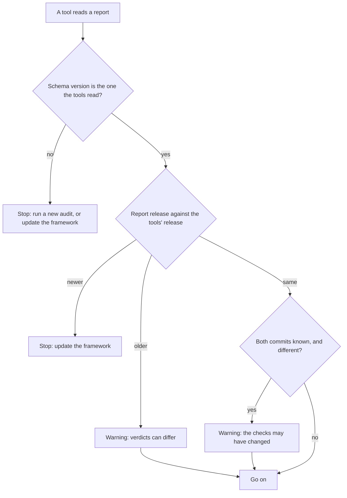

# Versions Reference

> **Audience:** Everyone who reads a report or a state file, and every contributor who changes a schema or cuts a
> release
> **Source of truth:** [`.release-please-manifest.json`](../../.release-please-manifest.json), the two schemas in
> [`audit/schema/`](../../audit/schema/) and the rule in
> [`validate_report.py`](../../audit/tools/validate_report.py) (`compare_versions`). The decision is
> [ADR 0008](../architecture/adrs/0008-one-release-version-and-current-schemas-only.md).
> **Status:** Live.

---

Every audit report and every implement state says which framework release made it. For example, a report from a
release bundle holds `"framework": {"release": "0.3.2", "revision": null, "install": "bundle"}`. The implement
tools compare that release with their own. A report from a newer release stops them; one from an older release gives
a warning. A report or state with another schema version stops them, and the message says what to do.

## Summary

Each number has one job.

| Number | Answers | Changes when | Who changes it |
|---|---|---|---|
| Release version, for example `0.3.2` | Which framework release made this file? | Every release | release-please |
| Framework commit (`revision`) | Which commit of a framework checkout made it? | Every commit | git; `null` outside a checkout |
| Install | Was the framework a `checkout`, a `bundle` or a `copy`? | When you install it another way | Detected by the tools |
| Catalogue version | Which set of checks and severities? | A check is added, removed or changes meaning | By hand, in `catalogue.json` |
| Ruleset revision and hash | Which engine rules gave the verdicts? | An engine verdict can move | By hand, in the engine |
| Report schema version, `0.2` | Which JSON shape has the report? | A report field is added, removed or changes meaning | By hand, in the schema |
| State schema version, `0.3` | Which JSON shape has the state? | A state field is added, removed or changes meaning | By hand, in the schema |

The engine's own report has a separate schema, version `2`. The engine and the audit adapter read it; this page does
not cover it.

---

## Where each number is written

### Release version

The release version is the root entry of [`.release-please-manifest.json`](../../.release-please-manifest.json).
release-please writes the same value into three code lines, each with the `x-release-please-version` marker and an
`extra-files` entry in [`release-please-config.json`](../../release-please-config.json):

| Code line | Written into |
|---|---|
| `__version__` in [`audit/engine/audit/__init__.py`](../../audit/engine/audit/__init__.py) | `audit --version`; the report's `provenance.engine.version` |
| `FRAMEWORK_RELEASE` in [`audit/tools/report.py`](../../audit/tools/report.py) | The report's `provenance.framework.release` |
| `FRAMEWORK_RELEASE` in [`implement/tools/progress.py`](../../implement/tools/progress.py) | The state's `framework.release` and `last_framework.release` |

[`dev/build_skills.py`](../../dev/build_skills.py) copies the manifest's version into each skill bundle's `SKILL.md`
as `metadata.version`. [`dev/tests/test_release_config.py`](../../dev/tests/test_release_config.py) fails when a code
line differs from the manifest, loses its marker or is missing from `extra-files`.

Between two releases, every checkout carries the last released version. The commit tells two such reports apart.

### Framework commit and install

The tools find the framework from the folder above their recipe folder: the repository root in a checkout, the skill
folder in a bundle. `validate_report.framework_facts` sets `install` to:

- `checkout` when that folder is the top of a git working tree. `revision` is the first 12 hex digits of `HEAD`.
- `bundle` when a `SKILL.md` sits there. A bundle inside another repository is still a bundle.
- `copy` for anything else, such as a source archive with no `.git` folder.

`revision` is `null` unless `install` is `checkout`. The tools never write a full 40-digit commit id here: secret
scanners read that shape as an access token.

### In a report

| Field | Holds |
|---|---|
| `schema_version` | The report schema version |
| `provenance.framework` | `release`, `revision` and `install` of the framework that made the report |
| `provenance.catalogue_version` | The catalogue version |
| `provenance.engine` | The engine's `version`, `ruleset_revision` and `ruleset_hash` |

### In a state

| Field | Holds |
|---|---|
| `schema_version` | The state schema version |
| `framework` | The framework that created the state, in the report's shape |
| `last_framework` | `release` and `revision` of the framework that last wrote the state |
| `source_reports[]` | Each report's `catalogue_version`, `release` and `revision` |

Every write sets `last_framework`. When it changes, the write also appends a log entry, for example
`Framework moved from v0.3.2 at cafecafecafe to v0.3.3 at beefbeefbeef.` `progress.py show` returns the three in
`data.versions`: `created`, `last` and `tools`.

---

## The compatibility rule

`validate_report.py` reads `schema_version` first, for every tool that reads a report. `progress.py init` and
`check_drift.py` then compare the report's release with their own. `check_drift.py` runs on every new run and every
resume, so a resume sees the rule too.

The flowchart shows the order of the checks.

| Report against the tools | Result | Exit |
|---|---|---|
| Another `schema_version` | Stop. An older schema: run a new audit. A newer one: update the framework. | 2 |
| Same schema, newer release | Stop: update the framework to that release or later | 2 |
| Same schema, older release | A warning; the run goes on | 0 |
| Same release, two known commits | A warning; the run goes on | 0 |
| Same release and commit | Nothing | 0 |

The tools compare `MAJOR.MINOR.PATCH` as numbers, so `0.3.10` is newer than `0.3.9`. Two versions with the same
numbers but other text, such as `0.3.2-dev` and `0.3.2`, count as older.

A state follows the same first step: `progress.py` reads only state schema `0.3`, and refuses another version with a
message. [`compare_reports.py`](tools-cli.md#compare_reportspy) gives a warning when its two reports come from
different releases, from one release at two commits, or from different catalogues. A verdict can move for that
reason alone.

---

## No backward compatibility yet

The tools read only the current report schema and the current state schema. A schema change replaces the old
version; nothing converts an old file. This holds until the first outside user or release `1.0.0`, whichever comes
first ([ADR 0008](../architecture/adrs/0008-one-release-version-and-current-schemas-only.md)).

`test_release_config.py` fails when the manifest reaches `1.0.0`. The owner then decides which older schemas the
tools read, updates this page and the ADR, and replaces that test.

## Messages

| Message starts with | What to do |
|---|---|
| `the report has schema 'X' (made by framework vY); these tools read schema 'Z'.` | Run a new audit with this framework, or use release vY. See [Implement an audit report](../how-to/implement-an-audit-report.md#when-the-versions-differ). |
| `the report was made by framework vX; these tools are vY. Update the framework` | Install release vX or later of both skills, or run a new audit with vY. |
| `the report was made by framework vX; these tools are vY. Verdicts can differ` | A warning. A new audit is the owner's call. |
| `the report was made at framework commit A; these tools run at B` | A warning. Run a new audit if the checks changed in between. |
| `the state has schema 'X' (made by framework vY); these tools read schema 'Z'.` | Move the old state files aside and run `progress.py init` again, or use release vY. See [Resume an interrupted run](../how-to/resume-an-interrupted-run.md#troubleshooting). |
