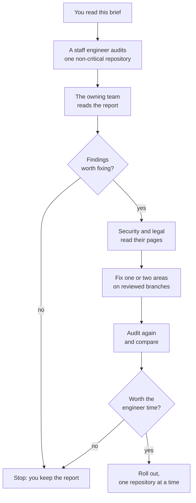

# Brief: preparing your repositories for AI coding agents

**Bottom line.** Your teams' AI coding agents are only as good as the repositories they work in. This free,
open-source framework audits a repository for what an agent needs, then fixes the gaps on branches your engineers
review. The clearest published benefit is lower cost per task. The audit half of a pilot takes an afternoon.

## The problem

An agent that cannot find how to build and test your code guesses. Guessing costs tokens, time and review
effort. An agent with no trustworthy tests cannot tell when it broke something.

## Why the repository is the place to act

Three things decide how well an agent works: the task, the agent and model, and the repository. You buy the agent
and write the task each time. You prepare the repository once, for every later task.

## What the framework checks

Nine ideas, each resting on published studies or our experience:

1. **Trustworthy feedback.** Tests and checks that the agent cannot weaken.
2. **Guardrails.** Clear limits on what an agent may change.
3. **Readable code.** Clear names and simple structure.
4. **Written-down decisions.** The reasons the code cannot tell.
5. **Reviewable work.** Changes a person can check fast.
6. **A map.** A way for the agent to find the right code.
7. **Findable commands.** One way to build, test and check, the same for agents, people and CI.
8. **Short instructions.** A brief rules file, written by a person.
9. **Ready-made tools.** Scripts kept in the repository, so agents do not rewrite them.

The first five are good engineering anyway, so your engineers gain too.

## What it does, and what it never does

- **The audit** reads a repository and writes a scored report in 10 to 30 minutes. Each finding cites evidence.
  An engineer confirms or rejects the findings.
- **The fix step** works one area at a time, on local branches. An engineer approves each area's change list
  first.
- **It never** writes during the audit, merges a branch, or pushes without your opt-in.
- **Your data:** your agent sends what it reads to its model provider, as it does today. The audit asks consent
  first. The tools open no connections of their own.
- **The licence:** the tools are AGPL-3.0, which covers the tools, not your repository. Reports are yours. What the
  fix step generates or copies in takes your repository's own licence.
- **The cost:** on the Sonnet 5.5 model, the project's audits of real repositories cost $1.24 to $3.02 each.
  [Cost and time](cost-and-time.md)

## What is known, and what is not

- **Known:** published studies of single practices show lower cost, from about 7% to about half fewer tokens
  ([the evidence](evidence.md)). Done badly, some raise cost. Gains in task success are flat or small, and shrink
  on stronger models.
- **Shown:** one open-source repository, which the project's maintainer owns, rose from a score of 0.54 to 0.73
  after one fix run. [Read its caveats](evidence.md#one-before-and-after). No outside team has published one.
- **Not yet known:** whether a whole prepared repository makes agents succeed more often. Nobody has measured it.
- **Limits today:** running the skills is tested on Claude Code, with one run on opencode, on Linux. Cursor,
  Codex, Gemini CLI and GitHub Copilot are not tested. The repository changes help any agent and any engineer.

## What to do next

Ask a staff engineer to run one audit on a non-critical repository this week. The diagram shows the path from
there to a rollout decision.

[Run a pilot](run-a-pilot.md) gives the steps and the success criteria.

More: [How it works](how-it-works.md) · [Security and data](security-and-data.md) ·
[Licence in plain words](licence-in-plain-words.md) · [Questions and answers](faq.md)
