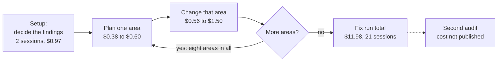
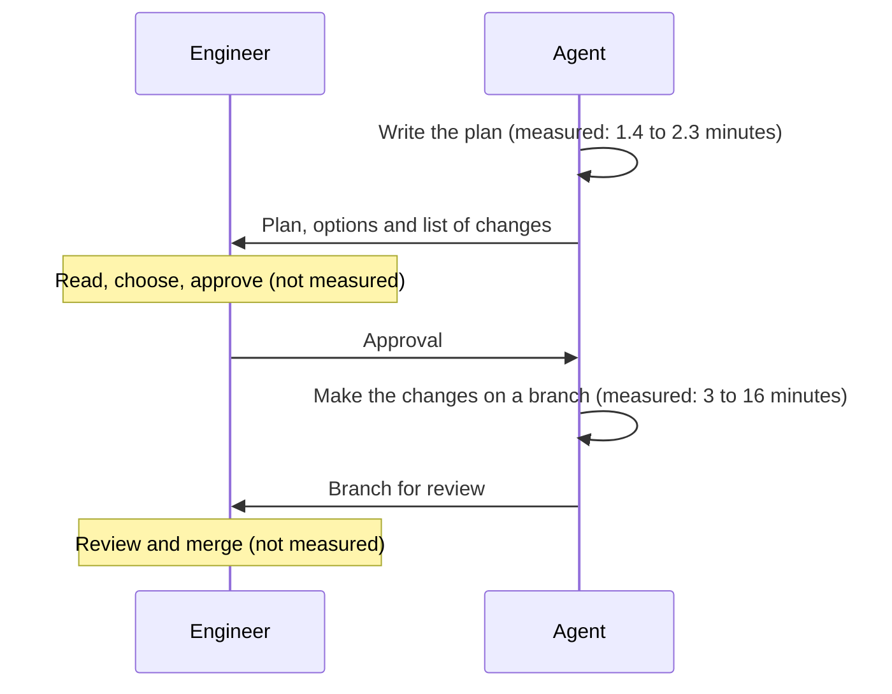

# Cost and time

For a CTO and for procurement: what it costs to adopt the framework.

**Bottom line.** The framework is free and open source. You pay for your coding agent's usage and for your
engineers' time. On the Sonnet 5.5 model, an audit of a real repository cost $1.24 to $3.02. The one published fix
run cost $11.98, on Sonnet. The project expects engineer time to be the larger cost, and has not yet measured it.

A fix run closes an audit's findings, one area at a time. An area is a group of related findings, such as tests.

## What you pay for

| Cost | What it is | What is published |
| --- | --- | --- |
| Price | Nothing. The tools are open source. | [Licence in plain words](licence-in-plain-words.md) |
| Agent usage | What your agent's model provider charges for the audit and the fix run | On Sonnet 5.5: $1.24 to $3.02 per audit of a real repository. On Sonnet: $11.98 for one fix run |
| Agent time | How long the agent itself works | Measured, with nobody answering: 4.5 to 11.3 minutes per audit; about 57 minutes for one fix run |
| Elapsed time | Agent time, plus the time people take to answer, approve and review | Not yet measured. Typical ranges: 10 to 30 minutes per audit, 3 to 6 hours per fix run |
| Engineer time | A person answers, approves and reviews | Not yet measured |
| Ongoing | Later audits, and keeping the new checks passing | Not yet measured |

## Agent usage

Every figure below comes from [Evaluation results](../reference/eval-results.md). All runs used Claude Code, in
October and November 2026. The audits and the small fix scenarios ran on the Sonnet 5.5 model. The fix run ran on
Sonnet, except one of its eight areas, which ran on Haiku, a smaller model. The results page gives no model version
for the fix run. The dollar amounts are what the agent sessions reported.

**The model sets much of the price.** Cost depends heavily on the model you choose. A larger model, such as Opus,
costs more. The project estimates about a dollar per audit with DeepSeek through the opencode agent. That figure
is the project's estimate, not a measurement.

| Run | Cost | Agent time |
| --- | --- | --- |
| Audit of 89 small sample repositories, on Sonnet 5.5 | About $0.97 each; $86.71 in total | About 3.1 minutes each (2.0 to 5.2) |
| Audit of 3 real repositories, one run each, on Sonnet 5.5 | $1.24 to $3.02 each | 4.5 to 11.3 minutes each |
| Fix run on 1 real repository, 40 findings, on Sonnet | $11.98 over 21 sessions | About 57 minutes |
| Fix step on 7 small test scenarios, on Sonnet 5.5 | $0.17 to $0.30 each | 36 to 92 seconds each |

The diagram shows where the $11.98 of the fix run went, session by session.

The ranges are for the seven areas on Sonnet. The area on Haiku cost $0.09 to plan and $0.42 to change.

Read these figures with four limits:

- **The 89 sample repositories are tiny.** Each holds a single defect.
- **The real figures are one run each.** Three audits and one fix run are examples, not averages.
- **The runs were unattended.** No session waited for a person, and the audits skipped the step where an engineer
  confirms findings.
- **The fix run's time is a low figure.** Three of its sessions reported a time near zero, which the results page
  marks as not trustworthy.

Do not add the $3.02 audit to the $11.98 fix run, although both concern one repository. That repository is an
open-source Java server that the project's maintainer owns. The fix run started from a later audit, whose
findings the owner had decided. That audit's cost is not yet published.
[The worked example](../../audit/schema/examples/server-worked-example/README.md) shows both reports.

## Elapsed time

Elapsed time is what your calendar shows: agent time, plus the time people take to answer, approve and review.

An audit typically takes 10 to 30 minutes. A fix run typically takes 3 to 6 hours. The project's
[README](../../README.md) gives both as typical ranges, not promises. Both assume a person who answers the agent.
Neither is a measurement: no attended run has a published time.

The one measured fix run took about 57 minutes of agent time, spread over nine calendar days. The project was
still writing the fix step then, so that span is not typical.

Elapsed time grows with the size of the repository, and with how long people take to answer. No published
figure relates size to time.

A fix run is not one sitting. The diagram shows one area: when the agent works, and when it waits for a person.

The minutes are from the one published run, without the three sessions whose times are not trustworthy.

## Engineer time

An engineer who can decide for the repository must be present at these points. The agent does not go on without
them.

During the audit ([Run an audit](../how-to/run-an-audit.md)):

1. Hear what the agent will send to its model provider, and consent.
2. Answer the opening questions about the repository, or supply the answers in a file beforehand.
3. Approve the plan: what the audit checks, what it leaves out, and which commands it may run.
4. Confirm or reject the findings: the most severe ones singly, the others in batches.

During the fix run ([Implement an audit report](../how-to/implement-an-audit-report.md)):

1. Decide once, for each finding, whether to keep, skip or defer it, and give a reason.
2. State the limits of the run: preferred tools, what not to touch, and whether the agent may push a branch.
3. For each area, read the agent's brief, pick among its options and approve the list of changes.
4. Answer when the agent stops: a value only you know, or a tool the repository lacks.
5. Review each area's branch and merge it. The agent never merges.
6. At the end, run a second audit and read the comparison of the two reports.

No source gives the hours this takes. The published run shows the amount of deciding instead: 40 findings to
decide, 59 preferences set by the owner, and eight branches to review. The source is its
[state file](../../audit/schema/examples/server-worked-example/digital-assistant-server-agentic-readiness-STATE.md).

## What you need first

- A coding agent that can run shell commands. Running the skills is tested on Claude Code, with one run on
  opencode. Other agents are not tested for running them ([Harness notes](../reference/harness-notes.md)).
- Git, and Python 3.11 or newer. The tools use only Python's standard library.
- A copy of the framework: a clone, or the skills from the release files
  ([Install the skills](../how-to/install-the-skills.md)).
- Read access to the repository for the audit. For the fix run, a clean working copy on your main development
  branch.

The audit never writes to your repository. The fix run keeps its own records outside it, and adds a tool only
after you name that tool. Linux is the tested platform.

One caveat: the install from the release files unzips the skills, with the AGPL tools, into a folder you choose.
Keep that folder out of what you commit ([Licence in plain words](licence-in-plain-words.md)).

## Ongoing cost

- **Later audits.** Each one is a full audit, with its agent usage. Saved answers remove the opening questions.
  There is no fixed schedule. The project improves the checks continuously, from community feedback. It suggests
  an audit with the latest release about once a quarter. Run one also after a major change to your automatic
  checks or your agent rules.
- **New releases.** The fix tools read only reports in their own format. After a release that changes the format,
  you run a new audit before a fix run.
- **Keeping the checks passing.** The fix run adds tests, automatic checks in CI and rules. Your CI then runs
  them on every change, and your engineers keep them green.
- **Recorded debt.** Some findings end as "partial": the problem is counted and guarded so it cannot grow. In the
  published run, 13 of 40 findings ended that way. Paying that debt down is your team's later work.

No ongoing cost is published yet.

## For many repositories

Each run handles one repository. Most of the cost therefore repeats.

| Per repository | Shared across repositories |
| --- | --- |
| The audit, and its agent usage | The price: nothing |
| The engineer's answers, approvals and reviews | One copy of the framework or of the skills |
| The fix run: one session and one branch per area | What your engineers learn on the first repository |
| The second audit and later audits | The agent and its setup |
| The folder that holds the report and the run's records | |

The owners of each repository must make its decisions, so engineer time does not pool across teams. No run
across many repositories is published.

Start with one repository and record your own engineer hours:
[Run a pilot](run-a-pilot.md).

## What is not yet published

- Measured agent usage on any other model, or on any agent other than Claude Code.
- Cost by repository size, and any figure for a large repository.
- Every figure for a second, private repository that had a fix run.
- Whether a prepared repository lowers what agents cost afterwards. [The evidence](evidence.md) says what is
  known.
