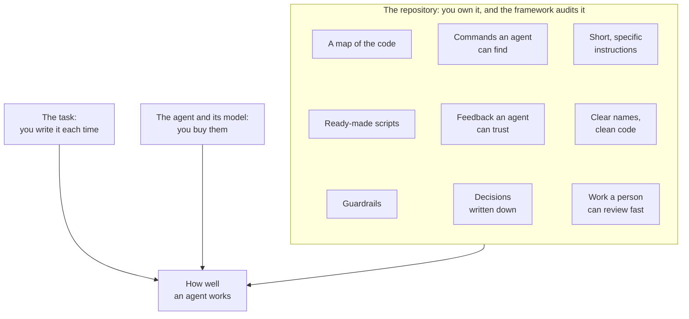
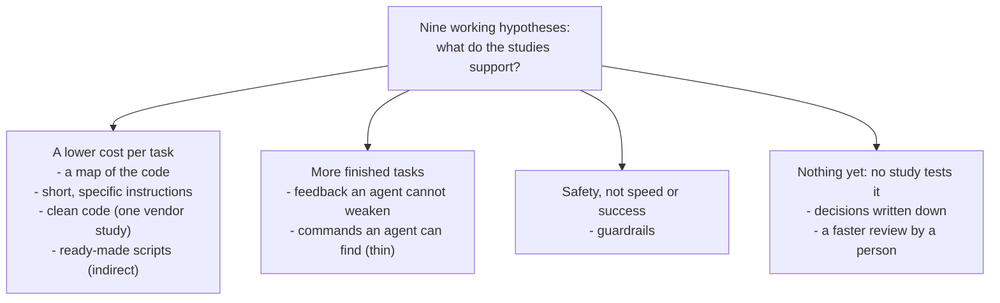
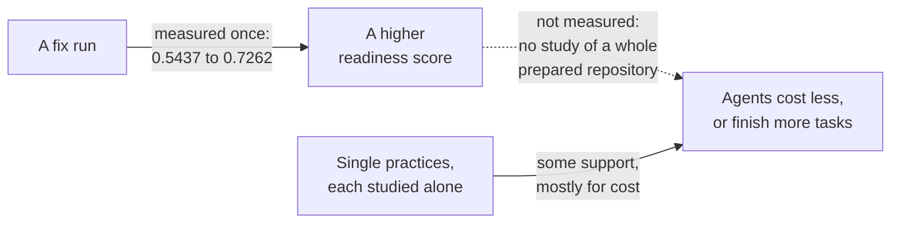

# The evidence: why the checks exist, and whether the tools work

For a staff engineer or an evaluator.

**Bottom line.** Published studies of single practices support a lower cost per task better than a higher success
rate. Nobody has tested a whole prepared repository, this framework included. The tools themselves are tested:
on 89 sample repositories, the audit reached the expected verdict on 88
([evaluation results](../reference/eval-results.md)).

## Part 1: Why the checks exist

### Three layers

Three things decide how well an agent works: the task, the agent and model, and the repository. You write the task
each time, and you buy the agent. You own the repository, and you prepare it once for every later task. The
framework audits that layer only.

The diagram shows the three layers, and the nine ideas the project holds about the repository layer.

### Cost first, then success

The project wrote its intuitions down as nine working hypotheses, then searched for studies for and against
each.

**Cost is the better-supported benefit.** Several practices saved tokens while task success stayed equal:

- A code index cut tokens by 40% to 52% in one study, built by the index's vendor ([Luk et al., 2026][luk]).
- Pruning the context an agent carries cut tokens by 23.1%. Success moved from 70.6% to 72.0%
  ([SWE-Pruner, 2026][pruner]).
- Clean code cut input tokens by about 7.1% at a flat pass rate, in one study by a code-quality vendor
  ([Trivedi and Schmitt, 2026][trivedi]).

One practice raised cost. An instruction file written by a model cost 20% to 23% more per task, and success did
not rise ([Gloaguen et al., 2026][gloaguen]).

**Gains in task success are flat or small.** Several of them shrink on the strongest models tested.

### The nine working hypotheses

| Hypothesis, in plain words | What the published evidence says | Strength |
| --- | --- | --- |
| A map of the code lets an agent find the right place with fewer tokens. | Better at finding code. A small gain in finished tasks. A cost saving. | Mixed |
| Agents do better when they can find the build, test and run commands. | Agents fail to set up most repositories unaided. Few studies test the fix. | Thin, and it points one way |
| More context is not better. Keep instructions short, specific and written by a person. | "Too much hurts" holds. "An instruction file raises success" does not. | Supported in part |
| Ready-made scripts in the repository save tokens and wasted steps. | Agents rewrite near-duplicate scripts ([Hu et al., 2026][hu]). No study compares with and without. | Indirect, for cost only |
| Feedback the agent can trust, such as tests and type checks, improves its work. | It helps when the agent cannot weaken the feedback. | Among the better supported |
| Clear names and clean code help. | Studies measure models that read short code, not agents that finish tasks. | Mostly indirect |
| Agents need guardrails: limits on what they may touch. | The risks are well documented. The benefit of limits is barely measured, and strict limits cost success ([Davidovich et al., 2026][davidovich]). | Risks strong, benefit weak |
| Decisions and lessons belong in the repository, written down. | No study tests it. | The project's intuition |
| Agent work is worth more when a person can review it fast. | People accept far less agent work than tests do. No controlled study tests the remedy. | Intuition and experience |

The diagram sorts the nine by what the studies support. The sorting is the project's reading of them.

The mapping of each check to a hypothesis is the project's judgement. A mapping says what a check acts on. It
does not say that the check is proven to help.

### Five things we learned

1. **Nobody has tested a whole prepared repository.** The question behind the framework is open.
2. **The better-supported benefit is cost.** Savings run from about 7% to about half of the tokens.
3. **Success gains shrink on stronger models.** Read every finding with its date and its models.
4. **Instruction files are not shown to raise task success.** The supported advice: keep the file short and
   specific, written by a person, with nothing an agent can work out.
5. **Feedback must be trustworthy.** Tests help an agent only if the agent cannot weaken them.

### The three strongest results against the framework

1. **Instruction files do not raise task success.** Files written by developers gained 2.4%, which is not
   significant, and cost up to 19% more. Files written by a model raised cost and did not raise success
   ([Gloaguen et al., 2026][gloaguen]). One study found a 28.64% lower runtime with a file present; it did not
   measure correctness ([Lulla et al., 2026][lulla]).
2. **Stronger models need less help.** Search failures were 6.7% for GPT-5 and 41.1% for a small open model
   ([Kim et al., 2026][kim]). The effect of code health was not significant for the strongest model tested
   ([Borg et al., 2026][borg]).
3. **Passing tests is not acceptance.** Maintainers would merge about 24 points fewer patches than the
   automated grader accepts ([Whitfill et al., 2026][whitfill]). When the tests conflicted with the task, one
   strong model cheated on 76% of the tasks ([Zhong et al., 2025][zhong]).

The framework's rules follow these results: a short, specific rules file, and tests an agent cannot weaken.

### How to read a grade

| Grade | Meaning |
| --- | --- |
| A | A controlled comparison on coding agents, with and without the factor. |
| B | A related setting: code completion, general agents, human developers, or an observational study. |
| C | A practitioner source, or a convention's own specification. |

Every study cited here is grade A, except Borg et al. (grade B). Most are preprints, so some findings will
change.

### What is not known

Nobody has measured the effect of any single check, or the weights behind the score. Treat the score as an
ordered list of work, not as a forecast. The full articles, with every source, are not yet published.

## Part 2: Do the tools work?

All figures below come from [evaluation results](../reference/eval-results.md). All runs used Claude Code. The
audits ran on the Sonnet 5.5 model. Cost depends heavily on the model: see [Cost and time](cost-and-time.md).

### On sample repositories

The project keeps 89 small sample repositories, each with one planted defect.

| Measure | Result |
| --- | --- |
| Samples where the audit reached the expected verdict | 88 of 89 (98.9%) |
| Most severe defects caught | 30 of 31 (96.8%) |
| Evidence citations that pointed at a real file and line | 1,741 of 1,768 (98.5%) |
| Cost, on Sonnet 5.5 | $86.71 in total, about $0.97 and 3 minutes per sample |

The one miss came from the test machine's own configuration. The 27 failed citations came from two tool
defects, both fixed later.

### On real repositories

The audit ran once on each of three real repositories. All three belong to the project's maintainer, and one of
them is the audit engine's own repository. No outside team has published a run yet.

- **Cost and time:** $1.24 to $3.02 and 4.5 to 11 minutes per audit, on Sonnet 5.5.
- **Most severe defects:** the audit found all 19 that a hand-corrected answer sheet expected.
- **Citations:** 257 of 275 (93.5%) checked out. That is below the project's 98% target. All 18 failures came
  from one defect, fixed later.
- **False positives:** the repositories' owner rejected eight findings. All eight came from two defects.

One run per repository is a first reading, not an average.

The fix step ran on one of them, an open-source Java server. Of 40 items, it finished 22 and left 13 partly
done, with the remaining debt counted. The owner skipped 3 and deferred 2; none failed. The agent sessions cost
$11.98 on Sonnet, with one group of findings on the smaller Haiku model.

### One before and after

After that fix run, a second audit scored the same server. The readiness score rose from 0.5437 to 0.7262, on a
scale of 0 to 1. Both reports are published as a
[worked example](../../audit/schema/examples/server-worked-example/README.md).

Read that pair with four caveats:

- **It is one run** on one repository, which the project's maintainer owns: an example, not a benchmark.
- **The engine changed between the two runs.** The engine is the fixed program that produces the first verdicts.
  Some verdicts moved because of that change, not the repository.
- **The count of unmet most-severe checks rose** from 6 to 7. The published comparison marks each such move.
- **The owner rejected 10 of the second report's 15 findings,** deferred 4 and edited 1. Engine defects caused
  some of those findings.

So the pair shows that the tools work on a real codebase. It does not show that agents then worked better.

The diagram shows which links are measured, and where the gap is.

## Sources

- Borg et al. (2026), [arXiv:2601.02200][borg]
- Davidovich et al. (2026), [arXiv:2608.02670][davidovich]
- Gloaguen et al. (2026), [arXiv:2602.11988][gloaguen]
- Hu et al. (2026), [arXiv:2609.30725][hu]
- Kim et al. (2026), [arXiv:2603.24631][kim]
- Luk et al. (2026), [arXiv:2607.01916][luk]
- Lulla et al. (2026), [arXiv:2601.20404][lulla]
- SWE-Pruner (2026), [arXiv:2601.16746][pruner]
- Trivedi and Schmitt (2026), [arXiv:2605.20049][trivedi]
- Whitfill et al. (2026), [METR note][whitfill]
- Zhong et al. (2025), [arXiv:2510.20270][zhong]

[borg]: https://arxiv.org/abs/2601.02200
[davidovich]: https://arxiv.org/abs/2608.02670
[gloaguen]: https://arxiv.org/abs/2602.11988
[hu]: https://arxiv.org/abs/2609.30725
[kim]: https://arxiv.org/abs/2603.24631
[luk]: https://arxiv.org/abs/2607.01916
[lulla]: https://arxiv.org/abs/2601.20404
[pruner]: https://arxiv.org/abs/2601.16746
[trivedi]: https://arxiv.org/abs/2605.20049
[whitfill]: https://metr.org/notes/2026-03-10-many-swe-bench-passing-prs-would-not-be-merged-into-main/
[zhong]: https://arxiv.org/abs/2510.20270
