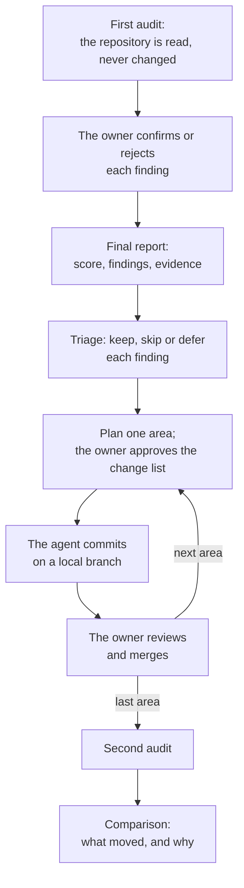
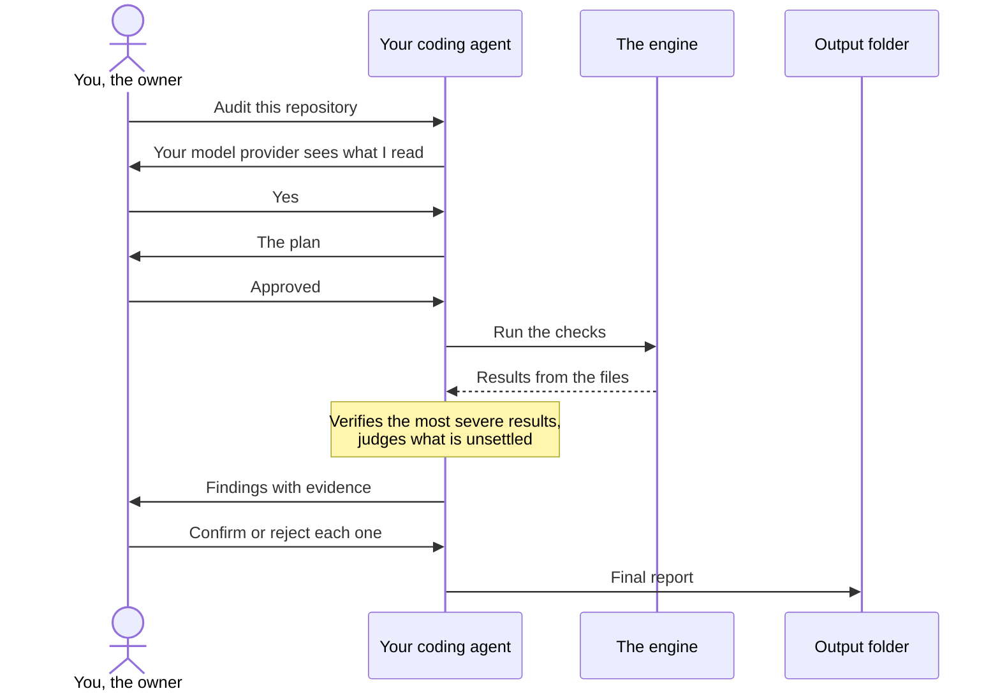
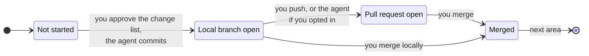
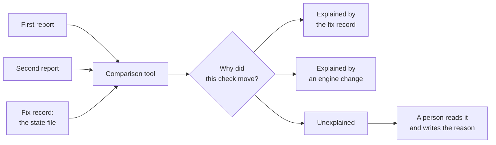

# How it works

For the staff engineer who was asked to evaluate this framework.

**Bottom line.** The framework runs one loop on one repository: audit, confirm, fix, audit again, compare. The
audit only reads. The fix step commits on local branches. An engineer approves one change list per area before
anything changes, and does every merge.

One open-source repository, which the project's maintainer owns, has been through the whole loop. Its score rose
from 0.54 to 0.73 ([the evidence](evidence.md#one-before-and-after)), and its
[reports are published](../../audit/schema/examples/server-worked-example/README.md). The examples on this page
come from that run. No outside team has published a run yet.

## The loop

The diagram shows the path from the first audit to the second, and where a person decides.

## The audit

Two parts do different work.

- **The engine counts.** The engine is a program with fixed rules. It reads the repository's files, calls no
  model and uses no network. It decides 76 of the 78 checks from the files alone
  ([audit master list](../reference/audit-master.md)).
- **Your coding agent judges.** It verifies each of the most severe results on its own and judges what the engine
  could not settle. It cites evidence for each finding. When an answer is unclear, it stops and asks.

A person decides at three points.

1. **Before anything is read.** The agent says that your model provider sees what the agent reads. It waits for
   your yes.
2. **Before the checks run.** You approve the plan: what is checked, what is excluded, and which of your own
   commands may run. By default none runs.
3. **Before the report is final.** The owner decides on each of the most severe findings alone, with its evidence.
   The owner decides on the rest in batches.

The sequence shows who speaks to whom in one audit.

The tools then write the final report, as a JSON file and a Markdown view, to a folder outside the repository.
They refuse an output path inside it. A check that could not be settled is marked unknown. It earns no credit and
is never shown as a pass.

An audit typically takes 10 to 30 minutes with a person answering ([cost and time](cost-and-time.md)). The steps
are in [Run an audit](../how-to/run-an-audit.md).

## What a report shows

The first report on the worked example is a good sample
([read it](../../audit/schema/examples/server-worked-example/digital-assistant-server-first-audit-20261028T131409Z.md)).
It opens with these parts:

- **The bottom line.** The score, here 0.54 over 57 scored checks. Then the count of most severe checks that are
  not met, and the count of unknown checks.
- **The first actions.** Three findings to fix first. Each says what an agent cannot do, why, and the fix. One of
  them reads: an agent cannot run the standard commands, because five of the seven are not defined.
- **Where it came from.** The framework version, the commit that was audited, the agent and model, and whether any
  of the repository's commands ran.
- **Every finding.** Its evidence, who captured the evidence, and the owner's decision.

The score is the weighted share of the scored checks that the repository meets. The report states its own limit:
"The framework sets no pass mark, and a score says nothing about whether agents will write correct code."

## The fix step

The fix step starts from a final report and refuses a draft. It works through the findings one area at a time.
An area is a group of related findings; the engineer pages call it a theme. There are eight, from commands and
quality tools to repository hygiene ([implement master list](../reference/implement-master.md)). One pass of the
fix step over a report is a fix run.

- **Triage, once.** For each finding you choose keep, skip or defer, with a reason. The agent does not propose a
  skipped finding again. You also state your limits, for example preferred tools or "no mass reformat". Triage
  changes nothing in the repository.
- **A plan per area.** The agent says what it will fix and why. It gives the options with pros and cons, and a
  recommendation. Nothing changes before you approve the change list.
- **Local branches.** Each area gets one branch in a separate working copy. The agent first runs your own checks
  once, as a baseline. It then works in small commits. A new test failure blocks a commit.
- **Existing debt.** The agent does not mass-fix old violations. It records the count and adds a guard, so the
  count cannot grow.
- **What it never does.** It never merges and never weakens or deletes a test. It adds no tool or dependency
  without your approval. It pushes a branch only if you opted in at triage.
- **State beside the report.** Your choices and the progress live in a state file beside the audit report, outside
  the repository. A run can stop after any area and resume later. Keep that folder until the run ends.

The state file records where each area stands. The diagram shows those states and who moves an area on.

A fix run takes longer than an audit, and it is rarely one sitting ([cost and time](cost-and-time.md)). The steps
are in [Implement an audit report](../how-to/implement-an-audit-report.md). The full list of what the fix step may and
may not do is in [Trust and safety](../explanation/user-overview/03-trust-and-safety.md).

## The second audit and the comparison

After the last merge, you run the audit again, into a new folder. A tool compares the two reports. The diagram
shows the three labels it can give a check that moved.

The worked example shows why you should read the comparison and not only the score. Its
[comparison file](../../audit/schema/examples/server-worked-example/digital-assistant-server-second-audit-comparison-20261106T091756Z.md)
shows three things:

- The score rose, and so did the count of unmet most-severe checks.
- The tool called 12 moves unexplained. A person annotated each one. Several came from a change in the engine
  between the two audits, not from the repository.
- The owner rejected most of the findings in the second report. In some of them the engine was wrong, and the
  comparison links the open issue.

So the engine makes mistakes, and the owner's decision is what catches them. The figures and their caveats are in
[The evidence](evidence.md#one-before-and-after).

The framework sets no fixed schedule for later audits. The project keeps improving the checks from community
feedback. It suggests an audit with the latest release about once a quarter. Audit also after a major change to
the repository's checks or its rules for agents.

## What the audit looks at

The checks act on nine ideas about what a repository gives an agent. The table groups the checks by idea.

| Idea | What the checks ask |
|---|---|
| **Good engineering anyway** | |
| Trustworthy feedback | Does a test command run a real suite? Are a linter and a type checker set up? Does CI run the same checks as a developer, and fail when they fail? Are tool versions and dependencies pinned? Is old debt counted, so new violations fail? |
| Guardrails | Is it written down what an agent may not touch? Are the tests protected from edits? Are secrets kept out of tracked files? Are dependencies scanned? |
| Readable code | Are there oversized files or catch-all folders? Are public functions documented? |
| Written-down decisions | Is there a home for permanent documents, and a record of decisions? |
| Reviewable work | Is there a formatter, a commit convention, a pull request template and a named owner for review? |
| **Specific to agents** | |
| A map | Is a code index registered and fresh? Are the components and an architecture overview declared? |
| Findable commands | Does the rules file name the standard commands? Does each documented command work? Are the environment variables listed? |
| Short instructions | Is there one rules file for agents? Is it specific to this repository? Does it say where permanent documents live and what "done" means? |
| Ready-made tools | Is each standard command defined once, as a script or target an agent can run? |

Read the table with two cautions.

- **The grouping is the project's judgement.** Each check sits under the idea that best explains the check's own
  stated reason. The grouping says the check acts on the idea. It does not say the check is proven to help.
- **One check can serve two ideas.** A linter is a ready-made tool, and its output is feedback. The table places
  each check once, under its main idea. The project has not yet published a count of checks per idea.

Every check, with what passes and why it matters, is in the [audit master list](../reference/audit-master.md).
Every fix, with what it changes and what it never does, is in the
[implement master list](../reference/implement-master.md).

## Next

- Run a pilot: [Run a pilot](run-a-pilot.md).
- What is measured and what is not: [The evidence](evidence.md).
- Data flow and permissions: [Security and data](security-and-data.md).
