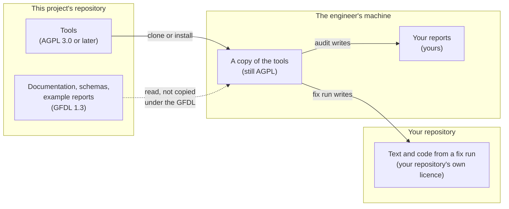
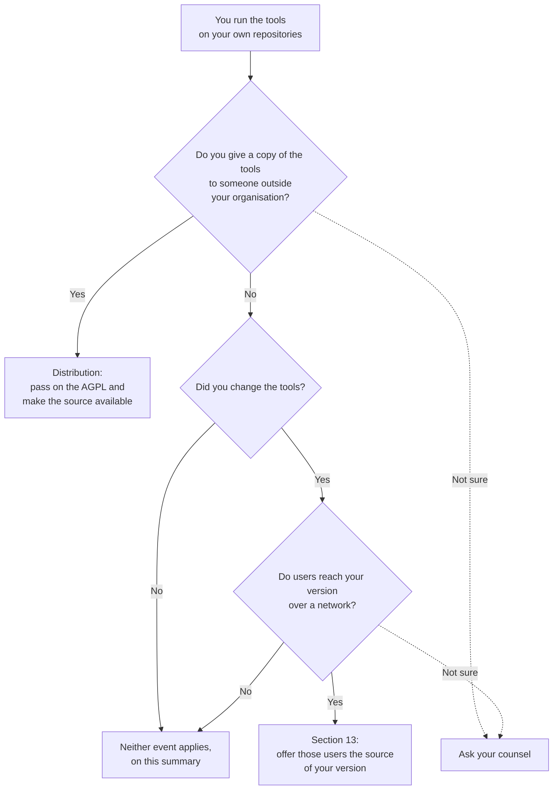

# Licence in plain words

For a lawyer or a procurement reviewer. This page says which licence covers what, and what that means for you.

**Bottom line.** The tools carry a copyleft licence, the AGPL. It covers the tools, not the repositories that
they analyse. Reports on your own repositories are yours. What the fix step puts into your repository takes your
repository's own licence, never the AGPL. A company that runs the tools on its own repositories, and gives no
copy away, distributes nothing.

This page is not legal advice. Have your counsel read the licence texts.

Two terms recur. The **audit** reads a repository and writes a report. A **fix run** is a later step in which a
coding agent closes the report's findings in that repository.

## Which licence covers what

| Content | Licence | Where it ends up |
| --- | --- | --- |
| The tools: the audit and fix scripts, the audit engine and their tests | AGPL-3.0-or-later | On the engineer's machine. Not in your repository |
| Documentation, the written instructions for the agent, the schemas and the example reports that this project publishes | GFDL-1.3-only | In this project's repository |
| Text and code that a fix run generates or copies into your repository | Your repository's own licence | In your repository |
| Reports that you produce on your own repositories | None from this project. They are yours | In the output folder that you name |

The [licensing page](../reference/licensing.md) is the source for which licence covers which path. The texts of
the two project licences are files at the root of the repository: [`LICENSE`](../../LICENSE) (GFDL 1.3) and
[`LICENSE-CODE`](../../LICENSE-CODE) (AGPL 3.0).

The diagram shows what stays with the project, what stays on the engineer's machine and what you receive.

## What goes into your repository

Only a fix run writes to your repository. The audit never does.

Everything that a fix run puts there takes your repository's own licence. That covers three cases:

- **Text or code written for your repository.** Examples are a rules file for agents, a CI step or a baseline
  file. The agent writes them to fit your repository's conventions.
- **Text adapted from this project.** Examples are a documentation page or a configuration file that starts from
  one of the project's templates.
- **Text or code copied word for word from this project.** A small number of fixes copy a script. Today there is
  [one such template](../../implement/playbooks/templates/).

The third case is the one a reviewer asks about. In this project's repository, such a script is AGPL. The
project licenses it so that your repository may relicense its copy under its own licence. The copy in your
repository does not carry the AGPL, and it does not carry the GFDL.

The same holds for a new repository. The project's scaffolder renders templates into a new project. The new
project owns its copy and picks its own licence ([greenfield guide](../../greenfield/README.md)).

## What you produce

A report that you produce on your own repository is yours. The tools place no licence on it
([licensing page](../reference/licensing.md)).

The example reports that this project publishes in its own repository are different. They are GFDL 1.3, like
the documentation.

## If you only run the tools internally

Take a company that clones the project, runs the audit on its own repositories and then runs a fix run. Three
facts apply:

1. The reports are the company's.
2. What the fix run puts into its repositories takes those repositories' own licences.
3. The company gives no copy of the tools to anyone outside it.

The AGPL's conditions attach to two events, described in the next section. The first, distribution, does not
happen in this case. The second concerns tools that you changed and that users reach over a network. This page
does not judge whether your internal use is such a case. That question is in the list for your counsel below.

One practical point. The install guide lets an engineer unzip the skills into a folder inside a project
([install the skills](../how-to/install-the-skills.md)). Those zips contain the AGPL tools. If that folder is
committed, the repository holds a copy of AGPL code, by the engineer's action. So keep the skill bundles out of
the repositories that you commit. A folder in the engineer's home folder, or a separate clone, does that.

## What would trigger AGPL obligations

These are the general terms of the licence, in summary. The licence text decides, not this page.

- **You distribute the tools.** You give a copy, changed or unchanged, to someone outside your organisation.
  The AGPL then asks you to pass on the same licence and to make the source code available.
- **You change the tools and offer them over a network.** You modify the tools and let users interact with your
  version remotely, for example as a hosted audit service. Section 13 of the AGPL then asks you to offer those
  users the source code of your version.

The diagram puts the two events in the order in which a reviewer can test them.

The licence identifier ends in "or later". You may follow version 3 of the AGPL or any later published version.

Three questions belong to your counsel, because the answers depend on your facts:

- whether a transfer to an affiliate, a contractor or a customer counts as distribution;
- whether a use that you plan counts as remote interaction by users;
- whether staff, contractors or affiliates who reach a changed version on your internal network are such users.

## The documentation licence

The GFDL covers this project's documentation, schemas and published examples. It matters when you copy or
republish them yourself, for example in your own handbook. Then its terms on notices and on the same licence
apply. Reading the documentation, or following it, creates no such duty.

The written instructions that the agent follows are documentation under this split. The agent reads them. What
a fix run then writes into your repository falls under the rule above, not under the GFDL.

## What the documents do not say

The sources for this page name no commercial licence, no support contract and no warranty beyond the licence
texts.

The exact grant is in [Licensing](../reference/licensing.md#what-an-implement-run-puts-into-your-repository). When
your repository declares no clear licence, the fix step asks you which one applies. It never guesses.

Who maintains the project, and how it decides, is in the [governance page](../../GOVERNANCE.md).

## Read next

- [Licensing](../reference/licensing.md): the table of paths and licences, and the identifiers.
- [Security and data](security-and-data.md): what runs where, and what leaves the machine.
- [Cost and time](cost-and-time.md): what a run costs.
