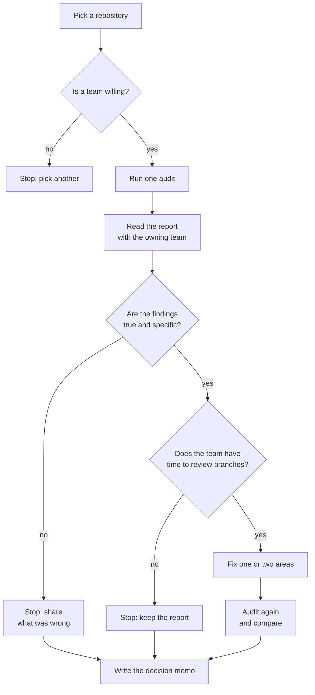
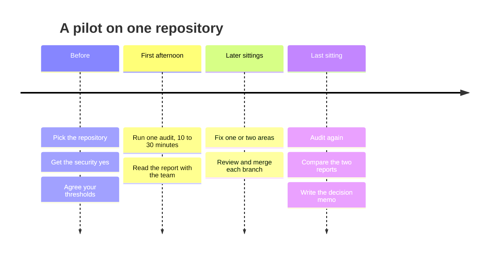

# Run a pilot on one repository

For the staff engineer who was asked to evaluate this framework.

**Bottom line.** One audit of one repository answers the first question: is the report specific and correct for
your code? The afternoon covers the audit and the reading of its report. The audit changes nothing in the
repository. A fix on one or two areas is the second, optional half of the pilot, and it takes longer.

The pilot has four decisions, and you can stop after each one.

| Step | What you do | What you learn |
|---|---|---|
| 1 | Pick a repository | Whether a team is willing |
| 2 | Run one audit | The time and the token cost of an audit |
| 3 | Read the report with the owning team | Whether the findings are true |
| 4 | Fix one or two areas, then audit again | Whether you would merge the fixes |

An area is a group of related findings; the engineer pages call it a theme. A fix run is one pass of the fix
step over a report.

The flow shows the same four steps, with the question that decides whether you go on or stop.



If you have not read [How it works](how-it-works.md), read it first.

## Before you start

- **A coding agent with shell access.** A skill is a set of instructions that a coding agent follows. Running the
  skills is tested on Claude Code, with one run on opencode. Cursor, Codex, Gemini CLI and GitHub Copilot are not
  tested for running them ([harness notes](../reference/harness-notes.md)).
- **`git` and Python 3.11 or newer**, on Linux, the tested platform ([README](../../README.md)).
- **A yes from your security reviewer**, if your company needs one. The audit asks for consent before it reads
  anything, because your agent sends what it reads to its model provider
  ([security and data](security-and-data.md)).

## Step 1: Pick a repository

- **Non-critical.** The audit only reads, but the fix step needs a team with time to review branches.
- **Owned by a willing team.** The owner confirms or rejects every finding. A pilot without the owner tests
  nothing.
- **A typical stack.** A result on an unusual repository does not transfer. The audit ships profiles for
  TypeScript on Node, Java and Python ([audit](../../audit/README.md)). For another stack the agent derives a
  profile and labels it as a guess.

## Step 2: Run one audit

1. Clone this framework and open your coding agent at its root.
2. Note the start time.
3. Say: "Audit `/path/to/your/repo` and write the output to `/path/to/output`".
4. Answer the agent's questions. Leave your repository's own commands switched off, which is the default.
5. Approve the plan the agent shows you.
6. Confirm or reject the findings, with an engineer from the owning team beside you.
7. Note the end time and the token cost your agent reports.

The output folder now holds the final report: a JSON file and a Markdown view. Do not edit them, and keep the
folder. The full steps are in [Run an audit](../how-to/run-an-audit.md). To use the skills without a clone, see
[Install the skills](../how-to/install-the-skills.md). If the session breaks, see
[Resume an interrupted run](../how-to/resume-an-interrupted-run.md).

The project's own unattended audits of real repositories cost $1.24 to $3.02 each, with Claude Code on the
Sonnet 5.5 model. Other models and the times are on the same page ([cost and time](cost-and-time.md)).

## Step 3: Read the report with the owning team

Read the Markdown view together, from the first actions at the top.

- **Is each finding true?** Open the file and the line that the evidence cites. Count the findings you agree with
  and the ones you reject.
- **Is it specific?** A good finding names your files and your commands, not general advice.
- **What is unknown?** The report marks a check it could not settle as unknown. It never shows one as a pass.

Expect some wrong findings. The
[worked example](../../audit/schema/examples/server-worked-example/README.md) is a repository that the project's
maintainer owns. There, the owner rejected most of the findings in the second report
([the evidence](evidence.md#one-before-and-after)). The project records such engine mistakes as issues.

You can stop here. The repository has not changed.

## Step 4: Fix one or two areas, then audit again

The fix step works one area at a time, in a fixed order of dependencies. The eight areas are in the
[implement master list](../reference/implement-master.md).

1. Choose one or two areas with the owning team.
2. Start a fresh agent session in the framework folder.
3. Say: "Start implementing the fixes on `/path/to/your/repo` based on `/path/to/output/<report>.json`".
4. At triage, keep the findings of your chosen areas. Defer the others, with a reason.
5. Read the plan for each area, and approve the change list.
6. Review each local branch as you review any pull request. Merge it yourself, or reject it.
7. Run the audit again, into a new output folder.
8. Ask the agent to compare the two reports.

Two notes on the choice in step 1. Defer, do not skip: a deferred finding returns when you say so. An area that
adds documents is easier to review than an area that changes the build or CI. That second note is the project's
suggestion, not a measured result.

A whole fix run typically takes 3 to 6 hours elapsed, with a person answering. That range is not yet measured
([cost and time](cost-and-time.md)). The same page gives the agent cost of the one published fix run. The
engineer time for review is not yet published. Record your own.

The timeline shows one way to spread the pilot over the calendar.



## Success criteria

| Criterion | How to check it | Your result |
|---|---|---|
| The report is specific and correct | The cited evidence exists at the file and line given | |
| The team agrees with the findings | Findings confirmed, and findings rejected, as two counts | |
| The fixes are mergeable | Branches merged, and branches rejected, as two counts | |
| The second audit explains itself | The comparison labels each check that moved | |
| The cost is known | Minutes, tokens and engineer hours, for the audit and for the fix | |

The framework sets no pass mark for these. Agree your own thresholds with the team before Step 2.

One thing this pilot cannot show: whether your agents then work better. A higher score is not that proof, and
nobody has measured it yet ([the evidence](evidence.md)). To learn it, give an agent the same tasks before and
after the fix. Compare the success, the tokens and the time.

## The decision memo

Send the CTO one page. This template follows the project's format for a decision request
([communication rules, section 5](../COMMUNICATION_RULES.md#5-decision-requests)).

```markdown
# Decision: agentic readiness after the pilot on <repository>

**Context.** We audited <repository> on <date> with <agent and model>. The score was <x>. The team
confirmed <n> of <m> findings. We fixed <areas>; <k> of <j> branches were merged. The score is now <y>.
Cost: <minutes>, <tokens or money>, <engineer hours>. Not measured: whether agents now work better.

**Options.**

| Option | Pros | Cons | Cost | How hard to undo |
|---|---|---|---|---|
| A. Stop here | ... | ... | ... | ... |
| B. Finish the fix on <repository> | ... | ... | ... | ... |
| C. Audit <n> more repositories | ... | ... | ... | ... |

**Recommendation.** <option>, because <one or two sentences>.

**Default.** If no answer comes by <date>, we <action>.
```

## From one repository to many

The framework audits one repository at a time. It gives no rollout plan, so these four decisions are yours.

- **Order.** Decide which repositories come first. An audit alone is a safe way to rank them, because it changes
  nothing.
- **Owners.** Name a person per repository who confirms the findings and merges the branches. The fix step never
  merges for you.
- **Keeping the gains.** The fix step adds checks to the repository's own CI, with counted debt that cannot grow.
  The engine can also fail a build when a new finding appears, compared with a baseline you accepted. Wiring that
  into CI is your step ([how to](../../audit/engine/docs/how-to/wire-the-ratchet-into-ci.md)).
- **When to audit again.** The framework sets no fixed schedule. The project suggests the latest release about
  once a quarter, and after a major change to your checks or agent rules. The checks keep improving between
  releases, so an engine change can move a result: the worked example shows several.

## Share what you find

Results from real repositories are the evidence this project lacks. A report template is not yet published. Until
then, post your results in
[GitHub Discussions](https://github.com/Nistapp/codebase-agentic-readiness-framework/discussions): the stack, the
agent and model, the two scores, the counts above and the cost. A result that shows no gain is as useful as one
that does.
