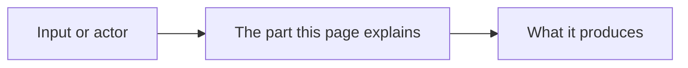

# [Topic]

> **Purpose:** [One sentence: the question this page answers, and why the reader needs the answer.]
> **Audience:** [Who reads it, for example contributors or adopters]
> **Status:** Draft | Live.

---

## 1. The short answer

[Two to four sentences. Put the conclusion first, then the main reason.]

## 2. How it fits together

[One sentence that says what the diagram shows.]

## 3. Why it is this way

- [A reason, with the decision record that holds it: ADR-NNNN.]

## 4. Trade-offs

| Choice | What it gains | What it costs |
|---|---|---|
| [Choice] | [Gain] | [Cost] |

## Next

- [Link to a how-to or a reference page]
