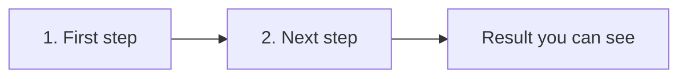

# Tutorial: [Learning Goal]

> **Purpose:** [One sentence: what the reader learns, and why it matters to them.]
> **Goal:** By the end, you will have [one concrete success].
> **Audience:** Newcomers
> **Time:** [N] minutes
> **Status:** Draft | Live.

---

## What you need

- [ ] [Prerequisite]

---

## The steps at a glance

[One sentence that says what the diagram shows.]

---

## 1. [First step]

[Do this. You should see that.]

## 2. [Next step]

[Do this. You should see that.]

---

## What you learned

- [Point]

## Next

- [Link to a how-to or explanation page]
