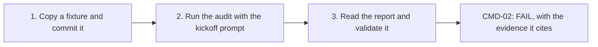

# Tutorial: Your First Audit on a Fixture

> **Goal:** By the end, you will have run the audit recipe on a small sample repository and read its report.
> **Audience:** Newcomers
> **Time:** about 20 minutes
> **Status:** Live.

---

## What you need

- [ ] Claude Code or another coding agent with shell access
- [ ] Python 3.11+ on `PATH`
- [ ] A clone of this repository

## The steps at a glance

The diagram shows the three steps and what each one leaves you with.



---

## 1. Pick a fixture

The engine's own test fixtures are small, one-defect repositories — each fails exactly one check, on
purpose, so you can see the audit catch something real without reading a large codebase first. Copy one
into a scratch directory outside this repository and turn it into its own git repo (the audit needs a
clean git checkout to run):

```bash
cp -r audit/engine/tests/fixtures/cmd-02-weak-check /tmp/my-first-audit
cd /tmp/my-first-audit
git init -q && git add -A && git commit -q -m "fixture snapshot"
```

`cmd-02-weak-check` is a one-file Node project whose `package.json` defines a `check` script that only
runs `npm run lint` — missing `format:check` and `typecheck`, which the framework's command surface
requires `check` to compose. That is the fixture's one deliberate defect, and it is what check `CMD-02`
exists to catch.

## 2. Run the audit

Paste [`audit/prompts/kickoff.md`](../../audit/prompts/kickoff.md) into your agent, naming
`/tmp/my-first-audit` as the target and this repository's checkout as where `audit/` lives.
Since you have no intake file, Stage 0 first asks you to acknowledge the provider-exposure statement; the run
will not start without it. Then it asks its other questions in one numbered block, each with a default.
Answer honestly for a first try: you are the operator, no verb needs to run against the target (`CMD-02` is
caught by reading `package.json`, not by running anything), and `eval_mode` can stay `false` since you are here
to confirm the finding yourself.
Approve Stage 1's plan when it is shown to you.

Real runs of this exact fixture, logged in this project's own roadmap, took 41–131 seconds end to end,
depending on the harness.

## 3. Read the report

Stage 5 writes `<label>.audit-report.<stamp>.json` and its Markdown rendering beside the draft, in the
output directory you named at intake. Open the Markdown report. Its Bottom line lists `CMD-02` among the
first actions, and its full row is under Checks that need attention. Its verdict is `FAIL`, severity
`BLOCKER`, with evidence citing `package.json`'s `scripts.check` field and the verbs it fails to compose.
That citation is the whole point of the exercise — every verdict in the report traces back to a specific file
and a specific piece of evidence, never an unstated hunch.

Validate the report mechanically, too, to see the tool side of the contract:

```bash
python3 audit/tools/validate_report.py <path to the .json report>
```

Exit `0` means the report matches the schema the [`implement` recipe](../../implement/SKILL.md) reads.

---

## What you learned

- How to copy one of the engine's one-defect fixtures into a scratch repository and run the audit recipe
  against it with the kickoff prompt.
- That every verdict in the report is backed by cited evidence — a file, a field, a line — not an
  unstated judgment call.
- How to validate a report mechanically with `validate_report.py`, independent of reading it yourself.

## Next

- [Run an audit](../how-to/run-an-audit.md) on a real repository, with an intake file and the full
  disposition workflow this tutorial skipped past.
