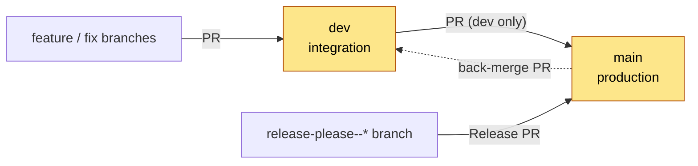
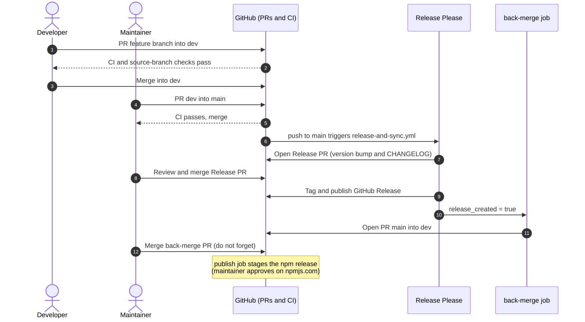
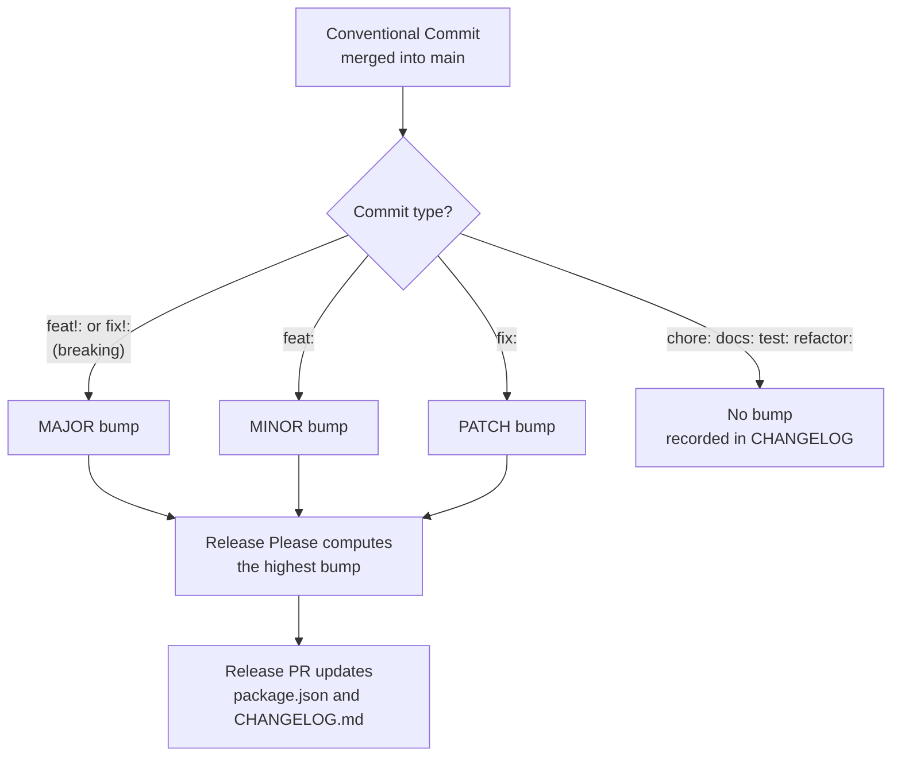
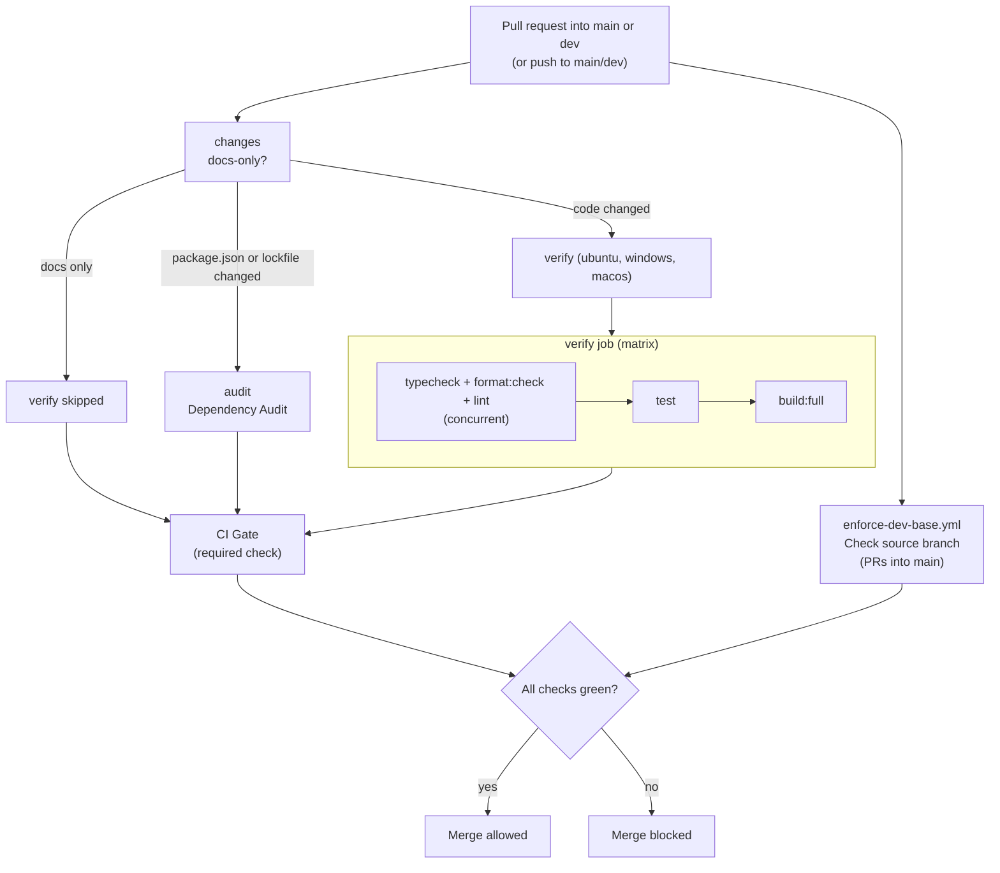
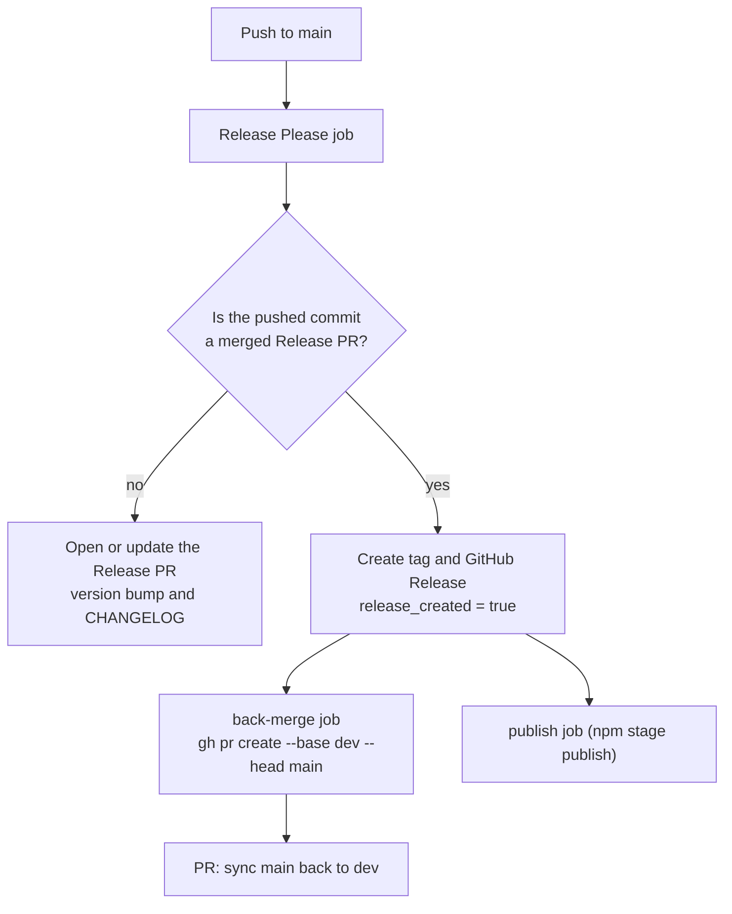
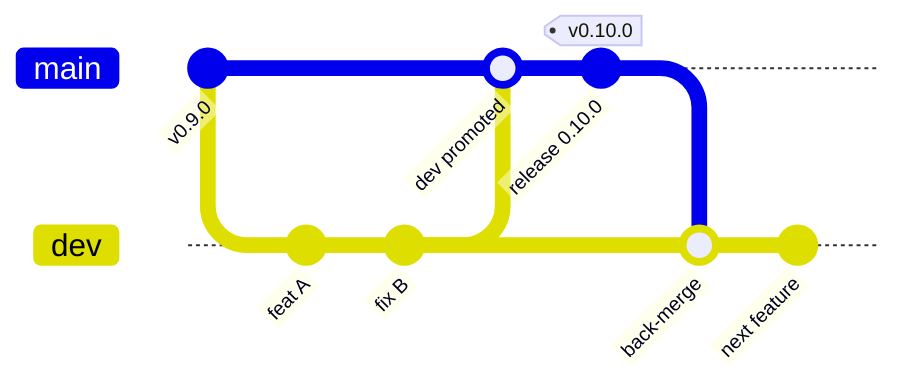
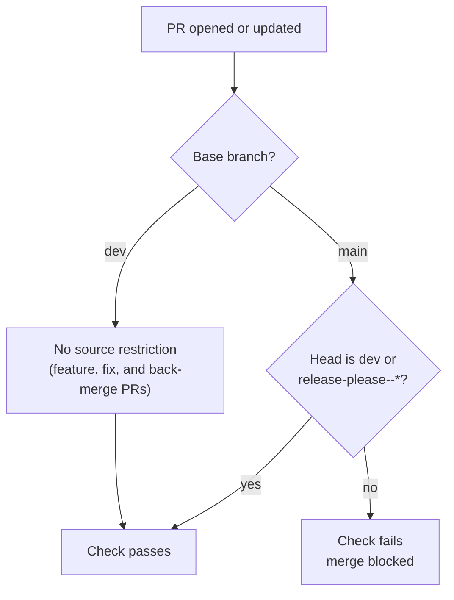
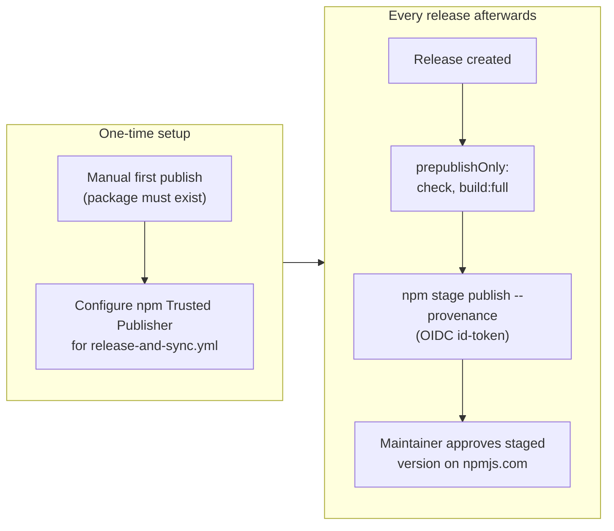

# Release Process

This project uses a GitFlow-inspired branching strategy combined with automated releases.

- `main` is the production branch. It contains only released code.
- `dev` is the active development branch — all feature/fix work is PR'd into it.
- `main` accepts PRs **only from `dev`** (plus automated `release-please--*` release PRs).
- CI (`ci.yml`) guards every PR into `main` and `dev`, and every push to them — typecheck,
  format, lint, tests, and build are all blocking. A single `CI Gate` check summarises the result.
- Release automation (`release-and-sync.yml`) handles version bumps, changelog generation,
  GitHub releases, the back-merge to `dev`, and npm publishing.
- Source branches are enforced by `enforce-dev-base.yml` (`Check source branch`): `main` only
  accepts `dev` (or `release-please--*`).
- `main` and `dev` are protected by **repository rulesets** — every change must arrive via
  a PR (see [Branch Protection](#branch-protection-repository-rulesets)).
- Stale branches are pruned automatically by the local janitor, `npm run git:clean`
  (see [Branch Hygiene & Automated Cleanup](#branch-hygiene--automated-cleanup)).

### Branch Model at a Glance



`dev` and `main` (highlighted) are protected by rulesets; nothing is pushed to them directly.

> **One-time prerequisite:** the automated npm publish uses **npm Trusted Publishing** (GitHub OIDC — no stored token). On <https://npmjs.com> open the package → **Settings → Trusted Publishing**, enable it for source **GitHub** / owner **`<org>`** / repository **`<project>`**, and restrict it to the workflow **`release-and-sync.yml`**.

## The Step-by-Step Release Process

1. **Develop:** All features and fixes are PR'd into `dev`.
2. **Stage for Release:** When ready, a maintainer opens a PR from `dev` to `main` and merges
   it after CI passes. (`main` accepts PRs only from `dev`.)
3. **Release Please:** GitHub Actions automatically opens a "Release PR" against `main` with
   the version bump (in `package.json`) and the updated `CHANGELOG.md`.
4. **Publish:** The maintainer reviews and merges the Release PR. The GitHub Release is
   published automatically, and the `publish` job uploads the release to npm as a **staged**
   version — a maintainer approves it on npmjs.com (passkey/2FA) before it goes live. See
   [npm Publishing](#npm-publishing).
5. **⚠️ THE BACK-MERGE (DO NOT FORGET):** Because Release Please updated the version and
   changelog directly on `main`, `main` is now exactly one commit ahead of `dev`.
   **Merge the automated PR from `main` → `dev` immediately** to prevent conflicts. If this is
   skipped, the next release will result in severe Git merge conflicts on `package.json` and
   `CHANGELOG.md`.

> **Versioning:** Release Please determines the next version from Conventional Commits. To
> override, edit the Release PR title (and `package.json` inside the PR) before merging.

### Release Lifecycle (End to End)



### Commit Messages and Version Bumps



## Gate Status

All gates are blocking in CI:

| Gate | Workflow job | Status |
|---|---|---|
| `npm run typecheck` | CI / `verify` | **Blocking** |
| `npm run format:check` | CI / `verify` | **Blocking** |
| `npm run lint` | CI / `verify` | **Blocking** |
| `npm test` | CI / `verify` | **Blocking** |
| `npm run build:full` | CI / `verify` | **Blocking** |
| `npm run security` | CI / `audit` (and weekly scheduled run) | **Blocking** |

### Why CI keeps runs short without dropping gates

Without the measures below, every change runs the same gates three to four times (feature PR,
`dev` push, promotion PR, `main` push), which adds delay without adding safety. This project
fixes that at the CI level, not by skipping checks:

- **Docs-only changes** (every changed file is `*.md`, `LICENSE`, or `CHANGELOG.md`) skip
  `verify` entirely. Skipping happens at job level, so `CI Gate` still reports a pass.
- **`audit`** runs only when `package.json` or `package-lock.json` change, on pushes to `main`,
  and on a weekly schedule — not on every PR. It reads the lockfile and needs no install when
  skipped.
- **Concurrency cancellation:** a newer push to a PR cancels that PR's in-flight run; pushes to
  `main`/`dev` are never cancelled.
- **`verify` runs on the full OS matrix** (`ubuntu-latest`, `windows-latest`, `macos-latest`),
  all blocking, on every PR — this project runs cross-platform checks up front rather than
  deferring them to a separate non-blocking workflow.



## Repository Setup

One-time settings, applied via `gh api` (or the GitHub UI):

```bash
# Use 'main' as the default branch.
gh api -X PATCH repos/<org>/<project> \
  -f default_branch=main

# Delete PR head branches automatically once merged.
gh api -X PATCH repos/<org>/<project> \
  -f delete_branch_on_merge=true
```

### Release App (CI on bot-opened PRs)

PRs opened with the default `GITHUB_TOKEN` don't trigger workflows, so required checks
never report on them. If your branch protection requires checks on the Release PR or the
back-merge PR, have `release-and-sync.yml` open them with a GitHub App installation token
(`actions/create-github-app-token`) instead. One-time setup:

1. Create a GitHub App in your org (webhook disabled) with repository permissions
   **Contents: Read and write**, **Pull requests: Read and write**, and **Issues: Read and
   write** (Release Please manages the `autorelease` labels).
2. Install it on `<project>` only.
3. Store the App ID as repository variable `RELEASE_APP_ID` and a generated private key as
   repository secret `RELEASE_APP_PRIVATE_KEY`.

The relevant step is scaffolded (commented out) at the top of `release-and-sync.yml` — uncomment
it and swap `secrets.GITHUB_TOKEN` for the generated token once the App is installed.

### Release Automation Workflow

How `release-and-sync.yml` reacts to a push to `main`:



### Why the Back-Merge Matters



Release Please commits the version bump and changelog directly on `main`. Without the
`main → dev` back-merge, the next release hits conflicts on `package.json` and `CHANGELOG.md`.

## Branch Protection (Repository Rulesets)

`main` and `dev` are protected by **repository rulesets** (the modern successor to classic
branch protection). Configure them with no bypass actors: direct pushes, force-pushes, and
branch deletion are blocked for everyone, including maintainers.

| Ruleset | Targets | Rules |
|---|---|---|
| `Protect main branch` | `refs/heads/main` | require PR, block deletion, block force-push, require status checks (`Check source branch`, `CI Gate`) |
| `Protect dev branch` | `refs/heads/dev` | require PR, block deletion, block force-push, require status checks (`CI Gate`) |

`CI Gate` is the single aggregate check emitted by `ci.yml`. It passes only when the `verify`
and `audit` jobs each succeeded or were intentionally skipped (docs-only change, or no
dependency change), so job renames or additions never require a ruleset edit.

Consequences:

- **Every change to `main` or `dev` must arrive via a pull request.**
- **Source-branch restrictions** are enforced by the `Check source branch` status (emitted by
  `.github/workflows/enforce-dev-base.yml`): `main` only accepts `dev` or `release-please--*`.
  Rulesets cannot express source-branch rules themselves.
- Merges must pass CI: the `CI Gate` check, which aggregates `verify` (typecheck, format, lint,
  tests, build across the OS matrix) and the dependency `audit`.

Example creation via `gh api`:

```bash
gh api -X POST repos/<org>/<project>/rulesets \
  --input protect-main.ruleset.json
```

where `protect-main.ruleset.json` includes `target` `branch`, the `refs/heads/main` include
pattern, and the desired `rules` (pull request, deletion, non-fast-forward, required status
checks).

## Branch Hygiene & Automated Cleanup

Feature, release, and back-merge PRs leave head branches behind after merge. This section
keeps local and remote branches at the clean state (`main`, `dev`).

### 1. Delete remote head branches automatically (one-time GitHub setting)

Enable **"Automatically delete head branches"** in `Settings → General → Pull Requests`, or
set it via the API (see [Repository Setup](#repository-setup) above).

### 2. Prune remote-tracking references locally

```bash
git config --global fetch.prune true   # or drop --global for this repo only
```

### 3. Delete stale local branches (`npm run git:clean`)

`scripts/git-branch-janitor.mjs` is a cross-platform Node ESM script — no build step required.
It deletes local branches whose upstream is gone, without touching `main`, `dev`, or the
current branch.

```bash
npm run git:clean:dry   # dry run — list what would be deleted (safe default)
npm run git:clean       # delete stale branches
```

Options: pass `--protected=main,dev,release` to override the protected allowlist.

> **Why `-D` and not `-d`:** squash-merges make `git branch -d` refuse to delete a branch (it
> cannot see the merge), so the janitor force-deletes. It only targets branches whose upstream
> is already gone; a purely local branch with no upstream is never touched.

### Source-Branch Enforcement

`enforce-dev-base.yml` emits the `Check source branch` status, which rulesets cannot express
on their own:



## npm Publishing

**Trusted Publishing** (GitHub OIDC, no stored token): on npmjs.com the package's **Settings
→ Trusted Publisher** allows owner `<org>`, repository `<project>`, workflow
`release-and-sync.yml`. Publishing access is set to require 2FA and disallow tokens.

**Staged publishing (recommended default):** the `publish` job runs `npm stage publish
--provenance --access public` (npm >= 11.21). The trusted publisher allows staged publishes
only; a plain `npm publish` from CI fails with `403 OIDC permission denied for this action`
once staged publishing is required. The upload lands as a staged version — approve it on
npmjs.com (package page → staged versions) with your passkey/2FA, or from a terminal with
`npm stage list <package-name>` and `npm stage approve <stage-id>`. Only then does it become
`latest`.

If you don't want the staged-approval step, swap in the plain `npm publish --provenance
--access public` step that's scaffolded (commented out) in `release-and-sync.yml`, and relax
the trusted-publisher setting accordingly.

**First-time setup:** publish `0.0.0-placeholder` by hand so the trusted publisher can be
configured (npm requires the package to exist first). If the trusted publisher configuration
lapses or the repo/workflow/environment changes, update it on the package's settings page —
all fields must match exactly.



## Future Plans

**Move to trunk-based development.** The flow above is `feature → dev → main`. The next step
is to remove `dev` and move to trunk-based development:

- Short-lived feature branches are PR'd straight into `main`; `main` is always releasable.
- Incomplete work ships behind feature flags or lands in small additive pieces.
- Release Please keeps producing the Release PR from Conventional Commits; the staged npm
  publish remains the final human gate.
- A GitHub merge queue (`merge_group` trigger) tests the real merge result, replacing the
  post-merge push runs.
- The `dev → main` promotion PRs, the `main → dev` back-merge job, and the source-branch check
  are no longer needed.

Why: every change currently passes the same gates twice (feature PR, promotion PR). Trunk-based
development runs the gates once per change and removes the back-merge risk described above.

## Security

See `SECURITY.md` for the project's vulnerability-reporting and secret-handling policy; this
document only covers release mechanics.
