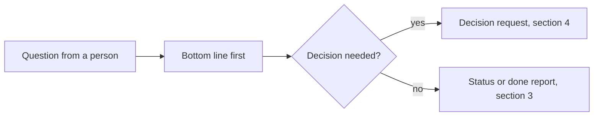

# Communication Rules

This page says how to write for people in this repository. It applies to people and AI agents. It covers chat
replies, plans, reports, commit messages, pull request descriptions and documentation.

[`AGENTS.md`](../AGENTS.md) §5 holds the short version. [`STYLE_GUIDE.md`](STYLE_GUIDE.md) holds the plain-language
rules (§8), the diagram rules (§9) and the rules that apply only to documentation pages. This page links to them
and does not repeat them.

---

## 1. Who you write for

1.1 Write for **a new engineer who knows TypeScript and Node, but not this repository or its terms**.

1.2 Define a term from this repository the first time you use it, or link to
[`architecture/glossary.md`](architecture/glossary.md).

1.3 Do not talk down to the reader. They are a skilled engineer. They only lack the context.

1.4 When you are not sure a sentence is clear, ask: "Can this engineer act on it without asking me?"

---

## 2. Writing rules

2.1 **The core rules** are in [`STYLE_GUIDE.md` §8](STYLE_GUIDE.md#8-plain-language). They cover the bottom line,
sentence length, one instruction per sentence, active voice, one word per meaning and vague words.

2.2 Four more rules apply to every message:\
a. **An example before the rule.** Show one concrete case first, then state the general rule.\
b. **Exact facts.** Give the file path, the command, the number and the unit: "3 of 11 tests", not "some tests".\
c. **Code names in code spans.** Write file names, commands, keys and identifiers as `code`.\
d. **Name every code.** Put the name next to a ticket key or short code each time: "ENG-142 login timeout".

2.3 Write other short forms out in full ("environment", not "env"). Keep a short form that every engineer knows,
such as CI, PR or URL.

2.4 **Diagrams** follow [`STYLE_GUIDE.md` §9](STYLE_GUIDE.md#9-diagrams). This diagram shows which layout a
message takes:

---

## 3. Messages to people

Use the same layout each time. Then the reader knows where to look.

3.1 **Status report.**\
a. **Done:** what is finished.\
b. **Not done:** what is left.\
c. **Blocked:** what stops you, and what you need.\
d. **Next:** what you do next.

3.2 **Done report.**\
a. **What changed:** the files, commits or pages.\
b. **How it was checked:** the command and its result, for example "`npm run check`: passed".\
c. **What was not done:** the skipped steps and known gaps, said plainly.

3.3 **Evidence labels.** Mark each claim that matters:\
a. *Checked* means you ran a command or read the file.\
b. *Inferred* means you concluded it from other facts.\
c. *Assumed* means you did not check it.

3.4 **Length and layers.**\
a. Keep a chat reply short. Put long material in a file, and give its full path in the reply.\
b. Temporary notes and plans go in `artefacts/`. Permanent knowledge goes in `docs/`.\
c. In Markdown, put optional detail in a `
` block.

3.5 **Changes.** Show the old and the new side by side, or as a short diff.

---

## 4. Decision requests

When the reader must decide, give them what they need to decide quickly.

4.1 **Context:** what the problem is, and why a decision is needed now. Use two to four sentences.

4.2 **Options:** a table with two to four rows.

| Option | Pros | Cons | Cost | How hard to undo |
|---|---|---|---|---|
| A. ... | ... | ... | ... | ... |

4.3 **Recommendation:** the option you pick, and why, in one or two sentences.

4.4 **Default:** what you do if no answer comes.

4.5 When you ask several questions, number them and letter the options. Then the reader can answer "1b, 2a".

---

## 5. Where these rules apply

| Text | Rules |
|---|---|
| Chat replies, plans, reports | Sections 1 to 4 |
| Commit messages and pull request descriptions | Sections 1 and 2; Conventional Commits from `CONTRIBUTING.md` |
| Documentation pages | Sections 1 and 2, plus [`STYLE_GUIDE.md`](STYLE_GUIDE.md) |
