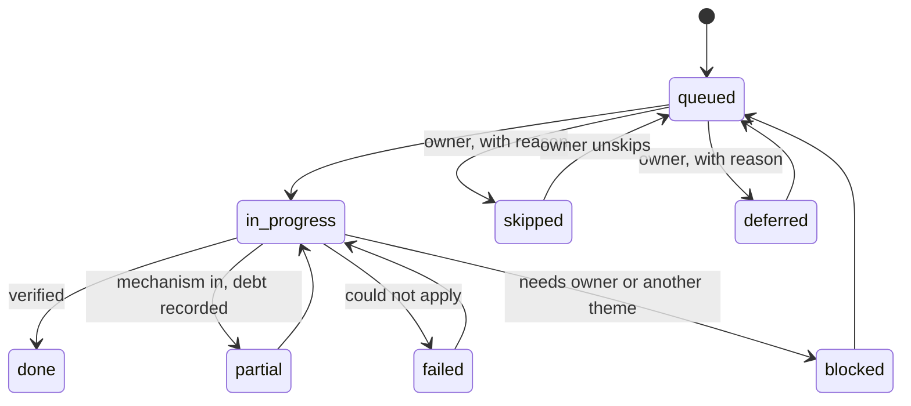

# State contract

The [implement recipe](SKILL.md) keeps one tracked state per target repository. The state is what lets a run
stop after any theme and resume another day, and it is where the owner's skips and preferences live. This
page is an agent directive: MUST and MUST NOT are used in the RFC 2119 sense.

> [!NOTE]
> The rules on this page bind every session. The schema and every `progress.py` command are live. A session
> changes an existing state only with `set-status`, `skip`, `unskip`, `defer`, `undefer`, `pref` and `theme`,
> which check the whole state, append a log entry and refuse a move the diagram below does not allow.

## Files and paths

The state lives in the target repository, in `docs/agentic-readiness/`. The audit report folder is never
edited; the state points at it.

| File | Role |
|---|---|
| `<label>-agentic-readiness-state.json` | The source of truth |
| `<label>-agentic-readiness-STATE.md` | Rendered from the JSON. Its header says it is generated and must not be edited |
| `README.md` | What the folder is, how to resume a run, a link to the audit report folder |

`<label>` is the audit report's `provenance.target.label`.

- The JSON MUST be the only file a session changes by intent; the Markdown view MUST be re-rendered from it,
  never edited by hand.
- The target's root `AGENTS.md` MUST carry one line that points at the STATE.md file and says: read it before
  changing tooling, CI, docs or `AGENTS.md`; skipped findings in it are final.

[`progress.py`](tools/progress.py) is the only writer of the JSON and the renderer of the Markdown view.
Writing inside a target repository is an exception to the tools rule, limited to these two files and decided in
[ADR 0002](docs/architecture/adrs/0002-progress-writes-state-in-target.md).

```bash
python3 implement/tools/progress.py init --report <target>/<report folder>/<final report>.json --target <target>
python3 implement/tools/progress.py show --target <target> [--json]
python3 implement/tools/progress.py render --target <target>
```

The report is committed on the integration branch at
`docs/agentic-readiness-report/<label>-<kind>-audit-<ts>.{json,md}`. `init` records the report file's SHA-256 in
`source_reports[].sha256`; `check_drift.py` recomputes it and reports `report_changed` when the file was edited
since. A state made before schema `0.2` has no digest, and `report_changed` is then `null`, not `false`.

`init` records the framework commit it ran from in `recipe.framework_rev`, read with `git` from the folder that
holds the tools. From an installed skill that folder is not a framework checkout: `init` then records the commit of
any git repository the skills folder sits in, or `null` when there is none. Pass `--framework-rev <commit>` with the
framework release's commit when you know it.

`init` refuses a report that is not final or that `validate_report.py` rejects, a report outside the target, and an
existing state. It queues confirmed and edited findings (an edited finding's note goes into `notes`), imports a
finding the owner deferred during the audit as `deferred` with the owner's note as its reason, and lists rejected
findings as `not_queued`. Each item gets the theme of its check from the table in the tool.

## Item statuses

Every confirmed finding is one item. An item has exactly one status:

| Status | Meaning |
|---|---|
| `queued` | Confirmed in the report and waiting for its theme |
| `in_progress` | A session is applying its playbook |
| `done` | The mechanism is in and the check's verification passes |
| `partial` | The mechanism is in, the repository does not pass it yet, and the debt is recorded |
| `failed` | The playbook could not be applied; the reason is recorded |
| `blocked` | Needs an owner decision or another theme first |
| `deferred` | The owner chose to leave it for later, with a reason |
| `skipped` | The owner chose not to do it, with a reason. Final until the owner unskips it |

A finding the audit marked `rejected` is never an item; the Markdown view lists it as `not_queued`.



Allowed next states, from each status (`progress.py set-status` refuses anything else and its message names them):

| From | May go to | Notes |
|---|---|---|
| `queued` | `in_progress`; `skipped`, `deferred` (owner) | |
| `in_progress` | `done`, `partial`, `failed`, `blocked` | |
| `partial`, `failed` | `in_progress` | never straight to `done`: go back to `in_progress`, then end it again |
| `blocked` | `queued` | never straight to `in_progress`: unblock to `queued` first |
| `deferred`, `skipped` | `queued` (owner) | `undefer`, `unskip` |
| `done` | nothing | final |

`set-status` to the status an item already has is not a transition: with `--note` (and any `--commit`) it appends
the note and logs "note added"; without `--note` it is refused.

- A transition not in the diagram MUST NOT be recorded.
- Every transition MUST record who made it (`owner` or `agent`), the date and, for `skipped`, `deferred`,
  `failed` and `blocked`, a reason.

## Skip, defer and preferences

- **Skip.** Only the owner skips. A session MUST NOT skip a finding on its own judgment, and MUST NOT propose
  a skipped finding again in any stage or session. The close-out re-audit lists skipped findings as
  owner-accepted, not as new gaps.
- **Defer.** Only the owner defers. A deferred item goes back to `queued` when the owner says so; a session
  MAY remind the owner of deferred items at the start of a theme.
- **Preferences.** Every owner choice (a tool, a style, a scope limit such as "no mass reformat") MUST be
  recorded as a preference with a key, a value, a reason, who decided, the date and the step. A session MUST
  read every preference before it plans a theme. A playbook step that conflicts with a preference MUST stop
  and ask; it MUST NOT override the preference. Keys are lower case (`node.version-file`: letters, digits, dot,
  underscore, hyphen). When the owner was asked and has no preference, record the value `none` with the owner's
  words as the reason (`pref set tool.formatter none --reason "..." --by owner`), so the question is not asked
  again.

## Continue on error

A theme's job is to install the mechanism: the formatter, the linter, the test verb, the coverage floor, the
CI step. When the repository does not pass it yet (unformatted code, lint debt, missing tests):

1. Count the debt and record it on the item: what, how many, and the baseline file if one exists.
2. Wire the check so the debt cannot grow: a ratchet, a baseline file, or a step marked report-only.
3. Mark the item `partial` and continue with the next item.

A session MUST NOT mass-fix, suppress rules or lower a gate unless the owner chooses that, and MUST NOT
record `done` for an item that is `partial`.

## JSON shape

The schema is [`schema/readiness-state.schema.json`](../audit/schema/readiness-state.schema.json), `schema_version`
`0.2` (a `0.1` state is still read); field notes are in
[the schema reference](../audit/schema/SCHEMA.md#readiness-state). Two examples are in the framework repository, under
`audit/schema/examples/`:
`readiness-state.example-service.json`, which `init` writes for the framework's example report, and
`readiness-state.example-service.in-progress.json`, a state some themes later. Each has its rendered Markdown
beside it.

The schema subset cannot express these rules, so `progress.py` checks them on every read and write:

- `skipped`, `deferred`, `failed` and `blocked` need a `reason`; `skipped` and `deferred` need `by: owner`.
- An item with `debt` is never `done`.
- A finding appears once, in `items` or in `not_queued`.
- `themes` holds T1 to T8, each once, in order; preference keys and source report paths are unique.

Commit SHAs (`git_sha`, `framework_rev`, `commits`, `merged_sha`) are copied as given, 7 to 40 lower-case hex
digits.
