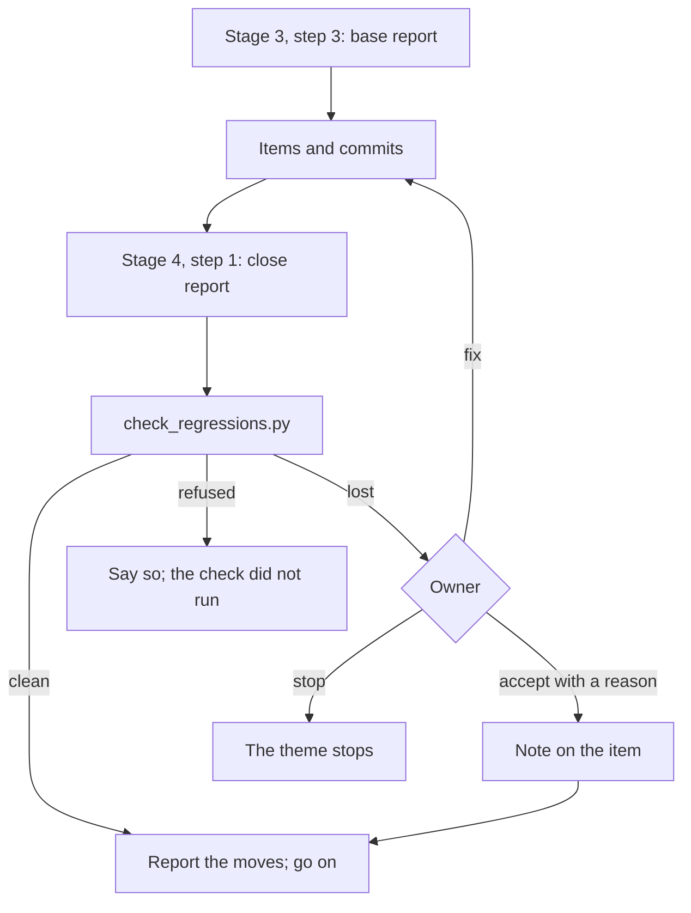

# Theme checks

Two checks of the [implement recipe](SKILL.md) guard a theme against changes it did not mean to make. The first
watches the integration branch move under the theme. The second finds an engine check that passed before the theme
and fails after it. Stages 3 and 4 run both. The page also says when a theme may branch from an unmerged theme.

## Check the integration branch

Run it after each item (Stage 3, step 4.6) and again at theme close (Stage 4, step 1).

Run `git -C <worktree> fetch origin`. Find the branch's base with
`git -C <worktree> merge-base HEAD origin/<integration branch>`. The integration branch moved when
`git -C <worktree> rev-list --count <base>..origin/<integration branch>` is above 0. Then list the files it
changed: `git -C <worktree> diff --name-only <base> origin/<integration branch>`.

- No file in common with this theme's commits or its next items: say so in the next status line and go on.
- A file in common: stop and ask the owner. Offer (a) go on, and resolve it at review; (b) merge the
  integration branch into the theme branch, as a merge commit; (c) stop the theme here. Default: none.
  Never rebase, never force-push.

### Stack on an unmerged theme

Stage 2, step 1 lets the owner branch a theme from a theme branch that is not merged yet. Ask first how the
repository merges pull requests (`gh repo view --json mergeCommitAllowed,squashMergeAllowed,rebaseMergeAllowed`,
or ask the owner).

- **Merge commits.** Stacking works. Each pull request targets the integration branch, and the upper branch keeps
  the lower branch's commits.
- **Squash or rebase merges.** The merge writes new commits, so the upper branch still holds the originals. Every
  file both themes change (`AGENTS.md`, a CI workflow, the command runner) then conflicts after each merge, once
  per layer. Default: do not stack. Wait for the lower theme to merge, then branch from the integration branch.
- **The owner stacks anyway.** After each lower merge, merge the integration branch into the upper branch, as a
  merge commit, and resolve the conflicts there. Never rebase, never force-push
  ([ADR 0003](docs/architecture/adrs/0003-push-and-pr-policy.md)).

## Keep passing checks passing

The audit report is older than the theme. It was taken at another commit, often on another path, and earlier
themes have changed the tree since. So the theme compares its worktree with itself: one engine report before the
first change, one at theme close. A check that was `PASS` at the base and is anything else at close is a **lost
pass**. The theme broke it, even when the theme does not own the check.



### The base report

Take it at the baseline gate (Stage 3, step 3), before the theme's first change:

```bash
python3 audit/tools/engine.py <worktree> --out-dir <workspace>/engine/<theme>
```

- `<theme>` is the theme's id, for example `T3`. The folder sits in the workspace, beside the audit report and the
  state. Never write an engine report inside the target; `engine.py` refuses an `--out-dir` there.
- Give both runs the same flags. Add `--no-user-config` to both when the playbook asks for it. Never pass
  `--run-gates` to one run only.
- Keep the path that `data.report` names. It is the base report.

### Resume without a base report

A theme may have no base report. It started before the recipe took one, or the report was lost. Take the base
report again, at the theme's base commit, in a temporary checkout. Do it on the resume, before the close report:

1. Find the base commit. Run `git -C <worktree> fetch origin`, then
   `git -C <worktree> merge-base HEAD origin/<integration branch>`. Call the result `<base>`.
2. Make a new empty folder outside the repository and outside the workspace, for example with `mktemp -d`. Call it
   `<dir>`. Add a detached worktree there: `git -C <repo> worktree add --detach <dir> <base>`. This is the same
   kind of worktree as the [baseline on a resume](SKILL.md#resuming).
3. Run the engine on it, with the flags the close run uses:
   `python3 audit/tools/engine.py <dir> --out-dir <workspace>/engine/<theme> --repo-label <name of the worktree
   folder>`. The label gives the report the theme worktree's file name. Keep the `data.report` path: it is the base
   report.
4. Remove the temporary worktree: `git -C <repo> worktree remove <dir>`. Keep `<dir>` as text for the comparison.

At theme close, add `--base-target <dir>` to the comparison. The base report's target is then `<dir>`, not the
theme worktree; without the option the tool refuses the pair. The changed paths are listed from the base report's
own commit, `<base>`.

Use a git worktree, not an export such as `git archive <base> | tar -x`. An export has no git metadata. The
report then records no commit, and the checks that read git can give other verdicts than on the theme worktree.
A real export of this repository moved six verdicts, so it would report lost passes the theme did not cause.

### The close report and the comparison

At theme close (Stage 4, step 1), run the same command again, with the same flags. Keep the new `data.report`
path: it is the close report. Then compare the two:

```bash
python3 implement/tools/check_regressions.py <base report> <close report> --changed-from <worktree> \
  --workspace <workspace> --theme <theme>
```

The tool lists the paths the theme changed since the base report's commit. It lays each moved check on them.
`--workspace` writes the verdict beside the state. While it reads `lost`, `progress.py` refuses to mark an item of
the theme `done` and the theme `merged`.
Read `data.status`:

- `clean`: no lost pass and no regression. Report the other moves (see below) and go on.
- `lost`: at least one row in `data.stops`. Stop the theme; see the next section.

### When a pass is lost

Stop the theme and send the owner a
[decision request](../audit/prompts/talking-to-the-user.md#decision-requests). Name each check in `data.stops`
with its name, its verdict at the base and at close, and the changed paths its `reads_hit` lists. A check that went
from `PARTIAL` to `FAIL` (class `regressed`) is a stop too. Offer:

- (a) **Fix it** in the theme, in a new commit by the commit rules of Stage 3. Then take the close report again and
  run the comparison again.
- (b) **Accept it**, with the owner's reason:
  `progress.py accept-lost <theme> --reason "<reason>" --by owner --workspace <workspace> --phase <step>`. This
  lifts the refusal for that verdict only; a new `lost` verdict needs a new answer. Name it under "What was not
  done" in the done report or the pull request.
- (c) **Stop the theme** here.

Default: none. Wait for the owner. The decision and its reasons are in
[ADR 0005](docs/architecture/adrs/0005-a-lost-pass-stops-the-theme.md).

### Moves that do not stop

The classes `improved`, `changed`, `added`, `removed` and `evidence` never stop the theme. Name them in the
status report, and in the done report under its heading for checks. A row with `unattributed: true` moved, but no
changed path meets a place its check reads. Say so. It may be a gap in the engine's read declarations. Such a gap
belongs to the framework, not to the target: change nothing in the target for it.

### When the comparison cannot run

- **Exit 2, refused.** The two reports differ in ruleset, target path, user-config setting or probe settings. The
  close report may also be no newer than the base. A move then cannot be laid on the theme. Say so and name the
  reasons in `data.errors`. Tell the owner the lost-pass check did not run. A base report taken on a temporary
  checkout differs in target by design: pass `--base-target`. A refused pair writes no verdict, and the theme's
  earlier verdict stays.
- **No base report.** Take it again on a temporary checkout of the base commit; see
  [Resume without a base report](#resume-without-a-base-report). When that cannot run, say so plainly: the
  lost-pass check did not run. Never take the base on the theme branch's tip; it holds the theme's changes.
- **Exit 1.** Fix the argument: a missing file, or a worktree that is not the reports' target.

In every case the theme's own checks are still compared with the audit report (Stage 4, step 1).
