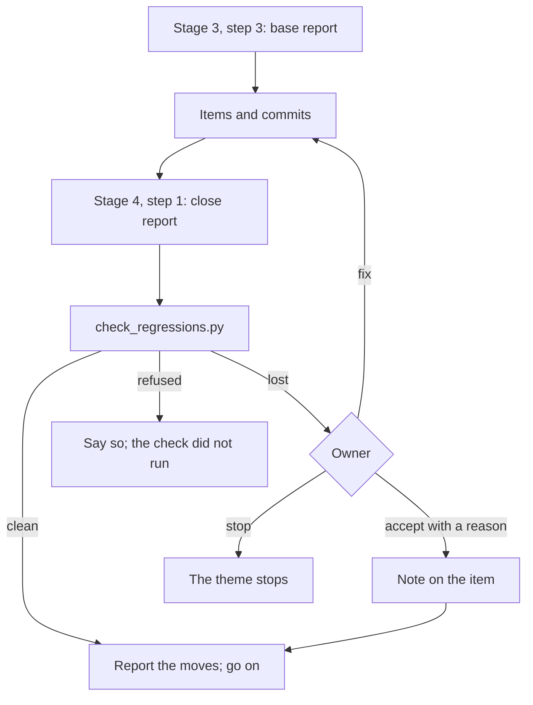

# Theme checks

Two checks of the [implement recipe](SKILL.md) guard a theme against changes it did not mean to make. The first
watches the integration branch move under the theme. The second finds an engine check that passed before the theme
and fails after it. Stages 3 and 4 run both.

## Check the integration branch

Run it after each item (Stage 3, step 4.6) and again at theme close (Stage 4, step 1).

Run `git -C <worktree> fetch origin`. Find the branch's base with
`git -C <worktree> merge-base HEAD origin/<integration branch>`. The integration branch moved when
`git -C <worktree> rev-list --count <base>..origin/<integration branch>` is above 0. Then list the files it
changed: `git -C <worktree> diff --name-only <base> origin/<integration branch>`.

- No file in common with this theme's commits or its next items: say so in the next status line and go on.
- A file in common: stop and ask the owner. Offer (a) go on, and resolve it at review; (b) merge the
  integration branch into the theme branch, as a merge commit; (c) stop the theme here. Default: none.
  Never rebase, never force-push.

## Keep passing checks passing

The audit report is older than the theme. It was taken at another commit, often on another path, and earlier
themes have changed the tree since. So the theme compares its worktree with itself: one engine report before the
first change, one at theme close. A check that was `PASS` at the base and is anything else at close is a **lost
pass**. The theme broke it, even when the theme does not own the check.



### The base report

Take it at the baseline gate (Stage 3, step 3), before the theme's first change:

```bash
python3 audit/tools/engine.py <worktree> --out-dir <workspace>/engine/<theme>
```

- `<theme>` is the theme's id, for example `T3`. The folder sits in the workspace, beside the audit report and the
  state. Never write an engine report inside the target; `engine.py` refuses an `--out-dir` there.
- Give both runs the same flags. Add `--no-user-config` to both when the playbook asks for it. Never pass
  `--run-gates` to one run only.
- Keep the path that `data.report` names. It is the base report.

### The close report and the comparison

At theme close (Stage 4, step 1), run the same command again, with the same flags. Keep the new `data.report`
path: it is the close report. Then compare the two:

```bash
python3 implement/tools/check_regressions.py <base report> <close report> --changed-from <worktree>
```

The tool lists the paths the theme changed since the base report's commit. It lays each moved check on them.
Read `data.status`:

- `clean`: no lost pass and no regression. Report the other moves (see below) and go on.
- `lost`: at least one row in `data.stops`. Stop the theme; see the next section.

### When a pass is lost

Stop the theme and send the owner a
[decision request](../audit/prompts/talking-to-the-user.md#decision-requests). Name each check in `data.stops`
with its name, its verdict at the base and at close, and the changed paths its `reads_hit` lists. A check that went
from `PARTIAL` to `FAIL` (class `regressed`) is a stop too. Offer:

- (a) **Fix it** in the theme, in a new commit by the commit rules of Stage 3. Then take the close report again and
  run the comparison again.
- (b) **Accept it**, with the owner's reason. Record it on the item whose commits changed the paths that
  `reads_hit` names, or else on the theme's last ended item:
  `progress.py set-status F-nnn <its status> --note "Lost pass <check>, accepted: <reason>" --by owner`. Name it
  under "What was not done" in the done report or the pull request.
- (c) **Stop the theme** here.

Default: none. Wait for the owner.

### Moves that do not stop

The classes `improved`, `changed`, `added`, `removed` and `evidence` never stop the theme. Name them in the
status report, and in the done report under its heading for checks. A row with `unattributed: true` moved, but no
changed path meets a place its check reads. Say so. It may be a gap in the engine's read declarations. Such a gap
belongs to the framework, not to the target: change nothing in the target for it.

### When the comparison cannot run

- **Exit 2, refused.** The two reports differ in ruleset, target path, user-config setting or probe settings. The
  close report may also be no newer than the base. A move then cannot be laid on the theme. Say so and name the
  reasons in `data.errors`. Tell the owner the lost-pass check did not run.
- **No base report.** The theme started before its base report was taken, or the report is lost. Say so plainly:
  the lost-pass check did not run. Never take the base on the theme branch's tip; it holds the theme's changes.
- **Exit 1.** Fix the argument: a missing file, or a worktree that is not the reports' target.

In every case the theme's own checks are still compared with the audit report (Stage 4, step 1).
